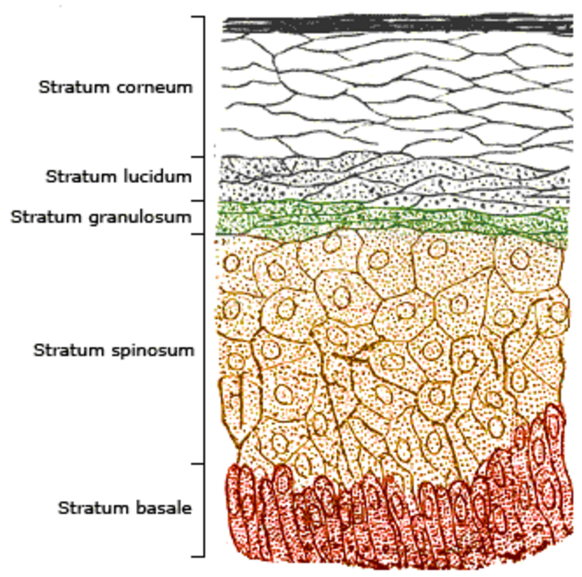
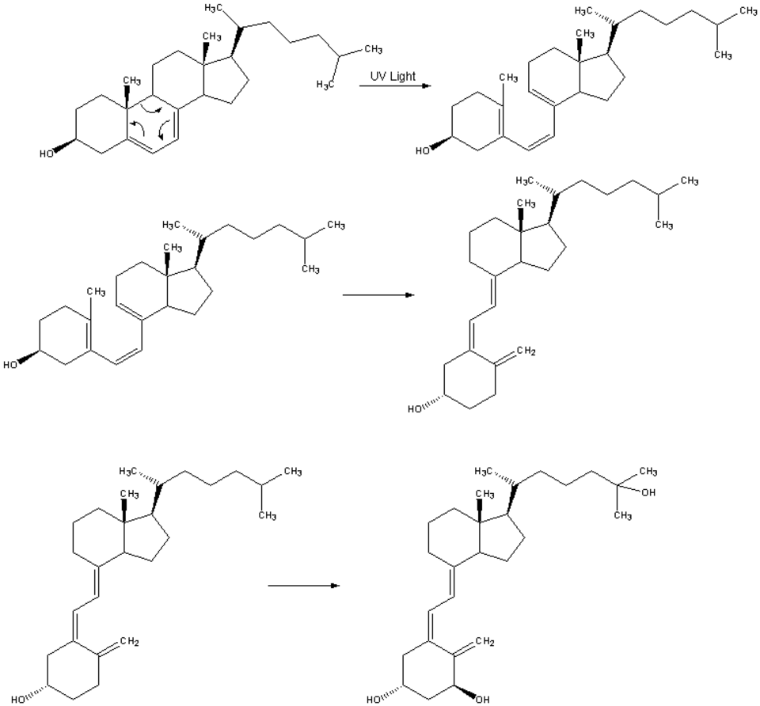
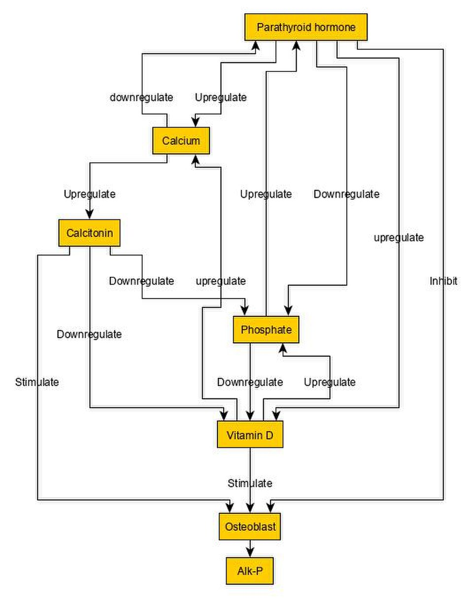
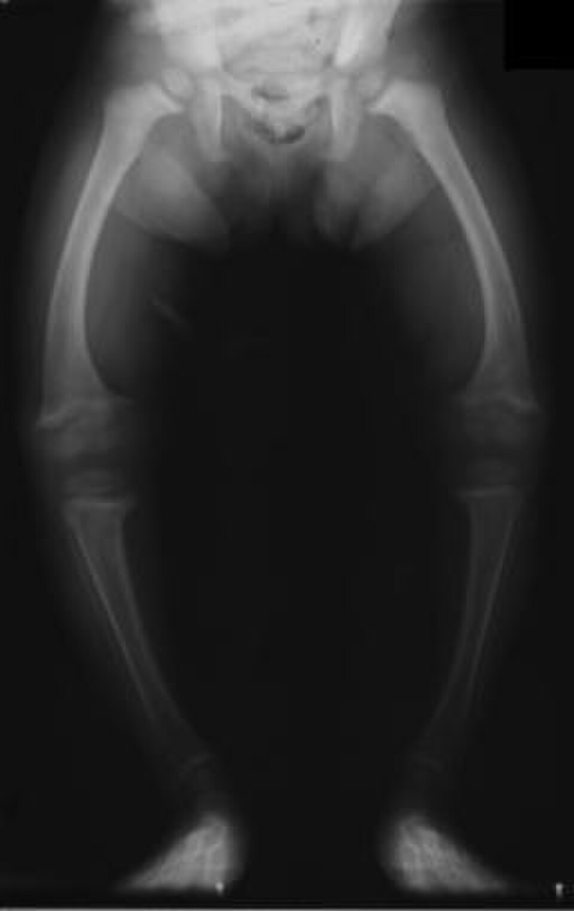

> [!style] هذا مثال لكيف سيُكتب وصف نمط الدكتور بعد سماع المحاضرة:
> - **يركّز على المسارات** (من وين لوين بيتحوّل الفيتامين) أكثر من الصيغ الكيميائية.
> - **أسئلته غالباً مقارنات**: "قارن بين D2 و D3"، "ما الفرق بين الكساح وتليّن العظام".
> - يكرر الجملة المهمة مرتين ويقول "انتبهوا"، وهذه علامة أنها **ستأتي بالامتحان**.
> - يحب الأسئلة التطبيقية على **حالات سريرية** قصيرة (مريض كلوي، طفل لا يتعرض للشمس...).
> - يعطي أرقاماً قليلة لكنه **يحاسب عليها** (الاحتياج اليومي، المستوى الطبيعي بالدم).

# مقدمة: ما هو فيتامين D؟

فيتامين D من **الفيتامينات الذوّابة في الدهون** (A, D, E, K)، لكنه حالة خاصة لأن الجسم يستطيع تصنيعه بنفسه في الجلد عند التعرض لأشعة الشمس، لذلك يعتبره كثير من العلماء ==هرموناً ستيرويدياً== أكثر منه فيتاميناً بالمعنى التقليدي.

يوجد بشكلين رئيسيين:
- **فيتامين D2 (Ergocalciferol):** مصدره نباتي وفطري (الفطر المعرّض للأشعة فوق البنفسجية).
- **فيتامين D3 (Cholecalciferol):** يُصنَّع في جلد الإنسان، ويوجد في المصادر الحيوانية. صيغته الجزيئية C~27~H~44~O.

> [!doctor] فيتامين D يُعامَل كهرمون وليس فيتاميناً فقط لأنه يُصنَّع داخل الجسم ويعمل على مستقبلات في خلايا بعيدة.
> قالها الدكتور مرتين وقال: "هاي الفكرة بدي ياها بالحرف".

> [!exam] لماذا يُصنَّف فيتامين D كهرمون ستيرويدي؟
> الفكرة: لأن الجسم يصنّعه من الكوليسترول (7-dehydrocholesterol) في الجلد، ثم يُنقل بالدم إلى أعضاء أخرى، ويعمل عبر مستقبلات نووية (VDR)، وهذه كلها صفات الهرمون.

# المصادر والتصنيع في الجلد

## التصنيع الجلدي
عند تعرّض الجلد للأشعة فوق البنفسجية من النوع **UVB** يتحول مركب **7-dehydrocholesterol** الموجود في طبقات البشرة إلى **previtamin D3** ثم إلى **vitamin D3**.

> [!note] الدكتور مرّ على هذه النقطة بسرعة: كمية التصنيع تقل مع **البشرة الداكنة** (الميلانين يمتص UVB)، ومع **التقدم بالعمر**، واستخدام **واقي الشمس**، والعيش في مناطق بعيدة عن خط الاستواء خاصة في الشتاء.

## المصادر الغذائية
| المصدر | النوع | ملاحظة |
| زيت كبد الحوت | D3 | أغنى مصدر طبيعي |
| الأسماك الدهنية (سلمون، سردين) | D3 | مصدر ممتاز |
| صفار البيض | D3 | كمية متوسطة |
| الفطر المعرّض للأشعة | D2 | المصدر النباتي الأهم |
| الحليب والحبوب المدعّمة | D2 أو D3 | حسب الدولة |

> [!remember] الحليب الطبيعي **فقير** بفيتامين D، والحليب "الغني" بالفيتامين هو الحليب **المُدعَّم**.

# الاستقلاب: من الجلد إلى الشكل الفعّال

فيتامين D (سواء من الجلد أو الغذاء) **غير فعّال** ويحتاج إلى خطوتي هدرلة (إضافة مجموعة OH):

1. **في الكبد:** يتحول إلى **25-hydroxyvitamin D** (Calcidiol) بواسطة إنزيم 25-hydroxylase.
2. **في الكلية:** يتحول إلى **1,25-dihydroxyvitamin D** (Calcitriol) بواسطة إنزيم 1α-hydroxylase، وهذا هو ==الشكل الفعّال==.

> [!doctor] الشكل الذي نقيسه بالدم لتقييم مخزون الجسم هو **25(OH)D** وليس الشكل الفعّال.
> - السبب: عمره النصفي طويل (حوالي 2–3 أسابيع) ومستواه ثابت.
> - الدكتور قال: "كل سنة في حدا بيغلط فيها".

> [!mistake] كثير من الطلاب يكتبون أن الشكل الفعّال يُقاس لتقييم العوز. الصحيح: نقيس **25(OH)D (Calcidiol)**.

> [!exam] مريض فشل كلوي مزمن عنده نقص كالسيوم رغم أنه يتعرض للشمس جيداً. فسّر.
> الفكرة: الكلية المريضة لا تصنع إنزيم 1α-hydroxylase بشكل كافٍ، فلا يتحول Calcidiol إلى Calcitriol الفعّال، فيقل امتصاص الكالسيوم من الأمعاء.
> الجواب: يُعطى المريض **Calcitriol** جاهزاً (الشكل الفعّال) وليس فيتامين D العادي.

> [!define] الكالسيتريول (Calcitriol)
> هو الشكل الفعّال هرمونياً من فيتامين D، صيغته 1,25-(OH)~2~D~3~، ويتشكل في الكلية بإضافة زمرة OH على الكربون رقم 1.

> [!why] يُقاس 25(OH)D وليس الكالسيتريول لتقييم مخزون فيتامين D في الجسم.
> لأن: عمره النصفي طويل (2–3 أسابيع) ومستواه ثابت ويعكس الوارد من الشمس والغذاء، بينما الكالسيتريول عمره ساعات ويُنظَّم بدقة حسب حاجة الجسم للكالسيوم.

> [!tip] رتّب الحروف: **ج – ك – ك** = **ج**لد ← **ك**بد ← **ك**لية. كل محطة تضيف شيئاً حتى يصبح فعالاً.

# الوظائف وتنظيم الكالسيوم

الوظيفة الأساسية لفيتامين D هي **الحفاظ على مستوى الكالسيوم (Ca^2+^) والفوسفات (PO~4~^3-^) في الدم** عبر:
- زيادة **امتصاص الكالسيوم والفوسفات** من الأمعاء الدقيقة (الوظيفة الأهم).
- زيادة **إعادة امتصاص الكالسيوم** في الكلية.
- المساعدة مع هرمون الدريقات (PTH) في **تحرير الكالسيوم من العظم** عند الحاجة.

> [!note] الصورة توضح شيئاً لم يفصّله الدكتور: انخفاض الكالسيوم ← يرتفع **PTH** ← يحفّز الكلية على تصنيع **Calcitriol** ← يزيد امتصاص الكالسيوم. وهذه حلقة تغذية راجعة سلبية.

> [!doctor] الوظيفة رقم 1 التي يجب أن تكتبها أولاً في أي سؤال هي **زيادة امتصاص الكالسيوم من الأمعاء**.

# أمراض العوز والتسمم

## الكساح (Rickets) عند الأطفال
يحدث قبل انغلاق صفائح النمو، فتصبح العظام **طرية** وتنحني تحت وزن الجسم، وأشهر علامة هي **تقوّس الساقين**.

## تليّن العظام (Osteomalacia) عند البالغين
نفس الآلية لكن بعد اكتمال النمو، فلا يحدث تشوّه واضح بل **ألم عظمي وضعف عضلي** وزيادة خطر الكسور.

> [!exam] قارن بين الكساح وتليّن العظام.
> الجواب:
> - **العمر:** الكساح عند الأطفال، وتليّن العظام عند البالغين.
> - **العلامات:** الكساح يسبب تشوّهات (تقوّس الساقين)، وتليّن العظام يسبب ألماً وضعفاً بدون تشوّه واضح.
> - **السبب المشترك:** نقص تمعدن العظم بسبب نقص فيتامين D أو الكالسيوم.

## التسمم بفيتامين D
لأنه ذوّاب في الدهون **يُخزَّن** في الجسم، والجرعات العالية جداً من **المكمّلات** (وليس من الشمس أبداً) تسبب **فرط كالسيوم الدم**: غثيان، عطش، حصيات كلوية، وتكلّس الأنسجة الرخوة.

> [!doctor] لا يمكن أن يحدث تسمم بفيتامين D من التعرض للشمس، لأن الجلد ينظّم الإنتاج ذاتياً ويحوّل الزائد لمركبات غير فعالة.
> الدكتور قال: "هاد سؤال صح وغلط مضمون".

## الوحدات والجرعات
تُكتب جرعات فيتامين D بوحدتين: **الميكروغرام (µg)** و**الوحدة الدولية (IU)**، والعلاقة بينهما: ==1 µg = 40 IU==.

> [!problem] طفل يحتاج 400 IU من فيتامين D يومياً. كم ميكروغراماً يحتاج؟
> المعطيات: الاحتياج = 400 IU، و 1 µg = 40 IU
> القانون: الكمية بالميكروغرام = الكمية بالوحدة الدولية ÷ 40
> الحل: 400 ÷ 40 = 10
> النتيجة: يحتاج **10 µg** يومياً.

> [!check] [00:41:10] لم يُسمع بوضوح هل قال الدكتور إن الحد الأعلى الآمن 4000 IU أم 400 IU. الأرجح 4000 IU (100 µg) حسب المراجع، لكن تأكد من زملائك أو من السلايدات.

> [!summary] **الخلاصة:** فيتامين D يُصنع بالجلد بالشمس أو يؤخذ بالغذاء، ثم يُفعَّل بالكبد ثم الكلية. وظيفته الأساسية امتصاص الكالسيوم. نقصه يسبب الكساح عند الأطفال وتليّن العظام عند البالغين، وزيادته من المكمّلات تسبب فرط الكالسيوم.
