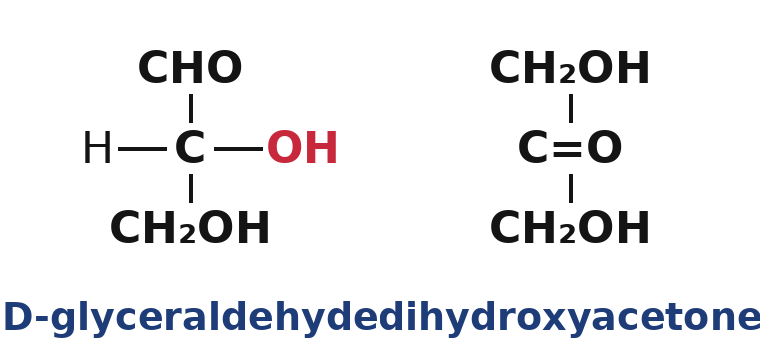
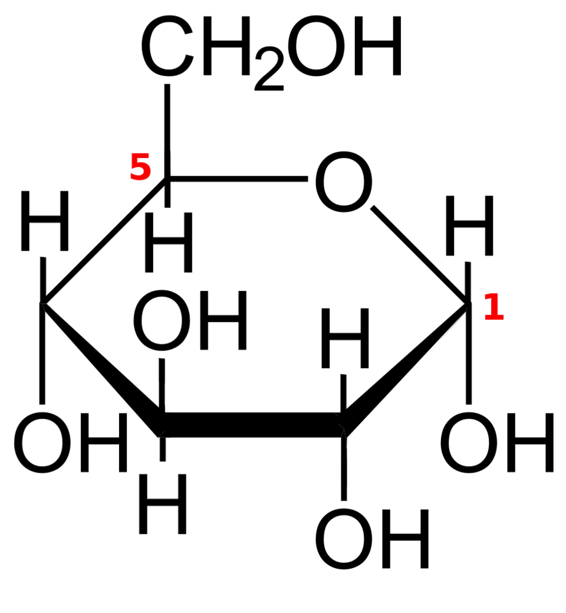
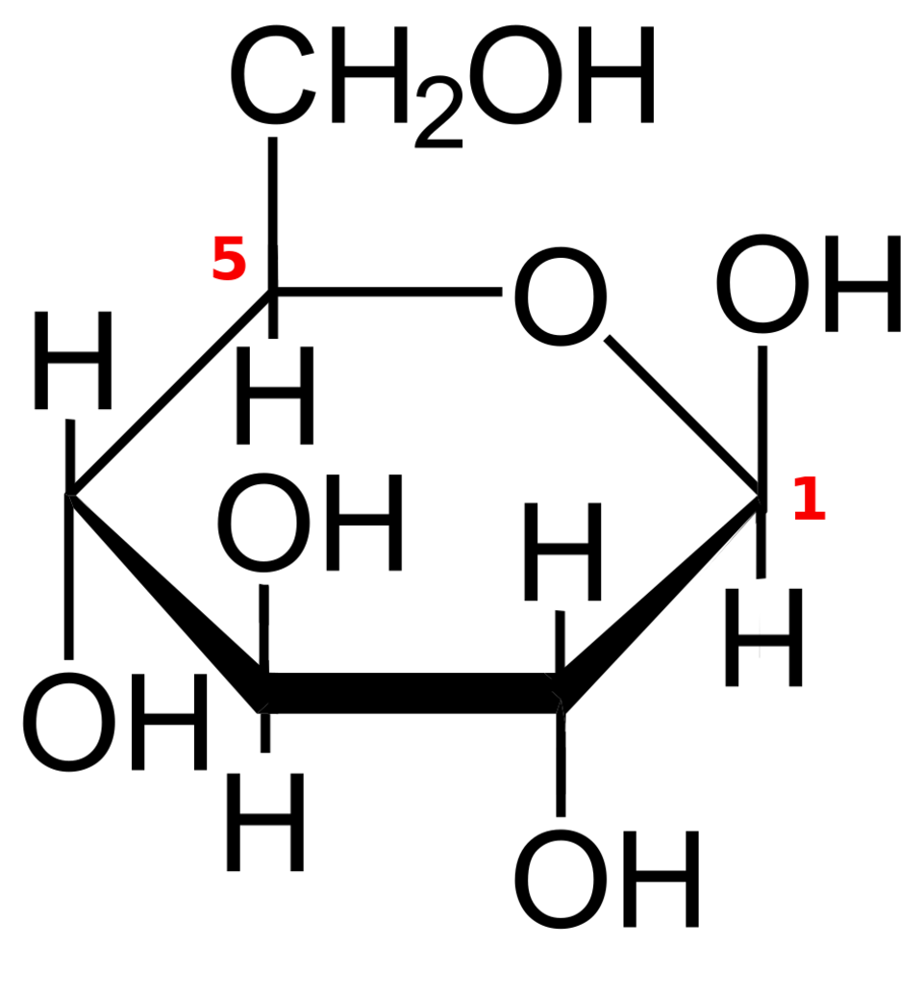
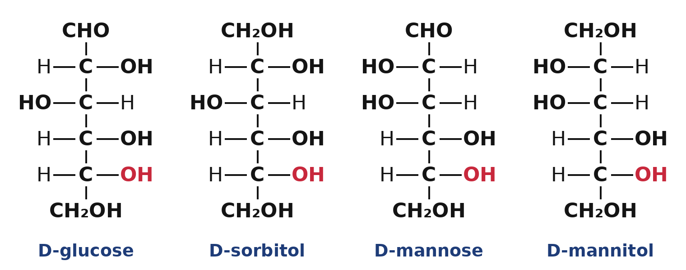
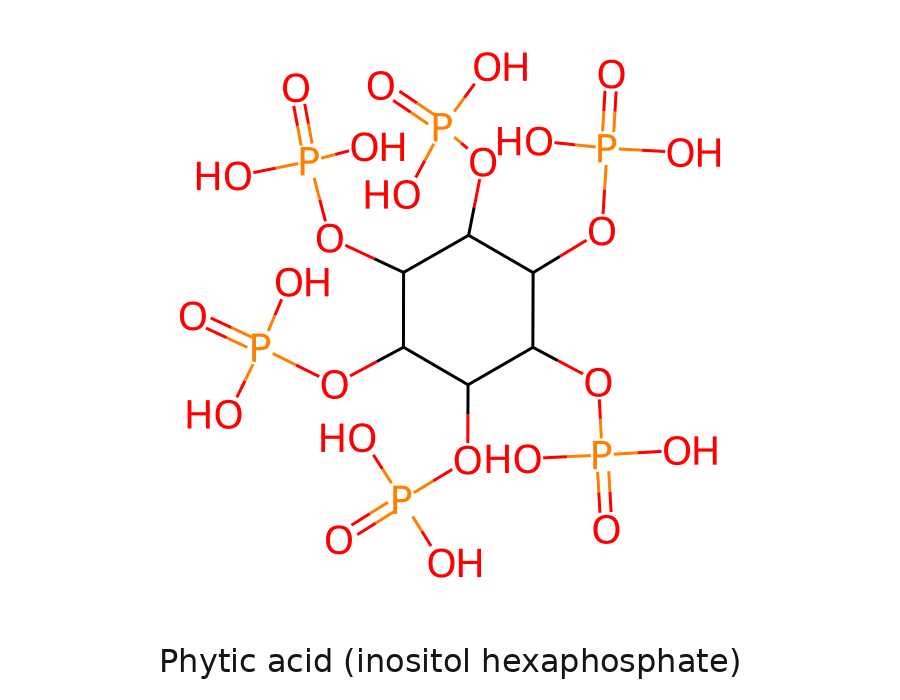
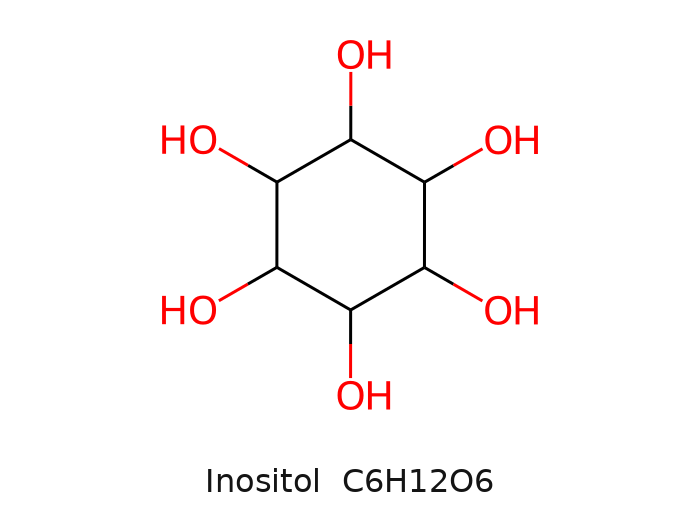
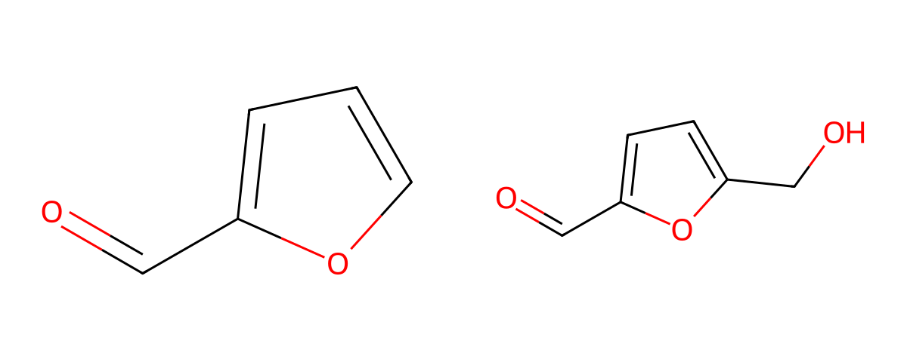

# الكربوهيدرات

* أبسط سكر ألدهيدي: **غليسر ألدهيد**.
* أبسط سكر كيتوني: **داي هيدروكسي أسيتون**.

> [!define] المخلوط الراسيمي
> محلول يحوي مماكبين أحدهما L والآخر D بنسب متساوية 50%:50%، يدعيان زوج إنانتيومير، ليس له فعالية ضوئية.

تسمى هذه بخاصية الإنانتيومير (وتعطي انعكاس الصورة).

> [!define] الزوج الإبيميري
> اختلاف توزع الهيدروكسيل OH – H حول ذرة كربون واحدة فقط. (غلوكوز – مانوز حول C2)، (غلوكوز – غالاكتوز C4).

> [!define] دياستيريومير
> اختلاف يكون حول أكثر من ذرة كربون.

# الشكل الحلقي للسكريات

الدلائل:
1. الألدهيدات تتفاعل مع بيسلفيت الهيدروجين بسهولة أو الغلوكوز تتفاعل بصعوبة بسبب غياب المجموعة الوظيفية أثناء تشكل الحلقة.
2. تتأكسد الألدهيدات بسهولة.
3. الألدهيدات تعطي نتيجة إيجابية مع اختبار شيف.
4. يوجد صورتين للغلوكوز: (نستدل عليه من) **ظاهرة التدوير المتبدل**:

إذا استحصلنا على الغلوكوز من:
- الماء ← α-D-غلوكوز: تكون زاوية دورانه 113° ← بعد فترة 52.7°
- الكحول ← β-D-غلوكوز: تكون زاوية دورانه +19° ← بعد فترة 52.7°

وتكون النسب عند الاستقرار (⅓ α و ⅔ β).

**صيغة هاورث**: (حلقة) (عامودية على السطح، الجزء الغامق الأقرب للناظر).

# السكر المحول

- السكر المحول هو (−).

السكروز يتألف من غلوكوز +52.7 وفركتوز −92 ← (−) (المحصلة سالبة) اتجاه الانحراف عكس عقارب الساعة.

يكون السكر المحول أكثر حلاوة وأصعب تبلوراً لذلك فهو الأفضل في تصنيع الحلويات والشرابات.

- غالباً الكيتونات أحلى من الألدهيدات، ولكن الكحولات السكرية الأحلى.

**الخواص العامة للأحاديات السكرية**: عديمة اللون – صلبة – متبلورة – تذوب في الماء – ذات طعم حلو – لا تذوب في المحلات اللاقطبية.

# الكحولات السكرية

- **السوربيتول** ← نحصل عليه من إرجاع (الكيتون والألدهيد) إلى CH~2~OH: إرجاع الغلوكوز والفركتوز (المجموعة الوظيفية) ← كحول سكري.
- **المانيتول** ← ناتج إرجاع مانوز، وناتج إرجاع الفركتوز. في الإرجاع نقوم بإضافة 2H^+^.

# حمض الفيتيك

> [!define] حمض الفيتيك
> أسترة جميع الزمر الكحولية من الإينوزيتول مع حمض الفوسفور.

له ألفة قوية للارتباط بالمعادن كـ Ca والفوسفور. لذلك ضار للغاية لبعض الأطفال لأنه يرتبط بـ Ca ويسبب كساح، ومن الوقت ذاته ...

> [!check] بقية هذا السطر في الدفتر غير مقروءة بخط اليد. وفي هامش الصفحة ملاحظة مائلة غير مقروءة أيضاً.

# السيللوز

يتواجد شكله النقي في القطن ويدخل في تركيب جدران الخلايا النباتية. يتألف من β-D-غلوكوز، والرابطة β(1←4).

# السكريات الألدوزية والكيتونية

- **السكريات الألدوزية**: غليسر ألدهيد، D-ريبوز، D-غالاكتوز، D-غلوكوز، D-مانوز.
- **السكريات الكيتونية**: ثنائي هيدروكسي أسيتون، D-ريبولوز، D-فركتوز.

* تتعدد المماكبات الفراغية للأحاديات السكرية من النمط L و D عن طريق الاختلاف في توزع OH و H على ذرة الكربون ما قبل الأخيرة.

# ذرة الكربون غير المتناظرة

ارتباط ذرة الكربون مع 4 مستبدلات مختلفة عن بعضها البعض أحد مماكباتها التي تلي، تدعى عندئذٍ ذرة كربون غير متناظرة، تتمتع بفعالية ضوئية.

$$ Z–C*(G)–Y

> [!check] السطر الأحمر فوق هذا التعريف مقصوص في المسح، والكلمة قبل "بفعالية ضوئية" غير واضحة تماماً.

# من الفيشر لهاورث (الهيمي أسيتال)

- كل الزمر الهيدروكسيلية على اليمين ← في الأسفل.
- كل الزمر الهيدروكسيلية على اليسار ← في الأعلى.
- عندما تكون OH في الأسفل تكون ألفا α، وفي الأعلى تكون β.

# الأميلوز والأميلوبكتين

| الأميلوز | الأميلوبكتين |
| ينحل بالماء | لا ينحل بالماء، إنما يشكل مع الماء الساخن محلولاً عجينياً |
| تفاعله مع اليود يعطي لوناً أزرقاً | تفاعله مع اليود يعطي لوناً بنفسجياً |
| سلسلة خطية غير متفرعة بارتباط α(1-4) | سلسلة خطية متفرعة بارتباط α(1-4) و α(1-6) |
| حوالي 300 وحدة | حوالي 1000 وحدة |
| ملتف بشكل حلزوني، عند دخول اليود العقد الحلزوني تتشكل روابط ومعقدات ذات لون أزرق داكن | ملتف بشكل حلزوني كروي، تمتص ذرات اليود على سطح البنية |

- 250 – 500 جزيء.
- كل 25 – 30 جزيء يحدث تفرع (النشاء).
- 8 – 12 جزيء (الغليكوجين).

# اشتقاق السكريات

# الكحولات الحلقية

تنتشر في الخلايا النباتية والحيوانية بصورة حرة أو مرتبطة، فتدخل في أنسجة الكبد والطحال والدم، وأهم أشكالها **ميوإينوزيتول**. (سداسي إينوزيتول مع حمض الفوسفور) رابطة استرية ← فيشكل حمض الفيتيك: قد يكون مفيد وقد يكون ضار، وهو من معيقات امتصاص المعادن مع الفوسفور والكالسيوم، عند اتحاده مع الكالسيوم يسبب ... ميوإينوزيتول.

> [!check] كلمة "الطحال" وآخر سطر في هذه الفقرة غير واضحين بخط الدفتر.

**المماثل**: مماثل للغلوكوز في الصيغة مع اختلاف توزع الذرات.

# الكواشف

الكاشف العام للسكريات هو **مولش**، حيث يقوم بنزع (H~2~O)~3~ من السكر، فإذا كان:
- خماسي ← يعطي **فورفورال**.
- سداسي ← **هيدروكسي ميتيل فورفورال**.

| الكاشف | |
| **سيليفانوف** | يكشف الكيتونات لأنها تعطي هيدروكسي ميتيل فورفورال بشكل أسرع |
| **خلات الأنيلين** | تكشف السكر الخماسي فقط |
| **بارفويد** | السكريات الأحادية المختزلة عن الثنائية غير المختزلة |
| **فهلنغ** | مختزل عن غير المختزل: الأحادية كلها، عدا السكروز |

# السكر مع الحموض والكرملة

- السكر: عند التفاعل مع الحموض تعطي ← فورفورال + هيدروكسي ميتيل فورفورال.

> [!define] الكرملة
> تفاعل لا أنزيمي تحت تأثير ارتفاع الحرارة. تفاعل إسمرار لا أنزيمي بغياب المواد الآزوتية.

(نتيجة عدة مراحل):
1. تسخين السكروز السريع عند 160° هنا تتم نزع جزيئة ماء ويتشكل غلوكوزان وفركتوزان:

$$ C~12~H~22~O~11~   →   C~6~H~10~O~5~  +  C~6~H~10~O~5~

2. عند درجة الحرارة 180 – 190° تتشكل إيزوسكروزان:

$$ C~6~H~10~O~5~  +  C~6~H~10~O~5~   →   C~12~H~20~O~10~

3. عند 200° وأعلى تتشكل كراميلان، تذوب في الماء، طعمها مر:

$$ 2C~12~H~22~O~11~  −  4H~2~O   →   C~24~H~36~O~18~

4. مع استمرار التسخين تفقد 8 جزيئات ماء ← سكروز ← كرميلين:

$$ 3C~12~H~22~O~11~  −  8H~2~O   →   C~36~H~50~O~25~

* الكرملة تؤدي إلى تشكيل مركبات حلقية ذات طعم ونكهة شبيهة بالكعك، مميزة في بدايتها طعم حلو ← الدور إيجابي في التصنيع الغذائي.

بالتوفيق للجميع.

# صفحات الدفتر

