> [!style] كيف كُتب هذا الملف:
> - لا يوجد تسجيل لهذه المحاضرة، فالمصدر هو **ملخص طالب من 6 صفحات** (CamScanner). كل معلومة منه عليها رقم صفحتها، مثل [ص 3].
> - الملف مكتوب **لمن لم يحضر**: يبدأ بفصل أساسيات، وكل رسم أو صيغة معه صندوق **"شرح النقطة"** (كيف نكتبها، لماذا، من أين، كيف تحدث).
> - ما أضفته من المراجع لتفهم موجود في صناديق **"توضيح إضافي"** و**"شرح النقطة"**، حتى تميّزه عن كلام الدكتور.
> - نمط الدكتور (د. جورج) مكتوب بالتفصيل في ملف المحاضرة 2 من تسجيلها: يكرر السؤال حتى يُحفظ، ويريد تعريفاً قصيراً بصياغته، ويربط كل مركب بمصدره وأثره في الجسم.

# قبل ما نبلّش: أساسيات لازم تعرفها

## ما هي الكربوهيدرات؟
الكربوهيدرات (Carbohydrates) هي **السكريات والنشويات**. اسمها يعني "ماءات الكربون" لأن صيغة كثير منها تُكتب C~n~(H~2~O)~n~، مثل الغلوكوز C~6~H~12~O~6~ = C~6~(H~2~O)~6~.

كيميائياً، السكر الأحادي هو جزيء فيه:
- **زمرة كربونيل**: إما **ألدهيد** (–CHO) في **أول** السلسلة، أو **كيتون** (C=O) في **وسط** السلسلة.
- و**عدة زمر هيدروكسيل** (–OH) على باقي ذرات الكربون.

> [!define] الألدوز والكيتوز
> **الألدوز (Aldose)**: سكر فيه زمرة **ألدهيد** (–CHO) على الكربون رقم 1، مثل الغلوكوز. **الكيتوز (Ketose)**: سكر فيه زمرة **كيتون** (C=O) غالباً على الكربون رقم 2، مثل الفركتوز.

## كيف نصنّف السكريات؟
| حسب | الأنواع | مثال |
| عدد الوحدات | أحادية / ثنائية / قليلة التعدد / عديدة | غلوكوز / سكروز / – / نشاء |
| عدد ذرات الكربون | ثلاثية (3)، رباعية (4)، خماسية (5)، سداسية (6) | غليسر ألدهيد، إريثروز، ريبوز، غلوكوز |
| الزمرة الوظيفية | ألدوز / كيتوز | غلوكوز / فركتوز |

> [!tip] نجمع التصنيفين في اسم واحد: الغلوكوز = **ألدو + هكسوز** (ألدهيد + 6 كربونات) = **ألدوهكسوز**، والفركتوز = **كيتوهكسوز**، والريبوز = **ألدوبنتوز**.

## صيغة إسقاط فيشر (Fischer projection)
هي الطريقة التي رُسمت بها كل السكريات في الملخص. **لازم تتقنها** لأن معظم الأسئلة مبنية عليها.

> [!explain] صيغة فيشر
> كيف نكتبها: 1) نرسم **خطاً عمودياً** هو سلسلة الكربون. 2) نضع **CHO في الأعلى** (أو CH~2~OH ثم C=O للكيتوز) و**CH~2~OH في الأسفل**. 3) كل ذرة كربون في الوسط نكتبها **C** ونرسم منها خطين أفقيين: على أحدهما **OH** وعلى الآخر **H**. 4) لا نرسم الحلقات ولا الزوايا: كل شيء خطوط مستقيمة.
> لماذا: لأن ما يميّز سكراً عن آخر (مثلاً الغلوكوز عن الغالاكتوز) هو **جهة الـ OH فقط** (يمين أو يسار)، وصيغة فيشر تُظهر هذا الفرق بأوضح طريقة.
> من أين: اخترعها الكيميائي **إميل فيشر** (Emil Fischer) عام 1891 لدراسة السكريات، والخطوط الأفقية فيها تعني روابط **متجهة نحوك** والعمودية **بعيدة عنك**.
> كيف تحدث: لتحفظ سكراً، احفظ فقط **نمط الـ OH من الأعلى للأسفل**. مثلاً الغلوكوز: يمين، يسار، يمين، يمين (R L R R).

> [!define] السكر D والسكر L
> ننظر إلى **آخر ذرة كربون غير متناظرة** (التي قبل CH~2~OH مباشرة): إذا كانت **OH على اليمين** فالسكر **D**، وإذا كانت **على اليسار** فالسكر **L**. معظم السكريات في الطبيعة وفي الغذاء من النوع **D**. {ص 2}

# أبسط السكريات والفعالية الضوئية

## أبسط سكر ألدهيدي وأبسط سكر كيتوني
- **أبسط سكر ألدهيدي**: **الغليسر ألدهيد** (Glyceraldehyde) C~3~H~6~O~3~. {ص 1، 2}
- **أبسط سكر كيتوني**: **ثنائي هيدروكسي الأسيتون** (Dihydroxyacetone) C~3~H~6~O~3~. {ص 1، 2}

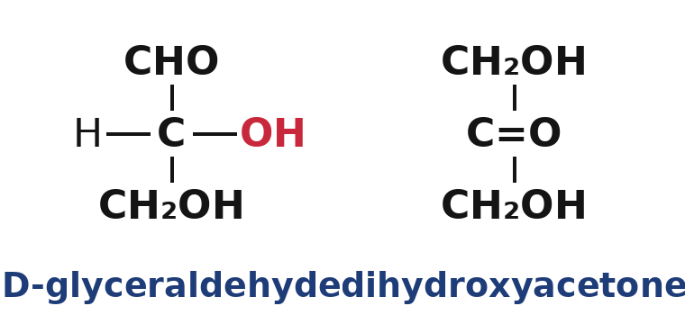

> [!why] الغليسر ألدهيد وثنائي هيدروكسي الأسيتون **مماكبان**.
> لأن: لهما **الصيغة الجزيئية نفسها** (C~3~H~6~O~3~) لكن **الزمرة الوظيفية مختلفة**: ألدهيد في الأول وكيتون في الثاني.

## ذرة الكربون غير المتناظرة والفعالية الضوئية

> [!define] ذرة الكربون غير المتناظرة (C*)
> ذرة كربون **مرتبطة بأربعة مستبدلات مختلفة** عن بعضها. وجودها يجعل المركب **فعّالاً ضوئياً**. {ص 3}

> [!define] الفعالية الضوئية
> قدرة المركب على **تدوير مستوى الضوء المستقطب** عند مروره في محلوله: إما **باتجاه عقارب الساعة (+)** أو **عكسها (−)**.

> [!explain] كيف نعرف ذرة الكربون غير المتناظرة؟
> كيف نكتبها: نعلّمها بنجمة **C*** كما في الملخص: Z–C*–Y مع G في الأسفل، حيث Z و Y و G والمستبدل الرابع **كلها مختلفة**. {ص 3}
> لماذا: إذا كانت المستبدلات الأربعة مختلفة، يوجد للجزيء **صورتان مرآتيتان لا تنطبقان** (مثل اليد اليمنى واليسرى)، وكل صورة تدوّر الضوء باتجاه.
> كيف تحدث: في الغليسر ألدهيد: الكربون الأوسط مرتبط بـ CHO و H و OH و CH~2~OH (أربعة مختلفة) ← C*. أما ثنائي هيدروكسي الأسيتون فليس فيه C* (الكربون الأوسط C=O)، لذلك **ليس فعّالاً ضوئياً**.

## المماكبات الفراغية: الإنانتيومير والراسيمي والإبيمر والدياستيريومير

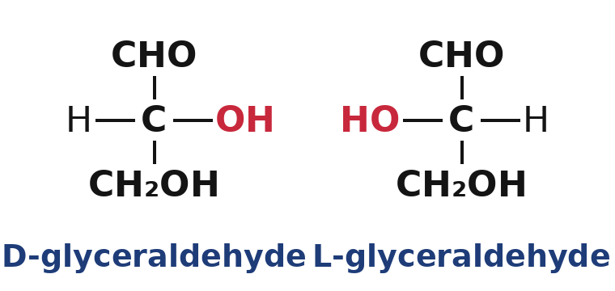

> [!define] الإنانتيومير (Enantiomers)
> مماكبان هما **صورة مرآتية** لبعضهما ولا ينطبقان، مثل D-غليسر ألدهيد و L-غليسر ألدهيد. {ص 1}

> [!define] المخلوط الراسيمي (Racemic mixture)
> محلول يحوي مماكبين أحدهما **D** والآخر **L** **بنسب متساوية 50:50**، ويسمّى المماكبان **زوج إنانتيومير**. {ص 1}

> [!why] المخلوط الراسيمي **لا يُظهر فعالية ضوئية**.
> لأن: المماكب D يدوّر الضوء بزاوية معينة باتجاه، والمماكب L يدوّره **بالزاوية نفسها بالاتجاه المعاكس**، وبما أن كميتهما متساوية **يلغي أحدهما أثر الآخر** فتكون المحصلة صفراً.

> [!define] الإبيمر (Epimers)
> مماكبان يختلفان في **توزع OH و H حول ذرة كربون واحدة فقط**. مثال: **الغلوكوز والمانوز** (يختلفان عند الكربون رقم 2 فقط). {ص 1}

> [!define] الدياستيريومير (Diastereomers)
> مماكبان فراغيان **ليسا صورة مرآتية** لبعضهما، ويكون الاختلاف بينهما **حول أكثر من ذرة كربون**. {ص 1}

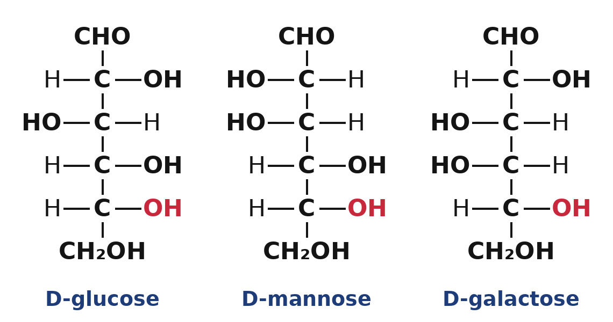

> [!tip] قارن دائماً **سطراً سطراً** في صيغة فيشر: اختلاف في سطر واحد = **إبيمر**، صورة مرآتية كاملة = **إنانتيومير**، اختلاف في أكثر من سطر (وليس مرآة كاملة) = **دياستيريومير**.

> [!note] الغلوكوز والغالاكتوز أيضاً **إبيمران** (عند C4)، وهذا مثال مشهور بالامتحانات. أما المانوز والغالاكتوز فيختلفان عند C2 و C4، فهما **دياستيريومير** وليسا إبيمرين.

# عائلة السكريات D: كيف تُشتق السكريات

تُشتق كل السكريات الألدهيدية من النوع D من **D-غليسر ألدهيد**، بإضافة ذرة كربون جديدة في كل مرة. {ص 4}

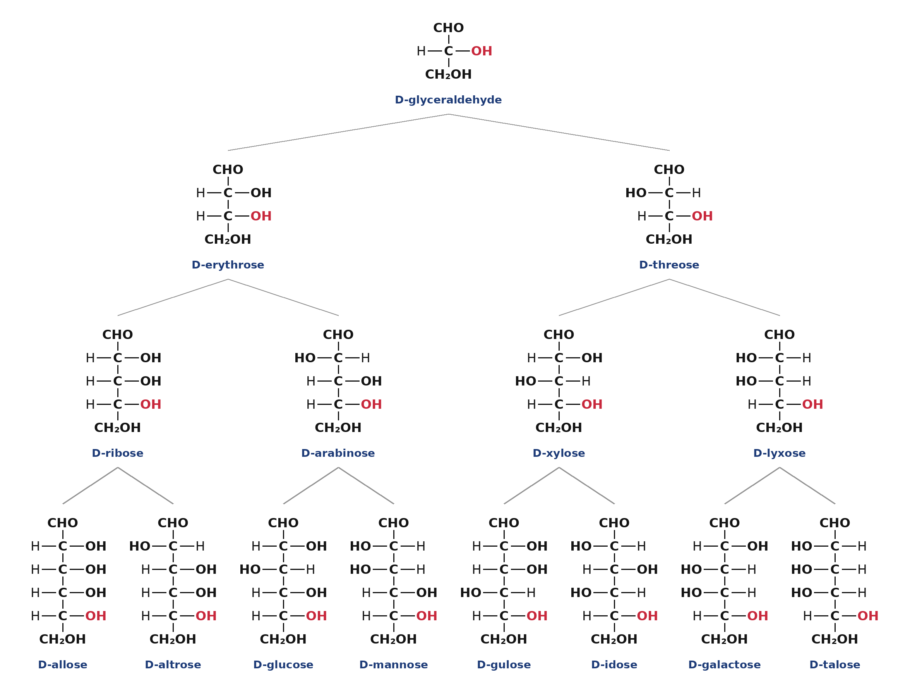

> [!explain] كيف تُشتق السكريات من بعضها؟
> كيف نكتبها: نأخذ السكر الأب ونضيف **ذرة كربون جديدة تحت CHO مباشرة**. هذه الذرة الجديدة لها احتمالان: **OH على اليمين** (الابن الأول) أو **OH على اليسار** (الابن الثاني). وباقي الصيغة تُنقل **كما هي**.
> لماذا: لذلك كل سكر يعطي **ولدين**: 1 ← 2 ← 4 ← 8. وعدد السكريات في كل مستوى = 2 أس (عدد ذرات الكربون غير المتناظرة).
> من أين: آخر OH (بالأحمر) لا يتغير أبداً لأنه **موروث من D-غليسر ألدهيد**، ولذلك كل الشجرة من النوع **D**.
> كيف تحدث: مثال: D-أرابينوز (يسار، يمين، يمين) + كربون جديد OH يمين ← **D-غلوكوز** (يمين، يسار، يمين، يمين)، و + كربون جديد OH يسار ← **D-مانوز** (يسار، يسار، يمين، يمين). لذلك الغلوكوز والمانوز إبيمران عند C2.

> [!tip] لحفظ ترتيب السداسيات الثمانية من اليسار لليمين: **All Altruists Gladly Make Gum In Gallon Tanks**
> - **A**llose، **A**ltrose، **G**lucose، **M**annose، **G**ulose، **I**dose، **G**alactose، **T**alose.
> - والخماسيات: **R**ibose، **A**rabinose، **X**ylose، **L**yxose: جملة "**RAXL**".

> [!note] رسم الشجرة في الملخص (ص 4) **فيه أخطاء**: بعض الصيغ ناقصة ذرات أو مكتوب تحتها اسم غير صحيح (مثلاً الرباعيان والترتيب تحتهما). الشجرة أعلاه مرسومة من جديد حسب المراجع، وتحققتُ من كل صيغة فيها حاسوبياً. **احفظ هذه.**

## السكريات الستة الأساسية في الملخص
رسم الملخص 4 سكريات ألدهيدية و2 كيتونية. هذه هي الأهم للحفظ: {ص 2}

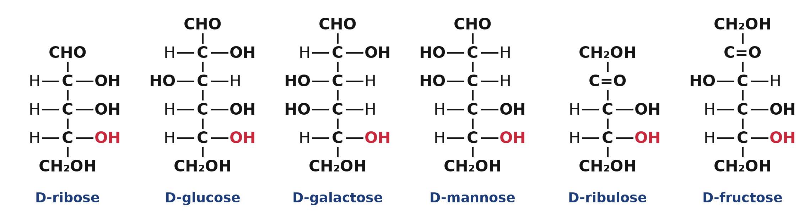

> [!explain] كيف أحفظ صيغ هذه السكريات الستة؟
> كيف نكتبها: احفظ **الغلوكوز** أولاً: يمين، يسار، يمين، يمين. ثم: **المانوز** = الغلوكوز مع قلب **C2**. **الغالاكتوز** = الغلوكوز مع قلب **C4**. **الفركتوز** = الغلوكوز نفسه من C3 للأسفل، لكن C1 = CH~2~OH و C2 = C=O.
> لماذا: لأن الفركتوز هو **الكيتوز المقابل** للغلوكوز: إذا نقلنا الكربونيل من C1 إلى C2 نحصل عليه.
> من أين: الريبوز (يمين، يمين، يمين) هو سكر الـ **RNA**، والريبولوز هو الكيتوز المقابل له.

# الشكل الحلقي للسكريات

السكريات الخماسية والسداسية لا تبقى غالباً سلسلة مفتوحة، بل **تنغلق على شكل حلقة**: زمرة الكربونيل (C1 في الألدوز) تتفاعل مع OH على الكربون 5 من الجزيء نفسه.

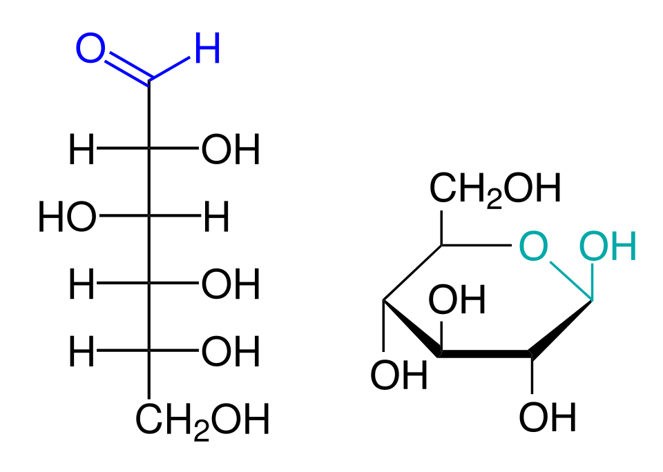

## الدلائل على وجود الشكل الحلقي
الألدهيدات العادية تعطي تفاعلات واضحة، أما الغلوكوز فيعطيها **بصعوبة أو لا يعطيها**، وهذا دليل على أن زمرة الألدهيد **تختفي** عند تشكّل الحلقة. {ص 1}
1. الألدهيدات تتفاعل **بسهولة** مع بيسلفيت الهيدروجين (NaHSO~3~)، أما الغلوكوز فيتفاعل **بصعوبة** بسبب **غياب المجموعة الوظيفية أثناء تشكّل الحلقة**. {ص 1}
2. الألدهيدات تتأكسد بسهولة. {ص 1}
3. الألدهيدات تعطي نتيجة **إيجابية** مع **اختبار شيف** (Schiff)، والغلوكوز لا يعطيها. {ص 1}
4. يوجد **صورتان للغلوكوز** (α و β)، ونستدل عليهما من **التدوير المتبدّل** (تحت). {ص 1}

> [!note] عن البند 2 ("الألدهيدات تتأكسد بسهولة"): الألدهيد العادي كله بشكل مفتوح فيتأكسد **فوراً**، أما الغلوكوز فمعظمه (أكثر من 99%) **حلقي** ولا يتأكسد إلا الجزء الصغير المفتوح الذي في توازن مع الحلقة، فيتأكسد **أبطأ**. ومع ذلك هو **سكر مُرجِع** يعطي فهلنغ إيجابياً، لأن الجزء المفتوح كلما تأكسد تنفتح حلقات جديدة لتعويضه. لذلك **الدلائل الأقوى** في الامتحان: **بيسلفيت** و**شيف** و**وجود α و β (التدوير المتبدّل)**.

## الأنوميران α و β

عند تشكّل الحلقة يصبح **C1 ذرة كربون غير متناظرة جديدة**، فتظهر صورتان: {ص 3}
- **α**: الـ OH على C1 **نحو الأسفل** في صيغة هاورث.
- **β**: الـ OH على C1 **نحو الأعلى**.

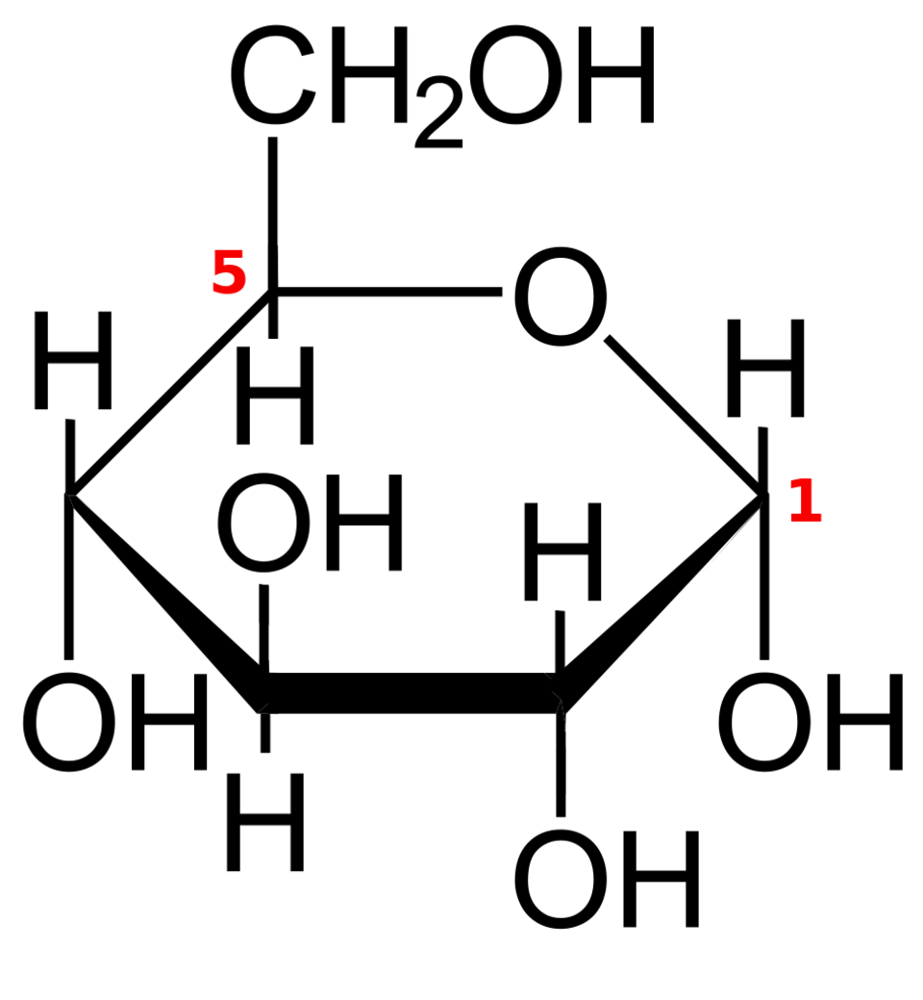

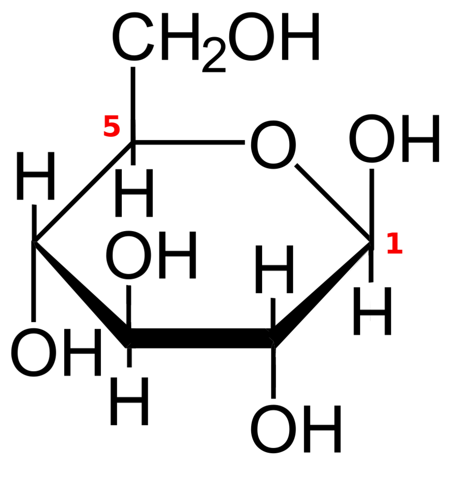

## صيغة هاورث (Haworth)
صيغة هاورث ترسم الحلقة **عمودية على مستوى الورقة**، و**الجزء الغامق (العريض) هو الأقرب للناظر**. {ص 1}

> [!explain] التحويل من فيشر إلى هاورث
> كيف نكتبها: 1) نرسم حلقة سداسية: ذرة **الأكسجين في الزاوية الخلفية اليمنى**، و**C1 على اليمين**، ثم C2 و C3 و C4 باتجاه عقارب الساعة، و C5 قبل الأكسجين. 2) **كل OH على اليمين في فيشر ← نحو الأسفل في هاورث**، و**كل OH على اليسار ← نحو الأعلى**. {ص 3} 3) في سكريات D تكون مجموعة **CH~2~OH (C6) نحو الأعلى**. 4) الـ OH على C1: **أسفل = α، أعلى = β**.
> لماذا: صيغة فيشر لا تُظهر الحلقة، أما هاورث فتُظهر الشكل الحقيقي للسكر في الماء والغذاء (حلقة)، وتُظهر الفرق بين α و β.
> من أين: القاعدة "يمين ← أسفل" تأتي من **تدوير** صيغة فيشر 90° وإغلاقها حلقة: الجهة اليمنى في فيشر تصبح تحت مستوى الحلقة.
> كيف تحدث: الغلوكوز في فيشر: C2 يمين ← أسفل، C3 يسار ← أعلى، C4 يمين ← أسفل. قارن مع صورة α-D-غلوكوز فوق: OH على C2 أسفل، على C3 أعلى، على C4 أسفل. ✓

## التدوير المتبدّل (Mutarotation)
إذا حضّرنا الغلوكوز بطريقتين مختلفتين نحصل على صورتين لهما زاويتا دوران مختلفتان، لكن **مع الوقت تتغير زاوية كل منهما حتى تصل للقيمة نفسها 52.7°**: {ص 1}
- **α-D-غلوكوز** (يُبلوَر من **الماء**): زاوية دورانه **+113°**، وبعد فترة تصبح **52.7°**.
- **β-D-غلوكوز** (يُبلوَر من **الكحول**): زاوية دورانه **+19°**، وبعد فترة تصبح **52.7°**.

> [!note] **تصحيح من المحاضرة 2:** الملخص كتب أن β يُبلوَر من **الكحول**، لكن الدكتور قال في تسجيل المحاضرة 2 إنه يُبلوَر من **حمض الخل**، والمراجع تؤيد ذلك (β-D-غلوكوز يُبلوَر من **حمض الخل الساخن**). اعتمد **حمض الخل**.

> [!define] التدوير المتبدّل (Mutarotation)
> **تغيّر زاوية الدوران الضوئي** لمحلول سكر مع الزمن حتى تثبت عند قيمة توازن، بسبب **تحوّل الصورتين α و β إلى بعضهما** عبر الشكل المفتوح. وعند الاستقرار تكون النسبة **⅓ α و ⅔ β**. {ص 1}

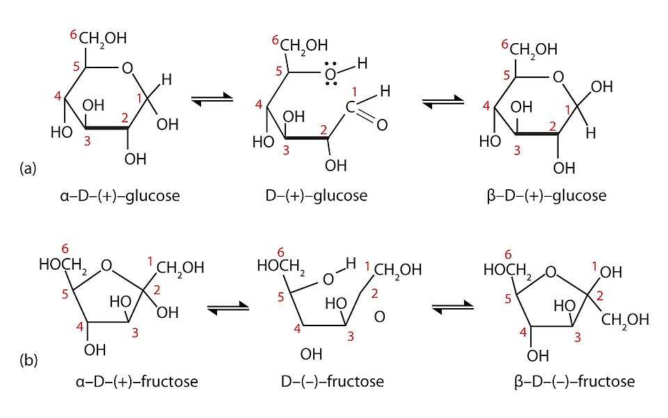

> [!problem] (تدريب) استنتج من زوايا الدوران أن نسبة α عند التوازن قريبة من الثلث.
> المعطيات: دوران α = +113°، دوران β = +19°، دوران المزيج عند التوازن = +52.7°
> القانون: دوران المزيج = (نسبة α × 113) + (نسبة β × 19)، ونسبة β = 1 − نسبة α
> الحل: 52.7 = 113x + 19(1 − x) ← 52.7 − 19 = 94x ← x = 33.7 ÷ 94 = 0.36
> النتيجة: نسبة α ≈ **36% (≈ ⅓)** ونسبة β ≈ **64% (≈ ⅔)**، وهذا ما كتبه الدكتور.

> [!why] عند التوازن تكون نسبة **β أكبر** من α.
> لأن: في β تكون كل زمر OH الكبيرة في الوضع **الاستوائي** (حول الحلقة لا فوقها وتحتها) فلا تتزاحم، فتكون β **أكثر استقراراً**.

# السكر المحوَّل والحلاوة والخواص العامة

## السكر المحوَّل (المقلوب)
**السكروز** (سكر الطعام) يتألف من **غلوكوز (+52.7°)** و**فركتوز (−92°)**. عند تحلله تكون المحصلة **سالبة (−)**: أي أن اتجاه الانحراف ينقلب إلى **عكس عقارب الساعة**، لذلك يسمى الناتج **السكر المحوَّل** (Invert sugar). {ص 1}

$$ C~12~H~22~O~11~ + H~2~O → C~6~H~12~O~6~ (غلوكوز +52.7°) + C~6~H~12~O~6~ (فركتوز −92°)

> [!problem] (تدريب) احسب زاوية دوران السكر المحوَّل (مزيج متساوٍ من الغلوكوز والفركتوز).
> المعطيات: الغلوكوز +52.7°، الفركتوز −92°، والنسبة 1:1
> القانون: دوران المزيج = متوسط الدورانين
> الحل: (52.7 + (−92)) ÷ 2 = −39.3 ÷ 2 = −19.65
> النتيجة: زاوية الدوران ≈ **−19.7°** (سالبة) ← لهذا سُمّي "محوَّلاً": السكروز كان (+) وصار الناتج (−).

> [!why] السكر المحوَّل **أفضل في تصنيع الحلويات والشرابات** من السكروز.
> لأن: هو **أحلى** من السكروز (لأنه يحوي الفركتوز، وهو أحلى سكر طبيعي)، و**أصعب تبلوراً**، فلا يتشكل فيه "تسكّر" (حبيبات سكر) ويبقى الشراب ناعماً. {ص 1}

> [!note] غالباً تكون **الكيتونات أحلى من الألدهيدات** (مثلاً الفركتوز أحلى من الغلوكوز)، لكن **الكحولات السكرية** قد تكون أحلى منهما. {ص 1}

## الخواص العامة للسكريات الأحادية {ص 1}
- **عديمة اللون**، **صلبة**، **متبلورة**.
- **تذوب في الماء**، وذات **طعم حلو**.
- **لا تذوب في المحلات (المذيبات) اللاقطبية**.

> [!why] السكريات الأحادية **تذوب في الماء ولا تذوب في المذيبات اللاقطبية**.
> لأن: فيها **عدد كبير من زمر OH القطبية** التي تشكّل **روابط هيدروجينية** مع جزيئات الماء، أما المذيبات اللاقطبية (مثل البنزين) فلا تستطيع تشكيل هذه الروابط.

# الكحولات السكرية والحلقية وحمض الفيتيك

## الكحولات السكرية
نحصل عليها من **إرجاع** زمرة الكربونيل (الألدهيد أو الكيتون) إلى CH~2~OH، أي **إضافة 2H**: {ص 2}
- **السوربيتول (Sorbitol)**: ناتج إرجاع **الغلوكوز** و**الفركتوز**. {ص 2}
- **المانيتول (Mannitol)**: ناتج إرجاع **المانوز** و**الفركتوز**. {ص 2}

$$ C~6~H~12~O~6~ + 2H → C~6~H~14~O~6~

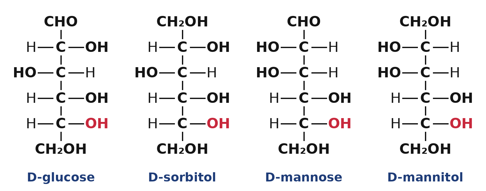

> [!why] إرجاع **الفركتوز** يعطي **سوربيتولاً ومانيتولاً معاً**، أما الغلوكوز فيعطي السوربيتول فقط.
> لأن: في الفركتوز تكون C=O على **C2**، وعند إرجاعها يصبح C2 **ذرة كربون غير متناظرة جديدة**، فالـ OH الجديد قد يتجه **يميناً** (فنحصل على السوربيتول، مثل الغلوكوز) أو **يساراً** (فنحصل على المانيتول، مثل المانوز).

## الكحولات الحلقية: الإينوزيتول
- تنتشر في **الخلايا النباتية والحيوانية**، إما **حرة** أو **مرتبطة**، وتدخل في **أنسجة الكبد والدماغ والدم**. {ص 5}
- أهم أشكالها: **ميو-إينوزيتول (myo-Inositol)**. {ص 5}
- الإينوزيتول **مماثل للغلوكوز في الصيغة (C~6~H~12~O~6~)** لكن **مع اختلاف توزع الذرات**: فهو حلقة من 6 ذرات **كربون** (لا أكسجين فيها)، على كل كربون OH. {ص 5}

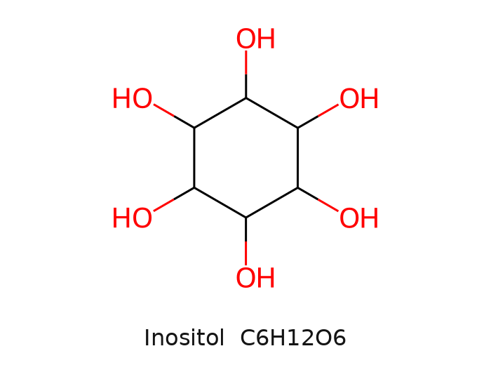

## حمض الفيتيك (Phytic acid)
- هو **أستر جميع الزمر الكحولية في الإينوزيتول مع حمض الفوسفور** (رابطة إسترية). {ص 2، 5}
- له **ألفة قوية للارتباط بالمعادن** مثل **الكالسيوم (Ca)**. {ص 2}
- لذلك هو **ضار لبعض الأطفال**: لأنه يرتبط بالكالسيوم ويسبّب **الكساح**. {ص 2}
- قد يكون **مفيداً** وقد يكون **ضاراً**، وهو من **معيقات امتصاص المعادن**. {ص 5}

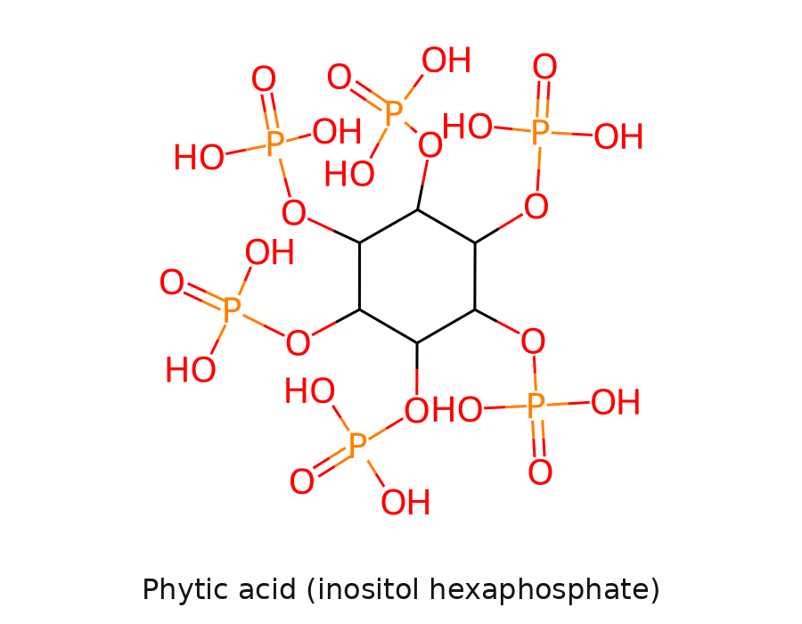

> [!explain] حمض الفيتيك
> كيف نكتبها: نرسم الإينوزيتول (حلقة 6 كربون)، ثم نستبدل **كل OH بـ O–PO~3~H~2~** (ستة فوسفات). الصيغة الجزيئية C~6~H~18~O~24~P~6~.
> لماذا: زمر الفوسفات **سالبة الشحنة** في الأمعاء، فتمسك بالأيونات **الموجبة** مثل Ca^2+^ و Fe^2+^ و Zn^2+^ وتشكّل معها **معقدات لا تذوب**، فلا يمتصها الجسم.
> من أين: يوجد بكثرة في **قشور الحبوب والبقوليات والمكسرات** (النخالة، الخبز الأسمر، الحمص، الفول)، وهو مخزن الفوسفور في البذرة.
> كيف تحدث: طفل يعتمد غذاؤه على حبوب كاملة كثيرة بدون حليب كافٍ ← حمض الفيتيك يرتبط بالكالسيوم ← نقص امتصاص الكالسيوم ← **كساح**. وهو مفيد من جهة أخرى كمضاد أكسدة. لتقليله: **النقع والتخمير** (خميرة الخبز تحلل جزءاً منه).

> [!note] شرح الدكتور في **المحاضرة 2** علاقة حمض الفيتيك بالحديد: حمض الفيتيك يمسك المعادن فيمنع امتصاصها، فإذا كان **قد أمسك الكالسيوم** يبقى **الحديد حراً** فيُمتص. ويقلل حمض الفيتيك أيضاً امتصاص **الزنك**. وملحه مع **الكالسيوم والمغنيزيوم** اسمه **الفيتين (Phytin)**.

# النشاء: الأميلوز والأميلوبكتين

النشاء (Starch) هو **مخزن الغلوكوز في النبات**، ويتكون من نوعين من السلاسل:

| وجه المقارنة | الأميلوز (Amylose) | الأميلوبكتين (Amylopectin) |
| الذوبان في الماء | **ينحل** بالماء | **لا ينحل**، إنما يشكل مع **الماء الساخن** محلولاً **عجينياً** |
| التفاعل مع اليود | يعطي **لوناً أزرق** | يعطي **لوناً بنفسجياً** |
| شكل السلسلة | **خطية غير متفرعة** | **خطية متفرعة** |
| نوع الروابط | α(1→4) فقط | α(1→4) **و** α(1→6) عند التفرعات |
| عدد الوحدات | حوالي **300** وحدة | حوالي **1000** وحدة |
| الشكل الفراغي | يلتف بشكل **حلزوني**، ويدخل اليود داخل الحلزون فيشكّل **معقدات زرقاء داكنة** | ملتف بشكل **حلزوني كروي** (متفرع)، و**تُمتز ذرات اليود على سطح البنية** |

{ص 3}

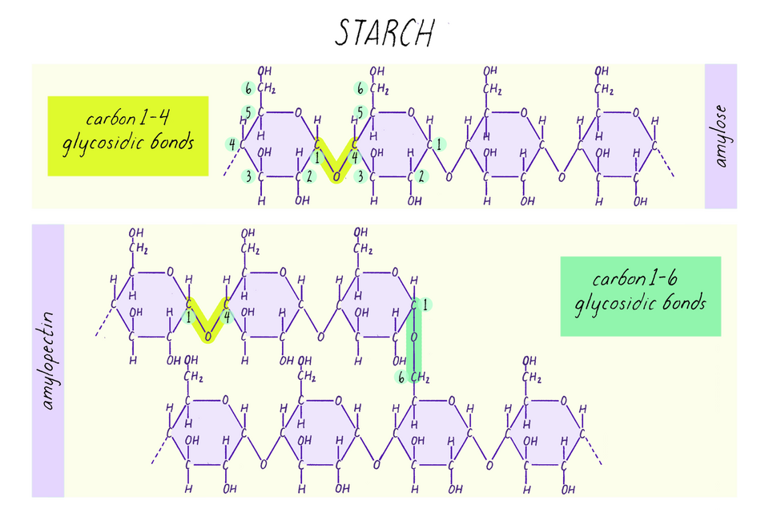

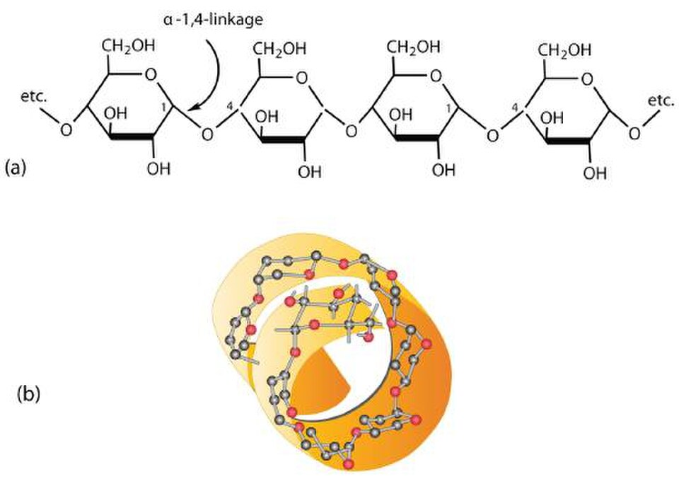

> [!explain] لماذا يتلوّن النشاء مع اليود؟ (اختبار اليود)
> كيف نكتبها: نضيف قطرات من **محلول اليود (اليود + يوديد البوتاسيوم)** إلى العينة: لون **أزرق** = نشاء (أميلوز)، **بنفسجي/أحمر** = أميلوبكتين أو غليكوجين، **لا تغيّر** (بقي بنياً-أصفر) = لا يوجد نشاء.
> لماذا: جزيئات اليود تدخل **داخل الحلزون** الطويل للأميلوز وتصطف فيه، فيتشكل **معقد** يمتص الضوء ويظهر **أزرق داكناً**. أما الأميلوبكتين فسلاسله **قصيرة بسبب التفرعات**، فلا تتشكل حلزونات طويلة، ويُمتز اليود على السطح فيظهر لون **بنفسجي** أفتح.
> من أين: هذا يفسّر لماذا الحلزون مهم: إذا سخّنا محلول النشاء الأزرق **يختفي اللون** (لأن الحلزون يتفكك)، ويعود عند التبريد.
> كيف تحدث: يُستعمل بالمخبر للكشف عن النشاء في الأغذية (مثلاً غش الحليب أو اللبن بالنشاء).

> [!note] السيللوز (Cellulose) أيضاً سلسلة من الغلوكوز لكن روابطه **β(1→4)** لا α، ولذلك لا يهضمه الإنسان. يوجد **بشكله النقي في القطن**، ويدخل في **تركيب جدران الخلايا النباتية**. {ص 2}

> [!note] أعداد الوحدات (300 و 1000) هي كما كتبها الدكتور، **واعتمدها في الامتحان**. المراجع تذكر أعداداً أكبر تختلف حسب مصدر النشاء (الأميلوز مئات إلى آلاف وحدة، والأميلوبكتين عشرات الآلاف)، لأن الرقم يتغير من نبات لآخر.

# الكواشف: كيف نكشف السكريات في المخبر

## كاشف مولش: الكاشف العام لكل السكريات
**الكاشف العام للسكريات هو مولش (Molisch)**، حيث يقوم **بنزع 3 جزيئات ماء (3H~2~O)** من السكر: {ص 5}
- إذا كان السكر **خماسياً** ← يعطي **فورفورال** (Furfural).
- إذا كان **سداسياً** ← يعطي **هيدروكسي ميتيل فورفورال** (HMF).

$$ C~5~H~10~O~5~ − 3H~2~O → C~5~H~4~O~2~ (فورفورال)

$$ C~6~H~12~O~6~ − 3H~2~O → C~6~H~6~O~3~ (هيدروكسي ميتيل فورفورال)

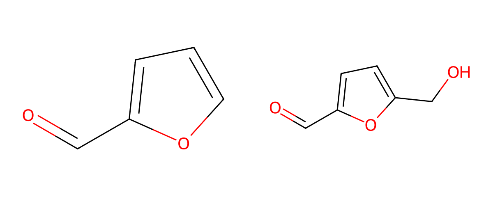

> [!explain] كاشف مولش ونزع الماء
> كيف نكتبها: نكتب السكر بصيغة فيشر، ونحوّط **3 أزواج (OH + H)** متجاورة كما في الملخص: كل زوج يخرج **جزيء ماء**. ما يبقى ينغلق في **حلقة خماسية** فيها أكسجين، وعليها زمرة **CHO**. {ص 5}
> لماذا: نستعمل **حمضاً قوياً مركّزاً** (حمض الكبريت) لأنه **ينزع الماء** بقوة من السكر.
> من أين: الحساب: C~5~H~10~O~5~ ناقص 3 × H~2~O (أي H~6~O~3~) = **C~5~H~4~O~2~** وهو الفورفورال. والسداسي C~6~H~12~O~6~ ناقص H~6~O~3~ = **C~6~H~6~O~3~** وهو HMF.
> كيف تحدث: في الأنبوب نضيف للعينة **ألفا-نفتول** ثم نسكب حمض الكبريت ببطء على الجدار: يتشكل الفورفورال أو HMF ويتفاعل مع النفتول فتظهر **حلقة بنفسجية** بين الطبقتين = **وجود سكر** (أي سكر).

> [!remember] عند تفاعل السكريات مع **الحموض القوية** تعطي **فورفورال + هيدروكسي ميتيل فورفورال**. {ص 6}

## كواشف خاصة {ص 5}
| الكاشف | ماذا يكشف |
| **مولش** (Molisch) | **كل السكريات** (الكاشف العام) |
| **سيليفانوف** (Seliwanoff) | **الكيتونات** (السكريات الكيتونية مثل الفركتوز)، لأنها تعطي **هيدروكسي ميتيل فورفورال بشكل أسرع** |
| **خلات الأنيلين** (Aniline acetate) | **السكريات الخماسية** فقط |
| **بارفويد** (Barfoed) | يميّز **السكريات الأحادية المُرجِعة** عن **الثنائية المُرجِعة** |
| **فهلنغ** (Fehling) | يميّز **المُرجِع** عن **غير المُرجِع**: **كل الأحادية مُرجِعة**، و**كل الثنائية مُرجِعة ما عدا السكروز** |

> [!define] السكر المُرجِع (Reducing sugar)
> سكر فيه زمرة كربونيل **حرة** (أو يستطيع أن يفتح حلقته ليحرّرها)، فيستطيع أن **يُرجع** أيونات النحاس في فهلنغ (من الأزرق إلى **راسب أحمر قرميدي** Cu~2~O).

> [!why] السكروز **غير مُرجِع** رغم أنه مكوّن من غلوكوز وفركتوز.
> لأن: الغلوكوز والفركتوز في السكروز يرتبطان **من خلال زمرتي الكربونيل نفسيهما** (C1 للغلوكوز مع C2 للفركتوز)، فلا يبقى أي كربونيل حر ولا تستطيع الحلقتان أن تنفتحا.

> [!tip] للحفظ: **مولش = الكل**، **سيليفانوف = كيتون** (S للـ **S**weet fructose)، **أنيلين = خماسي**، **بارفويد = أحادي أم ثنائي**، **فهلنغ = مُرجِع أم لا (كله مُرجِع إلا السكروز)**.

# الكرملة (Caramelization)

> [!define] الكرملة
> **تفاعل إسمرار لا أنزيمي** يحدث للسكر **تحت تأثير ارتفاع الحرارة**، **بغياب المواد الآزوتية** (البروتينات والحموض الأمينية). {ص 6}

> [!note] إذا **وُجدت** مواد آزوتية (حموض أمينية) مع السكر والحرارة، يسمى الإسمرار **تفاعل ميلارد** (Maillard)، وهو المسؤول عن لون الخبز المحمّص واللحم المشوي. الفرق بينهما سؤال شائع.

## مراحل الكرملة (على السكروز) {ص 6}
1. عند تسخين السكروز إلى **160°م**: ينزع **جزيء ماء** ويتشكل **غلوكوزان** و**فركتوزان**:

$$ C~12~H~22~O~11~ → C~6~H~10~O~5~ (غلوكوزان) + C~6~H~10~O~5~ (فركتوزان) + H~2~O

2. عند **180–190°م**: يتشكل **إيزوسكروزان**:

$$ C~6~H~10~O~5~ + C~6~H~10~O~5~ → C~12~H~20~O~10~

3. عند **200°م وأعلى**: يتشكل **كراميلان** (Caramelan)، **يذوب في الماء** و**طعمه مر**:

$$ 2 C~12~H~22~O~11~ − 4 H~2~O → C~24~H~36~O~18~

4. **مع استمرار التسخين**: يفقد **8 جزيئات ماء** فيتشكل **كراميلين** (Caramelen):

$$ 3 C~12~H~22~O~11~ − 8 H~2~O → C~36~H~50~O~25~

> [!explain] كيف أكتب معادلات الكرملة ولا أنساها؟
> كيف نكتبها: كل مرحلة = **عدد جزيئات سكروز** ناقص **عدد جزيئات ماء**. احفظ الأرقام: **(1 سكروز، −1 ماء)** ← **(2 سكروز، −4 ماء)** ← **(3 سكروز، −8 ماء)**.
> من أين: نحسب الناتج بطرح الذرات. في المرحلة الثالثة: جزيئا سكروز = C~24~H~44~O~22~، ونطرح منها أربعة جزيئات ماء (H~8~O~4~) فيبقى **C~24~H~36~O~18~**. وفي المرحلة الرابعة: ثلاثة جزيئات سكروز = C~36~H~66~O~33~، ونطرح ثمانية جزيئات ماء (H~16~O~8~) فيبقى **C~36~H~50~O~25~**. (تأكدت من المعادلات الأربع بالحساب.)
> لماذا: كلما ارتفعت الحرارة **يخرج ماء أكثر** وتتّحد جزيئات أكثر، فتكبر الجزيئات، ويغمق اللون، ويزداد **المرار**.
> كيف تحدث: هذا ما تراه في المطبخ: السكر يذوب ← يصفرّ ← يصير بنياً بطعم الكراميل ← إذا زادت الحرارة يسودّ ويصير مراً.

> [!why] للكرملة **دور إيجابي في التصنيع الغذائي**.
> لأن: الكرملة تؤدي إلى **تشكيل مركبات حلقية ذات طعم ونكهة مميزة شبيهة بالكعك**، ومن بدايتها يكون الطعم **حلواً**، فتُستعمل لإعطاء اللون والنكهة (الكراميل، الحلويات، المشروبات الغازية). {ص 6}

> [!note] اسم ناتج المرحلة 4 في الملخص "كرميلين" هو **الكراميلين (Caramelen)** C~36~H~50~O~25~ (تحققتُ من الصيغة: 3 سكروز − 8 ماء). وانتبه: في المراجع ناتج ثالث أكبر بعده اسمه **Caramelin** (C~125~H~188~O~80~) لا يذوب في الماء، واسمه بالعربي متشابه، فميّز بينهما **بالصيغة**.

> [!summary] **الخلاصة:** السكريات ألدوزات (CHO) أو كيتوزات (C=O)، وتُرسم بصيغة فيشر، ونوعها D أو L حسب آخر OH. المماكبات: إنانتيومير (مرآة)، إبيمر (فرق بكربون واحد)، دياستيريومير (أكثر من كربون). الخماسية والسداسية تنغلق حلقة (هاورث) فتظهر α و β، وتتحول إحداهما للأخرى (التدوير المتبدّل: ⅓ α و ⅔ β). السكروز يتحول لسكر محوَّل (−). الإرجاع يعطي كحولات سكرية (سوربيتول، مانيتول). حمض الفيتيك يمسك الكالسيوم. النشاء: أميلوز (أزرق مع اليود) وأميلوبكتين (بنفسجي). الكواشف: مولش للكل، سيليفانوف للكيتون، أنيلين للخماسي، بارفويد وفهلنغ للمُرجِع. والكرملة إسمرار بالحرارة بدون مواد آزوتية.

# صفحات الملخص الأصلي

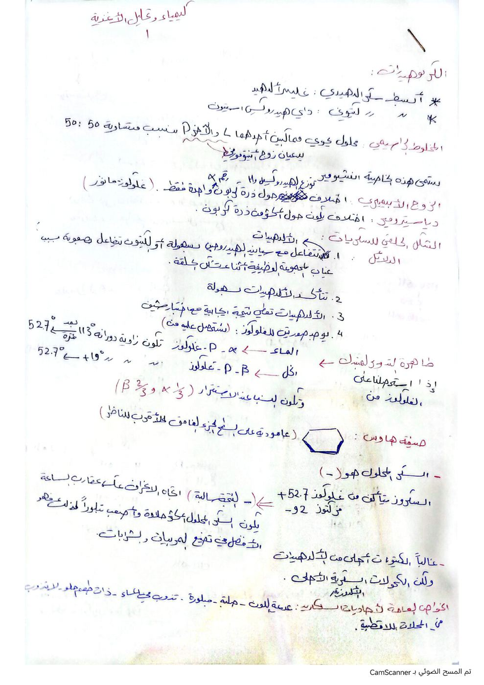

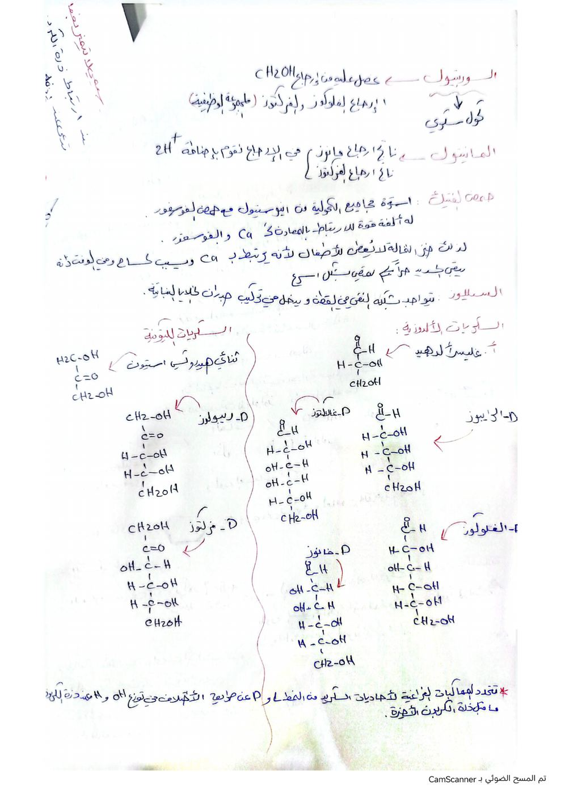

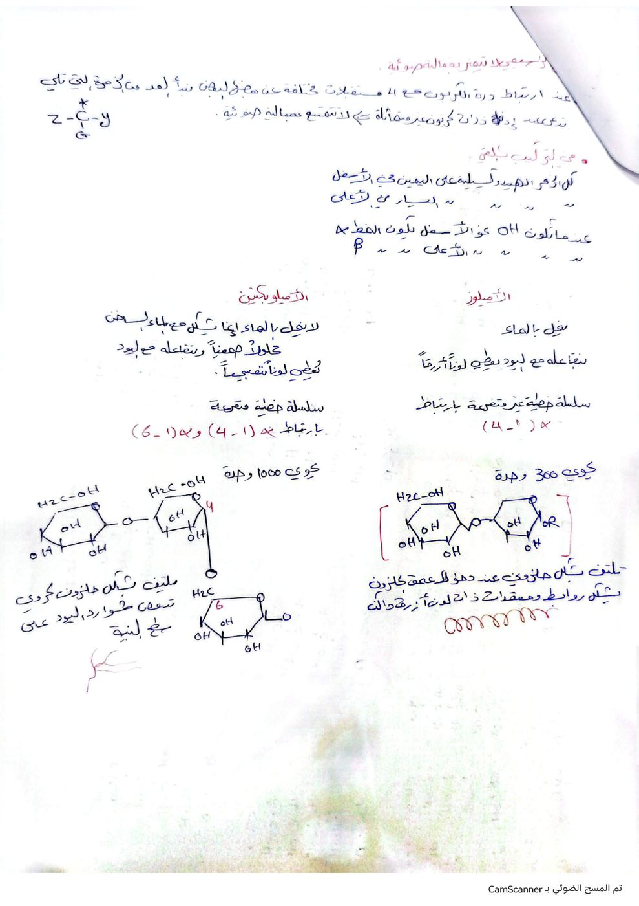

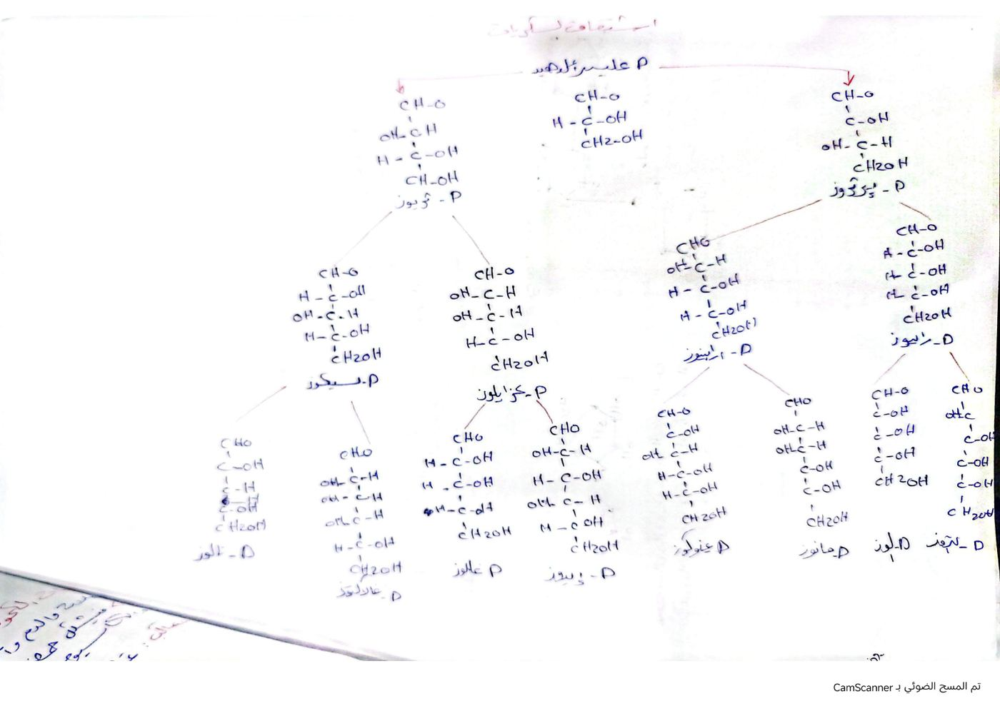

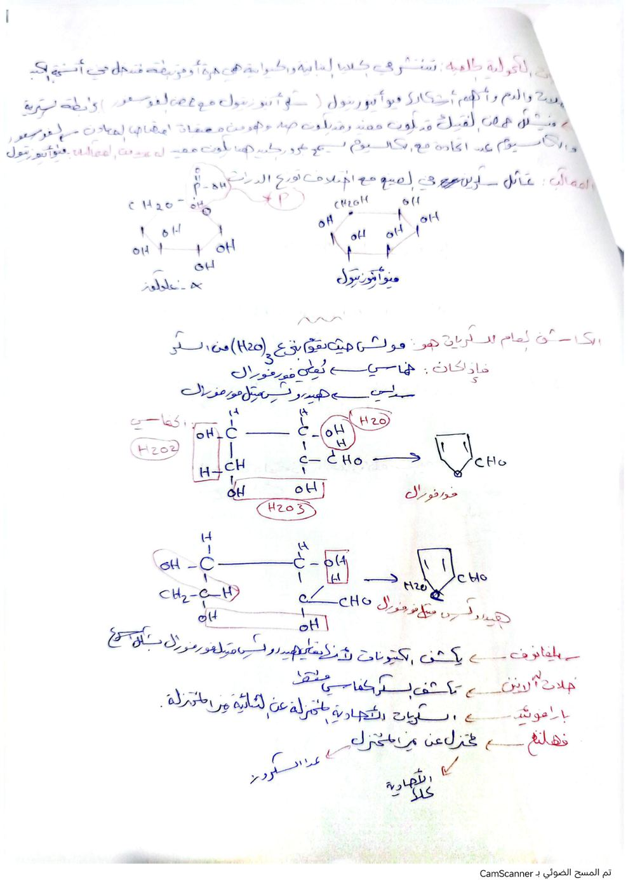

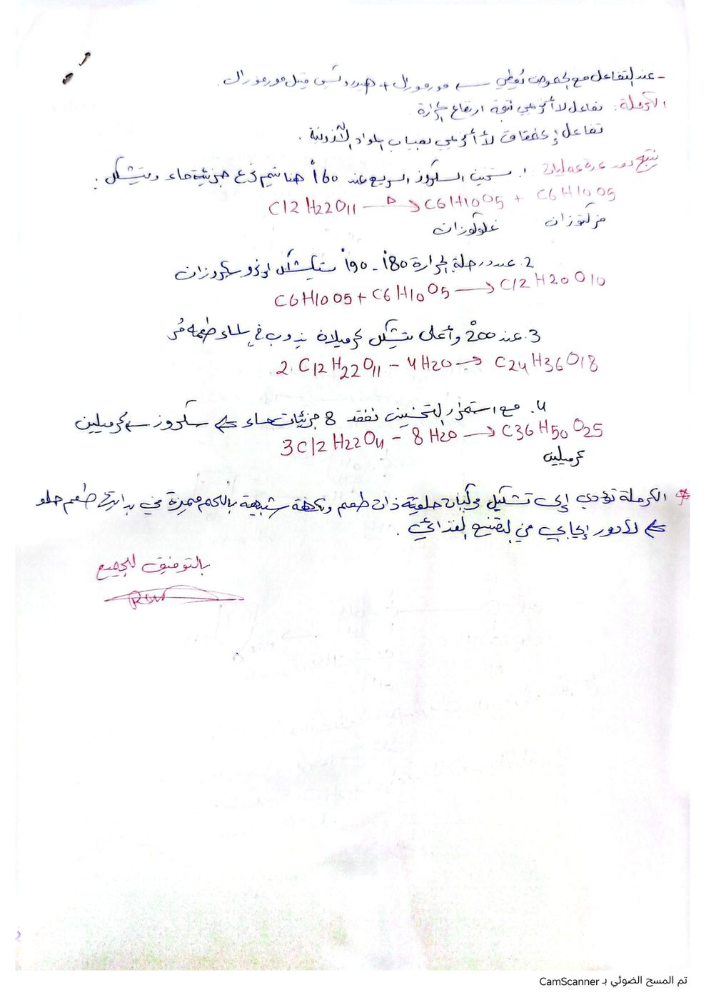
