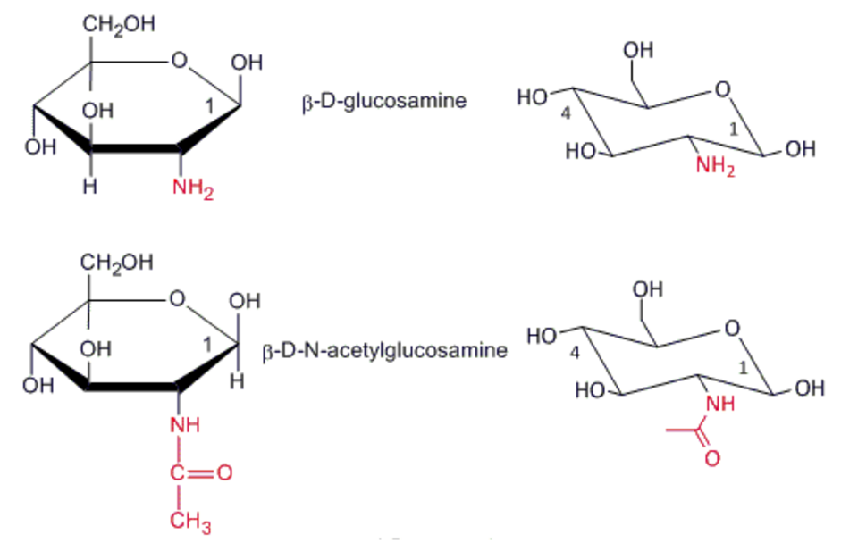
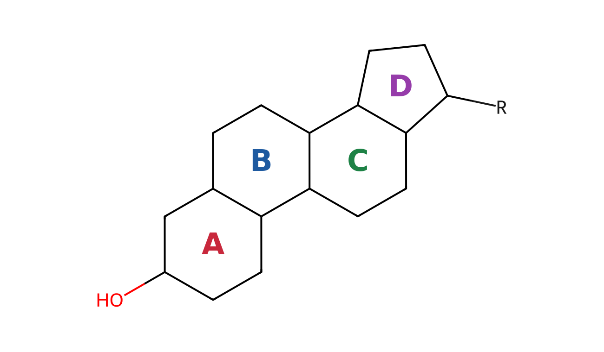
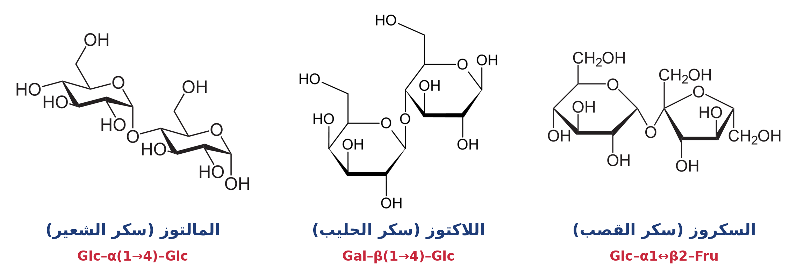
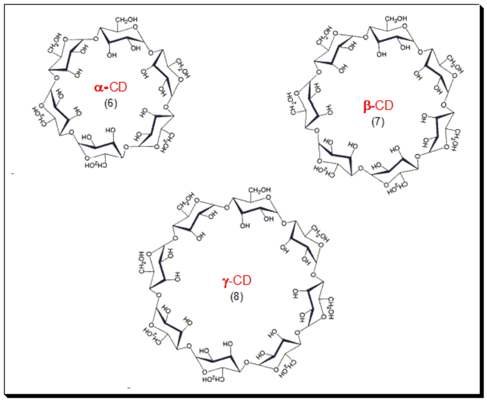
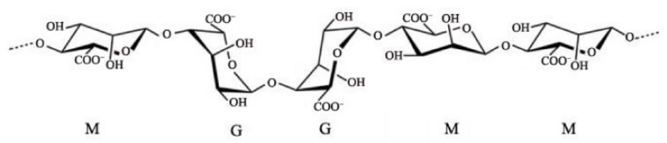
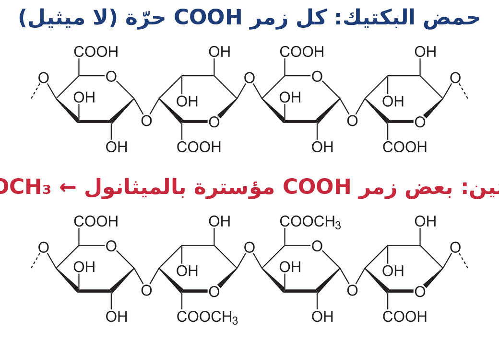
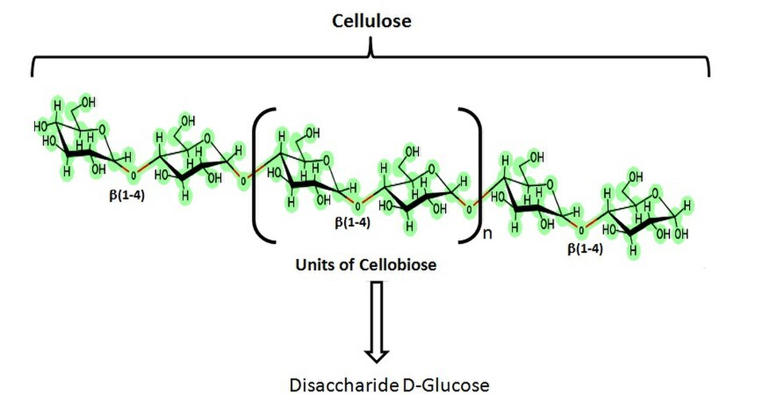
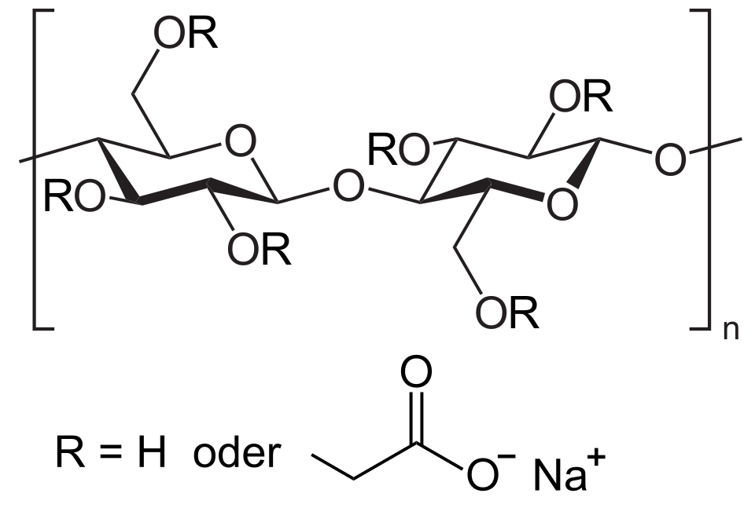

# التفاعل مع المركبات الآزوتية

**المشتقات الآزوتية للسكريات الأحادية**: β-D-غلوكوزأمين، α-D-غالاكتوزأمين.

تدخل في تركيب الهيبارين وحمض الهيالورونيك ومركب الكوندروايتين الذي يدخل في تركيب النسيج الضام والغضاريف والأوتار.

N-أستيل D-غلوكوزأمين: (NH–CO–CH~3~) نستبدل OH.

# الزوج الأنوميري

> [!define] الزوج الأنوميري
> يكون الاختلاف حول الذرة الأنوميرية (الوظيفية).

$$ عدد المماكبات  =  2^n^

مماكبات الغلوكوز: 2^4^ = 16 مماكب.

# الغليكوزيدات والأغليكون

• إن تفاعل مجموعة الهيمي أستيال في السكريات الأحادية مع المجموعة الغولية (الكحولية) من أساس سكري يدعى بـ: رابطة غليكوزيدية.

• إن تفاعل الهيمي أستيال مع كحول ذو أساس سكري تدعى رابطة غليكوزيدية، و" " " ذو أساس غير سكري يدعى بـ أغليكون.

## أمثلة الأغليكون

1. **ساليسين** (يوجد في الصفصاف) في الجسم يتحول إلى ساليسيليك أسيد (مهدئ – خافض حرارة – مضاد التهاب).
2. **الأنتراكينون** (يوجد في الصبار) في الجسم يتحول إلى الأسيتين (ملين أمعاء).
3. **الكومارين**.
4. **الأبترين**: يوصف لتوسيع الشرايين التاجي الذي يوقف قنوات الكالسيوم.

**الأميغدالين** يتركب من: فينيل + سكر الغلوكوز + سيانيد الهيدروجين HCN، والذي يدعى بـ سكر الجنتيوبيوز.

يستخرج الأميغدالين من سكر الجنتيوبيوز (فينيل غلايكوليك نتريل) بالحلمهة يعطي: بنز ألدهيد + HCN.

# حمض الهيالورونيك والهيبارين

**حمض الهيالورونيك**: يتكون من N-أستيل D-غلوكوزأمين تتحد مع غلوكورونات (غلوكوز متأكسد – من الرابطة 6 – منزوع H من COOH)، برابطة من نوع β(1-3).

**الهيبارين**: يتألف من وحدات من مشتقات كبريتية من إيدويورونيك متحدة مع N-أستيل D-غلوكوزأمين.

# الغليكوزيدات الفينولية

النواة الفينولية هي الأغليكون، تتحد مع المركبات مثل مشتقات البيريميدينية الموجودة في Vicin و Convicin في الفول (التفول) الذي يسبب انحلال الدم، والأربوتين في عنب الدب الذي يستخدم كمطهر للمجاري البولية.

نواة هي الفينول + سكر.

# الغليكوزيدات الستيرولية

* مثل مركب السولانين (مادة سامة توجد في البطاطا المزرعة) والديجوتوين مركب هام لعمل القلب.

الستيرول قد يكون كولستيرول أو Vit D أو هرمون أو أملاح صفراوية حسب R.

* **الصابونينات**: تعطي رغوة – تسبب انحلال خلايا الحمراء – مقشعة رافعة للضغط كما في السوس.

  كحول لاسكري ستيرول + سكر.
* **المضادات الحيوية**: ستربتومايسين – جنتامايسين.

  هي أغليكون (ستيرول) + سكر.

• **الغليكوزيدات المحلية**: تحوي على ستيفيول الذي يستخرج من نبات الستيفيا كأغليكون متحد مع غلوكوز يعطي الغليكوزيد ستيفيوزيد، وهو حلو أكثر من السكر 100 مرة. تستفيد منه البكتيريا النافعة في الأمعاء لذلك لا يرفع سكر الدم لأنه لا يمتص.

# السكريات الأحادية في الأغذية

- الثلاثية والرباعية لا توجد بشكل حر إنما بشكل مرتبط أو وسطي.
- الخماسية: توجد في الأغذية صعبة التخمر أحياناً عند الإنسان.
- السداسية:
  - D-غلوكوز
  - D-مانوز ← مانان جوز الهند
  - D-غالاكتوز
  - D-فركتوز

تختلف هذه السكريات عن بعضها البعض بنوعية السكر السائد فيها.

# السكريات المركبة

| السكر | الرابطة |
| مالتوز | α(1-4) |
| لاكتوز | β(1-4) |
| سكروز | α(1-2) |

- **رافينوز** (غلوكوز – فركتوز – غالاكتوز) في ملفوف القرنبيط، تحلله بـ غالاكتوزيداز، هذا الأنزيم لا يوجد عند الإنسان ⇐ يتخمر ويعطي (CO~2~ غاز – ميتان). الروابط: β(1-2) و α(1-6).

# السيكلودكسترينات

• **سيكلودكسترينات**: تتألف من 6 – 12 جزيئة من الغلوكوز، نحصل عليه بواسطة أنزيم سيكلومالتودكسترين (من جنس ... اللبن)، وهي محلي خفيف، تثبيت الفيتامينات والمواد المعطرية، وتحميل المواد المرة، ومادة حاملة للمادة الفعالة في الأدوية. أنواعها: α – β – γ.

> [!check] الكلمات بين القوسين بعد اسم الأنزيم غير واضحة بخط الدفتر.

# السكريات المتعددة

**السكريات المتعددة**: تستخدم في التصنيع الغذائي كمنتجات طبيعية أو معدلة، مثل المغلظات والمهلمات (النشاء – الكيتين(؟) – بكتين)، أو مثبتات للمستحلبات، أو التشكيل أو تشكيل أغذية أو أغلفة وألياف غذائية.

أغلبها لا تنحل بالماء، وبعضها تمتص الماء وتنتفخ، وبعضها تنحل بالماء الساخن، وبعضها تشكل محاليل لزجة في التراكيز العالية والمنخفضة.

> [!check] الكلمة الثانية بين النشاء والبكتين غير واضحة بخط الدفتر.

## البكتينات

* **البكتينات**: مركبات تتألف من غالاكتويورونيك متحدة مع بعضها برابطة α(1-4). تستخدم في حالات الإسهال والإمساك حسب نسبة الماء فيها.

## الآغار

* **الآغار**: منتج هلامي يعزل من الطحالب البحرية الحمراء، يتركب من β-D-غالاكتوبيرانوز و α-L-غالاكتوبيرانوز.

يستخدم في:
1. الأوساط الميكروبية المغذية.
2. في الصناعات الغذائية، فهو غير قابل للهضم وله فعالية إسهالية ومثبت للبن.
3. يعيق تيبس الخبز.
4. يساعد في القوام الهلامي في اللحوم المعلبة.

## الألجينات

* **الألجينات**: تتواجد في الطحالب البحرية السمراء، تتألف من β-D-مانويورونيك و α-L-غولويورونيك.

تستخدم في:
1. مادة مغلظة ومثبتة ومشكلة للهلام وتحسين القوام.
2. تمنع تشكل البلورات الثلجية الكبيرة في البوظة.
3. تستخدم في مختلف المنتجات الهلامية.
4. تثبيت عصائر الفواكه الطازجة وإعطاء رغوة البيرة.

## الكاراجينانات

* **الكاراجينانات**: منتج هلامي يعزل من الطحالب الحمراء ويتركب من β-D-غالاكتوبيرانوز و 3-6-L-أنهيدروغالاكتوز (لا منزوع الماء).

يستخدم في:
- زيادة لزوجة المحاليل.
- تثبيت الاستحلاب.
- في صناعة الشوكولاتة لمنع انفصال قطرات الدسم وتثبيت المعلقات ودقائق الكاكاو.
- تحسين صفات العجين (الدبقية – المطاطية والانتفاخ).
- منع تخثر بروتين الحليب.
- مروق للعصائر والمشروبات.

## الصمغ العربي

* **الصمغ العربي**: ينتج من الأكاسيا، يتألف من L-أرابينوز ورامنوز و D-غالاكتوز و D-غالاكتويورونيك.

يستخدم في:
1. عامل استحلاب ومثبت لمنتجات الجبن.
2. يمنع تشكل بلورات ثلجية كبيرة في البوظة.
3. يعيق بلورة السكر وانفصال الدسم في الحلويات.
4. مثبت رغوة في المشروبات والمواد المنكهة.

## البكتين

* **البكتين**: سلسلة بوليميرية α-D-غالاكتويورونيك و α(1-4)، وغالاكتان وأرابينان وكزايلوز. غالباً تكون فيه المجموعات الكربوكسيلية مؤسترة بالميتانول، وهي التي تعطي القوام الهلامي.

يقسم البكتين إلى:
1. **البروتوبكتين** (طليعة البكتين): يشتق منه تشكل البكتين (ثمار غير ناضجة)، ينحل بالماء الساخن، له القدرة على تشكيل الهلام. تتفكك بفعل أنزيم البروتوبكتيناز (Protopectinase).
2. **البكتيك**: لا يحوي على مجموعة الإستر ميتيل، تتمتع بقدرة ضعيفة على تشكيل الهلام، نقوم بإزالة العكارة. وعندما نريد الحصول على عصائر رائقة تتم تنشيط الأنزيمات البكتينية.
3. **حمض البكتينيك**: ناتج وسطي لتشكل البكتين.

## النشاء

* **النشاء**: مدخر سكري في النباتات.
- يتكون من الأميلوز والأميلوبكتين.
- يتميز بحساسية للتأثيرات الميكانيكية (تنعيم – طحن – تسخين) أو الكيميائية (المؤكسدات والحموض)، فيتشكل أنواع من النشاء المعدل (متهلم – متدفق – مؤكسد – الفوسفاتي – كربوكسي ميتيل النشاء).
- يستخدم كعوامل مغلظة ورابطة في إنتاج الحلويات والصلصات وحشوات المعجنات والمايونيز.

## السيللوز

* **السيللوز**: سكر داعم في النباتات، صعب الهضم، يتكون من β-غلوكوبيرانوز ورابطة من النوع β(1-4).

يتشكل الميكروكريستالين نتيجة تحليل الروابط بين السلاسل، وهو غير منحل بالماء وليس له قيمة سعرية، يستخدم في منتجات الأغذية منخفضة الكالوري ومنها السلطات والفواكه والبوظة.

**الميكروكريستالين**: هو تقطيع السيللوز إلى جزيئات قصيرة، ثم يتم الحصول عليه.

> [!note] تنويه، وظائف الألياف:
> 1. مالئة.
> 2. تمنع السرطان عن طريق ادمصاص العناصر الثقيلة الإيجابية.
> 3. الدور في تنظيم السكر بالدم.

## كربوكسي ميتيل السيللوز

معاملة السيللوز مع حمض كلورو الأستيك.

هو:
- عامل مغلظ لتعديل قوام المنتجات (الجيلي – الهلام – حشوات – العصائر).
- يعيق تبلور السكروز.
- منع تخرب النشاء والتيبس غير المرغوب فيه.
- تحسين من الصفات الثباتية والترطيب لأغلب المنتجات المجففة.

انتهت المحاضرة الثانية – 2 –

بالتوفيق للجميع.

# صفحات الدفتر

