> [!style] نمط الدكتور (من تسجيل هذه المحاضرة):
> - **يسأل الطلاب طوال الوقت ويجعلهم يعيدون التعريف** مرات كثيرة حتى يُحفظ ("ما هو الأغليكون؟" تكررت أكثر من 10 مرات). **التكرار عنده = مهم.**
> - يريد **تعريفاً قصيراً دقيقاً**: قال عن السابونينات "قوليها بثلاث كلمات بتاخدي العلامة التامة". فاحفظ التعاريف بصياغته.
> - يربط كل مادة بـ **مصدرها في الطبيعة وأثرها في الجسم**: اللوز المر، البطاطا الخضراء، السوس، الملفوف، الصفصاف، الفول. توقّع أسئلة "أين يوجد؟" و"ما تأثيره؟".
> - يربط الكيمياء بـ **الدواء** (تداخلات دوائية، مضادات حيوية، أدوية القلب) وبـ **تصميم الوجبات** لمرضى السكري.
> - يطلب **حفظ سلسلة السكريات غيباً** (الألدوزات والكيتوزات D) ويسمّعها في الصف.
> - يبدأ المحاضرة بمراجعة ما سبق، ويقول بوضوح: **"اللي بدي ياه عم أحكيكم ياه"**، أي أن كلامه في المحاضرة هو المرجع.
> - يشرح كل استعمال صناعي **بمثال من المطبخ**: المايونيز، الشوكولا، البوظة، عصير التفاح، التين المجفف، العجين والخل.
> - المحاضرة مسجّلة على جزأين: الأول (ساعتان) حتى الألجينات، والثاني (33 دقيقة بعد الاستراحة) من الكاراجينان حتى CMC.

> [!admin] قال الدكتور إنه لا يعطي ملخص كتاب، وإن **ما يريده هو ما يشرحه في المحاضرة** [00:36:42]، وإنه **ربما يعطي وظائف** من الأسبوع القادم [00:37:27].

> [!admin] **حلقات البحث**: وزّع الدكتور مواضيع يختارها الطلاب (كل طالب/ة موضوع)، يحضّرونها ويشرحونها لزملائهم **بعرض PowerPoint**، وهو يساعد فيها. المواضيع التي طُرحت: أوميغا 3 وأوميغا 6؛ شوربة الإندومي وأحادي غلوتامات الصوديوم (فوائده ومضاره)؛ خافضات الشحوم (الستاتينات وإنزيم HMG-CoA ريدوكتاز)؛ ارتفاع حموضة زيت الزيتون وتزنّخ الدهون؛ الحساسية تجاه الحليب ومنتجاته (والفرق بين الحساسية وعدم التحمل)؛ حساسية البيض (الكونالبومين والأوفوموكويد)؛ حساسية السمك؛ المؤشر السكري (Glycemic index)؛ البكتينات (تركيبها الكيميائي ودورها التغذوي).

# قبل ما نبلّش: ما تحتاجه من المحاضرة الأولى

بدأ الدكتور بمراجعة سريعة. إذا لم تقرأ ملف المحاضرة 1 فهذه أهم الأفكار التي يبني عليها اليوم:

- **ذرة الكربون غير المتناظرة** (C*): كربون مرتبط بـ **أربع مجموعات مختلفة**، وهي سبب الفعالية الضوئية والمماكبات.
- **الشكل الحلقي**: في السكر السداسي يتفاعل **الألدهيد (C1)** مع **OH على C5** فتنغلق حلقة، ويظهر على C1 زمرة OH جديدة اسمها **هيمي أسيتال**.
- **التدوير المتبدّل**: α و β تتحولان لبعضهما في المحلول حتى التوازن (⅓ α و ⅔ β).

> [!remember] منتجات أكسدة وإرجاع السكر (راجعها الدكتور أول المحاضرة):
> أكسدة **C1** ← حمض **ألدونيك** (غلوكونيك). أكسدة **C6** ← حمض **يورونيك** (غلوكورونيك، مانورونيك، غالاكتورونيك). أكسدة **C1 و C6 معاً** ← حمض **ألداريك (سكّريك)**. **إرجاع** الألدهيد ← **كحول سكري**: الغلوكوز ← غلوسيتول (اسمه الشائع **سوربيتول**)، المانوز ← **مانيتول**، الزيلوز ← **زيليتول**.

> [!remember] السكر + **حمض مركّز** ← يفقد 3 جزيئات ماء: السكر **الخماسي** يعطي **فورفورال**، و**السداسي** يعطي **هيدروكسي ميتيل فورفورال (HMF)**. ومع **ألفا نفتول (كاشف مولش)** تتشكل **حلقة ملونة (بنفسجية)** بين الطبقتين. والكرملة أُخذت في المحاضرة 1.

## حمض الفيتيك والكالسيوم والحديد (من مراجعة الدكتور)

**حمض الفيتيك** هو **الميو-إينوزيتول** الذي اتحدت كل زمر OH فيه مع **حمض الفوسفور**. يوجد في **قشور الحبوب (النخالة)**. عندما يتحد مع **الكالسيوم** يشكّل **معقدات**.

مثال الدكتور: عندما نضع اللوز أو الجوز أو الزيتون في **الكلس** (ماء الكلس، أي الكالسيوم)، "يمسك" حمض الفيتيك الكالسيوم فيعطي **قواماً متماسكاً**.

> [!why] عندما يكون حمض الفيتيك مرتبطاً بالكالسيوم **يُمتص الحديد بشكل أفضل**.
> لأن: حمض الفيتيك يمسك المعادن (ومنها الحديد) فيمنع امتصاصها. فإذا كان قد **أمسك الكالسيوم** مسبقاً، يبقى **الحديد حراً** فيُمتص. ولو لم يوجد كالسيوم لأمسك حمضُ الفيتيك الحديدَ ومنع امتصاصه.

> [!exam] هل نعطي الأطفال أغذية غنية بحمض الفيتيك (النخالة) بكثرة؟ ولماذا؟
> الجواب: **لا**، لأن حمض الفيتيك **يرتبط بالكالسيوم** ويشكّل معقدات لا تُمتص، فيقلّ الكالسيوم المتاح للعظام وقد يُصاب الطفل **بالكساح**.

# المشتقات الآزوتية للسكريات الأحادية

## ما هي؟ {ص 1}
**المشتقات الآزوتية** (Amino sugars) هي سكريات أحادية **استُبدلت فيها زمرة OH على الكربون 2 بزمرة آزوتية NH~2~**. فيصبح الغلوكوز **غلوكوزأمين** (Glucosamine).

ثم يمكن أن يتحد الآزوت مع **حمض الأسيتيك (حمض الخل CH~3~COOH)** فتصبح الزمرة **NH–CO–CH~3~**، ويسمى المركب **N-أسيتيل-D-غلوكوزأمين** (N-Acetyl-D-glucosamine). {ص 1}

أهمها: **β-D-غلوكوزأمين** و**α-D-غالاكتوزأمين**. وتدخل في تركيب **الهيبارين** و**حمض الهيالورونيك** ومركب **الكوندرويتين** (Chondroitin) الذي يدخل في تركيب **النسيج الضام والغضاريف والأوتار**. {ص 1}

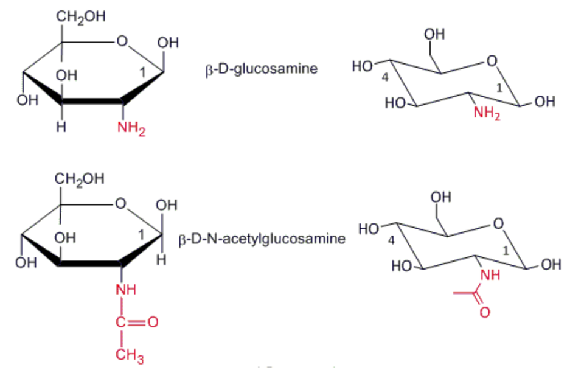

> [!define] المشتق الآزوتي للسكر (السكر الأميني)
> سكر أحادي **استُبدلت فيه زمرة الهيدروكسيل OH (غالباً على C2) بزمرة أمين NH~2~**، مثل الغلوكوزأمين. وإذا اتحدت زمرة الأمين مع حمض الخل أصبحت **NH–CO–CH~3~** وسمي المركب **N-أسيتيل** غلوكوزأمين.

> [!explain] N-أسيتيل-D-غلوكوزأمين
> كيف نكتبها: 1) نرسم حلقة الغلوكوز (هاورث) كما هي. 2) نمسح **OH على C2** ونكتب مكانها **NH~2~** ← هذا **غلوكوزأمين**. 3) نضيف إلى الآزوت مجموعة أسيتيل: **NH–C(=O)–CH~3~** ← هذا **N-أسيتيل غلوكوزأمين**. الحرف **N** في الاسم يعني أن الأسيتيل مرتبط **بالآزوت** لا بالأكسجين.
> لماذا: إدخال الآزوت يغيّر خواص السكر: يصبح جزءاً من سلاسل طويلة **لزجة ومحبة للماء** تملأ الفراغات بين الخلايا وتليّن المفاصل.
> من أين: من **الأمونيا (NH~3~)** في الجسم تأتي زمرة الأمين، ومن **حمض الخل (الأسيتيل-CoA في الجسم)** تأتي مجموعة الأسيتيل. والكلمة "أسيتيل" نفسها من *acetum* أي الخل.
> كيف تحدث: يتفاعل NH~2~ مع حمض الخل فيخرج جزيء ماء وتتشكل **رابطة أميدية** (–NH–CO–)، كما في المعادلة تحت.

$$ R–NH~2~ + CH~3~COOH → R–NH–CO–CH~3~ + H~2~O

## حمض الهيالورونيك (Hyaluronic acid) {ص 2}
يتكون من **N-أسيتيل-D-غلوكوزأمين** متحد مع **غلوكورونات** (أي غلوكوز **متأكسد على الكربون 6** فصار COOH، ثم **نُزع H من COOH** فصار COO^−^)، برابطة من نوع **β(1→3)**. {ص 2}

حمض الهيالورونيك والهيبارين والكوندرويتين تسمى **السكريات المتعددة المخاطية** (Mucopolysaccharides)، كما ذكّر الدكتور في الجزء الثاني من المحاضرة.

هو **السائل المزلّق بين المفاصل** (مثلاً في الركبة)، ويوضع في **كريمات الوجه كمرطّب**. ويوجد في الجسم **إنزيم الهيالورونيداز** (Hyaluronidase) الذي **يحطّم** حمض الهيالورونيك، فإذا اختلّ هذا السائل (لأسباب فيروسية أو غيرها) قد يحدث **التهاب مفاصل**.

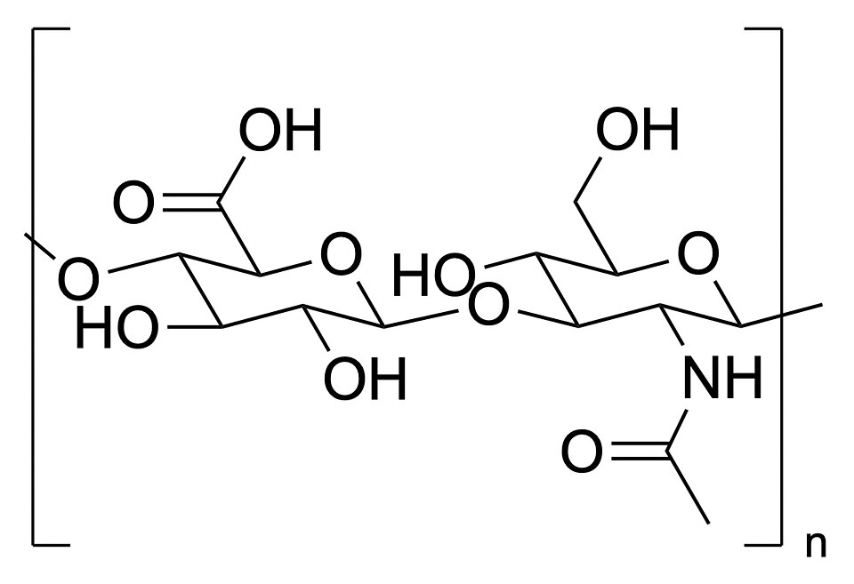

> [!explain] غلوكورونات / حمض الغلوكورونيك
> كيف نكتبها: نرسم الغلوكوز ونغيّر **CH~2~OH (الكربون 6)** إلى **COOH**. إذا كتبنا **COO^−^** (بعد نزع H) نسميه **غلوكورونات**.
> لماذا: الكربون 6 هو الكحول الأولي الوحيد في الحلقة، فهو الذي يتأكسد إلى حمض كربوكسيلي دون أن تنفتح الحلقة.
> من أين: هذا هو حمض **اليورونيك** الذي أخذناه في الأكسدة (أكسدة C6). وبالقياس: من المانوز ← **مانورونيك**، ومن الغالاكتوز ← **غالاكتورونيك**، ومن الإيدوز ← **إيدورونيك**.

> [!note] في المراجع: الوحدة المتكررة في حمض الهيالورونيك هي **غلوكورونيك β(1→3) N-أسيتيل غلوكوزأمين**، وهذه الوحدات ترتبط ببعضها برابطة **β(1→4)**. فالسلسلة تتناوب بين (1→3) و(1→4). الملخص ذكر β(1→3) فقط، وهي الرابطة داخل الوحدة.

## الهيبارين (Heparin) {ص 2}
**مضاد تخثر** (يمنع تجلط الدم). يتألف من **مشتقات كبريتية** (فيها زمر SO~3~^−^) من **حمض الإيدورونيك** متحدة مع **N-أسيتيل-D-غلوكوزأمين**. {ص 2}

> [!note] حمض الإيدورونيك هو حمض اليورونيك المشتق من سكر **الإيدوز**، ويحوي الهيبارين معه أيضاً كمية أقل من **حمض الغلوكورونيك**. وفي المراجع تكون أغلب وحدات الغلوكوزأمين في الهيبارين **N-سلفات** (NH–SO~3~^−^) وبعضها N-أسيتيل. أما **الكوندرويتين** فيتألف من **غلوكورونيك + N-أسيتيل غالاكتوزأمين** (مكبرت)، وهنا يأتي دور **الغالاكتوزأمين** المذكور في الملخص.

> [!doctor] لمعرفة من أين يأتي الإيدورونيك، طلب الدكتور من الطالبات **تسميع سلسلة الألدوهكسوزات D غيباً** في الصف ("حفظانينها؟"). احفظها بالترتيب.

| الترتيب | السكر (D) | بالإنجليزية |
| 1 | ألوز | Allose |
| 2 | ألتروز | Altrose |
| 3 | **غلوكوز** | Glucose |
| 4 | **مانوز** | Mannose |
| 5 | غولوز | Gulose |
| 6 | **إيدوز** | Idose |
| 7 | **غالاكتوز** | Galactose |
| 8 | تالوز | Talose |

> [!tip] جملة الحفظ الإنجليزية المشهورة: **"All Altruists Gladly Make Gum In Gallon Tanks"**: أول حرف من كل كلمة = Allose, Altrose, Glucose, Mannose, Gulose, Idose, Galactose, Talose. (الشجرة الكاملة مرسومة في ملف المحاضرة 1.)

# الزوج الأنوميري وعدد المماكبات

## كيف تنغلق الحلقة ومن أين تأتي α و β
في الغلوكوز، **زمرة الألدهيد (C1)** تتفاعل مع **زمرة OH على الكربون 5**، لأنه **الأقرب إليها فراغياً**، فتتشكل حلقة سداسية وتظهر على C1 زمرة OH جديدة هي **الهيمي أسيتال**. هذه الـ OH الجديدة لها احتمالان:
- **للأسفل** (في صيغة هاورث) ← **α**.
- **للأعلى** ← **β**.

> [!define] الزوج الأنوميري (Anomers)
> مماكبان ضوئيان **يكون الاختلاف بينهما حول الذرة الأنوميرية (الوظيفية)** فقط، أي حول C1 في الألدوز. مثل **α-D-غلوكوز و β-D-غلوكوز**. {ص 1}

> [!explain] الذرة الأنوميرية
> كيف نكتبها: في حلقة هاورث، الذرة الأنوميرية هي **الكربون المجاور لأكسجين الحلقة من اليمين** (C1)، وعليها نرسم OH **تحت** (α) أو **فوق** (β).
> لماذا: قبل الانغلاق كان C1 جزءاً من C=O (مستوٍ، غير متناظر). بعد الانغلاق يصبح مرتبطاً بأربع مجموعات مختلفة (أكسجين الحلقة، وزمرة الهيدروكسيل، والهيدروجين، والكربون الثاني) فيصير **غير متناظر جديداً**، وله صورتان.
> من أين: الاسم من اليونانية *ano* = "فوق/الأعلى"، لأنها الذرة التي كانت **أعلى** السلسلة (رأس السلسلة، الزمرة الوظيفية).
> كيف تحدث: هجوم أكسجين OH (على C5) على كربون الكربونيل يمكن أن يأتي من **أحد وجهي** الكربونيل، فينتج α من وجه و β من الوجه الآخر.

## عدد المماكبات الضوئية: القانون 2^n^ {ص 1}

$$ عدد المماكبات = 2^n^

حيث **n = عدد ذرات الكربون غير المتناظرة**. {ص 1}

> [!problem] كم عدد المماكبات الضوئية للغلوكوز (بالشكل المفتوح)؟
> المعطيات: الغلوكوز CHO–(CHOH)~4~–CH~2~OH
> القانون: عدد المماكبات = 2^n^
> الحل: نبحث عن ذرات الكربون المرتبطة بأربع مجموعات مختلفة.
> الخطوة 1: الكربون الأول (زمرة **CHO**) ليس غير متناظر، لأنه مرتبط بالأكسجين برابطة مضاعفة.
> الخطوة 2: الكربون السادس (زمرة **CH~2~OH**) ليس غير متناظر، لأن عليه ذرتي هيدروجين.
> الخطوة 3: تبقى أربع ذرات غير متناظرة (الكربون 2 و 3 و 4 و 5)، أي **n = 4**.
> الخطوة 4: نعوّض في القانون: 2^4^ = 2 × 2 × 2 × 2 = 16
> النتيجة: **16 مماكباً** (8 من السلسلة D و 8 من السلسلة L)، والغلوكوز أحدها. {ص 1}

> [!problem] (تطبيق على القانون نفسه) كم عدد المماكبات للفركتوز وللريبوز بالشكل المفتوح؟
> المعطيات: الفركتوز CH~2~OH–CO–(CHOH)~3~–CH~2~OH، الريبوز CHO–(CHOH)~3~–CH~2~OH
> القانون: عدد المماكبات = 2^n^
> الخطوة 1: في الفركتوز الكربون الثاني كيتون (ليس غير متناظر)، فتبقى الذرات 3 و 4 و 5، أي **n = 3**.
> الخطوة 2: في الريبوز الذرات غير المتناظرة هي 2 و 3 و 4، أي **n = 3**.
> الخطوة 3: نعوّض: 2^3^ = 2 × 2 × 2 = 8
> النتيجة: **8 مماكبات** لكل منهما.

> [!explain] القانون 2^n^
> كيف نكتبها: عدّ ذرات الكربون التي عليها **أربع مجموعات مختلفة** فقط (لا تعدّ CHO ولا C=O ولا CH~2~OH الطرفي)، ثم ارفع 2 لهذا العدد.
> لماذا: كل ذرة غير متناظرة لها **ترتيبان فقط** (OH يمين أو يسار)، وكل ذرة مستقلة عن الأخرى.
> من أين: من قاعدة العدّ: إذا كان لكل ذرة خياران، ولدينا n ذرة، فعدد الاحتمالات هو حاصل ضرب 2 بنفسه n مرة، أي 2^n^. للغلوكوز أربع ذرات، فالاحتمالات 2 × 2 × 2 × 2 = 16.
> كيف تحدث: في الامتحان: اكتب الصيغة المفتوحة، ضع نجمة (*) على كل كربون غير متناظر، عدّ النجوم، طبّق القانون.

> [!note] في **الشكل الحلقي** يصبح C1 غير متناظر أيضاً (الذرة الأنوميرية)، فيصير للغلوكوز الحلقي 5 ذرات غير متناظرة و 2^5^ = 32 احتمالاً، وهذا يشمل α و β لكل واحد من الـ 16. الملخص يقصد الشكل المفتوح (16).

# الغليكوزيدات: الرابطة الغليكوزيدية والأغليكون

هذا **أهم جزء في المحاضرة**: كرّره الدكتور عشرات المرات وسأل عنه كل طالبة.

## التعريف {ص 1}
**تفاعل مجموعة الهيمي أسيتال** في السكريات الأحادية **مع مجموعة غولية (كحولية)**:
- إذا كان الكحول **ذو أساس سكري** (أي OH من سكر آخر) ← تتشكل **رابطة غليكوزيدية** (Glycosidic bond). {ص 1}
- إذا كان الكحول **ذو أساس غير سكري** ← يسمى هذا الكحول **أغليكون** (Aglycone)، ويسمى المركب كله **غليكوزيد**. {ص 1}

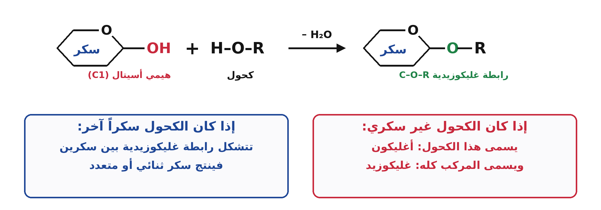

$$ R′–OH + HO–R → R′–O–R + H~2~O

حيث **R′–OH** هو السكر (و OH هي زمرة الهيمي أسيتال على الكربون 1)، و **HO–R** هو الكحول.

> [!define] الأغليكون (Aglycone)
> **كحول لاسكري** (ليس من سكر) **يتحد مع مجموعة الهيمي أسيتال في السكر**، فيتشكل غليكوزيد. أي: الغليكوزيد = **سكر + أغليكون**.

> [!define] الرابطة الغليكوزيدية
> الرابطة التي تتشكل بين **مجموعة الهيمي أسيتال** في سكر أحادي و**مجموعة كحولية من سكر آخر** (C–O–C)، وبها ترتبط السكريات لتعطي ثنائيات ومتعددات. {ص 1}

> [!doctor] كرّر الدكتور السؤال "ما هو الأغليكون؟" أكثر من 10 مرات، وقال: "إذا كان الكحول من سكر بنسميه غليكوزيد (رابطة غليكوزيدية)... أما إذا كان هذا الكحول ما من سكر اسمه **أغليكون**". **احفظ هذا الفرق حرفياً.**

> [!exam] عرّف الأغليكون. وما الفرق بين الأغليكون والرابطة الغليكوزيدية؟
> الجواب: الأغليكون **كحول لاسكري يتحد مع الهيمي أسيتال في السكر**. أما إذا كان الكحول **من سكر آخر** فالرابطة الناتجة **رابطة غليكوزيدية** (بين سكرين).

> [!explain] الغليكوزيد
> كيف نكتبها: ارسم السكر حلقة، وعلى C1 بدل **OH** اكتب **O–R**، حيث R هو الأغليكون (أو سكر آخر). الأكسجين في الوسط هو **جسر** الرابطة.
> لماذا: OH الهيمي أسيتال على C1 **أكثر نشاطاً** من باقي زمر OH في السكر (لأن C1 مرتبط بأكسجينين: أكسجين الحلقة و OH)، فهو الذي يتفاعل مع الكحولات.
> من أين: الاسم من *glycos* (سكر) + *ide*. والأغليكون: البادئة *a-* تعني "لا"، أي **"الجزء اللاسكري"**.
> كيف تحدث: يتفاعل OH الهيمي أسيتال مع OH الكحول ويخرج **جزيء ماء** (تكاثف). والعكس: **الحلمهة** (إضافة ماء، بإنزيم أو حمض) تفك الغليكوزيد إلى سكر + أغليكون، وهذا ما يحدث في الجسم فيتحرر الأغليكون ويعمل (دواء أو سم).

## أمثلة الأغليكون {ص 1}

### 1. الساليسين (Salicin)
يوجد في **الصفصاف**، ويتحول في الجسم إلى **حمض الساليسيليك** (Salicylic acid) الذي هو **مسكّن، خافض حرارة، ومضاد التهاب**. {ص 1} وقال الدكتور إنه أصل **الأسبرين** ومشتقاته، وإن لهذه المركبات **تداخلات دوائية**.

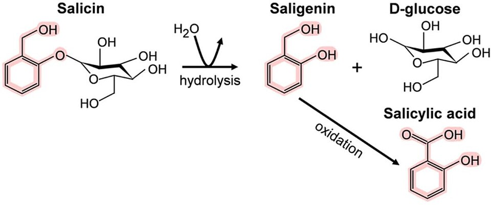

$$ C~13~H~18~O~7~ + H~2~O → C~7~H~8~O~2~ + C~6~H~12~O~6~

بالكلمات: **ساليسين + ماء ← ساليجينين (الأغليكون) + غلوكوز**.

> [!explain] لماذا الساليسين "أغليكون + سكر"؟
> كيف نكتبها: حلقة غلوكوز، وعلى C1 أكسجين مرتبط بحلقة بنزن فيها CH~2~OH. الجزء البنزيني هو **الأغليكون (الساليجينين)**.
> لماذا: لأن الكحول الذي ارتبط بالسكر هنا **ليس سكراً** بل كحول عطري (فينولي).
> من أين: من لحاء شجرة الصفصاف (*Salix*)، ومنه جاء اسم "ساليسين" و"ساليسيليك".
> كيف تحدث: في الأمعاء والكبد تُحلمه الرابطة ثم يتأكسد الأغليكون إلى حمض الساليسيليك الفعّال.

### 2. الأنثراكينون (Anthraquinone)
يوجد في **الصبّار**، ويتحول في الجسم إلى مادة **مليّنة للأمعاء** (Laxative). {ص 1}

### 3. الكومارين (Coumarin)
إذا كان الأغليكون هو **الكومارين** واتحد مع سكر يعطي **الأبترين** (Apterin)، الذي **يوصف لتوسيع الشرايين التاجية** لأنه **يوقف (يحصر) قنوات الكالسيوم**. {ص 1}

> [!note] الملخص كتب اسم الدواء بخط غير واضح، والدكتور قال **"الأبترين"** مرتين [00:22:23]. وبالبحث في المراجع: **الأبترين (Apterin)** فعلاً **غليكوزيد كوماريني** (فورانوكومارين مرتبط بالغلوكوز) يُستخرج من جذور نباتات **الأنجليكا** (Angelica)، ويُذكر أنه **يوسّع الشرايين التاجية ويحصر قنوات الكالسيوم**، أي ما قاله الدكتور تماماً.

### 4. الغليكوزيدات السيانية: الأميغدالين (Amygdalin)
**الأميغدالين** موجود في **اللوز المر** و**بذور المشمش المرّة** و**بذور التفاح والكرز**، وهو سبب **طعمها المر**. يتركب من: **فينيل + سكر الغلوكوز + سيانيد الهيدروجين HCN**، والسكر فيه يسمى **الجنتيوبيوز** (Gentiobiose). وعند **الحلمهة** يعطي **البنزالدهيد + HCN**. {ص 1}

مثال الدكتور من البيت: بذور المشمش المرّة توضع في الماء، وإذا دخلت المطبخ تشم **رائحة لاذعة** هي رائحة السيانيد. و**شراب اللوز** فيه هذه النكهة (البنزالدهيد) لكن بتركيز خفيف جداً.

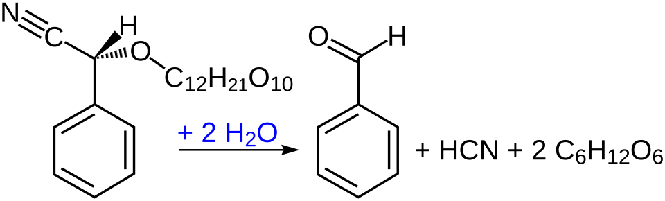

$$ C~20~H~27~NO~11~ + 2 H~2~O → C~7~H~6~O + HCN + 2 C~6~H~12~O~6~

> [!note] **تصحيح لعبارة الملخص** "يستخرج الأميغدالين من سكر الجنتيوبيوز (فينيل غلايكوليك نتريل)": الصحيح أن الأميغدالين **غليكوزيد** مؤلف من جزأين: **الجنتيوبيوز** (سكر ثنائي = غلوكوز + غلوكوز برابطة β(1→6)) و**الأغليكون** الذي اسمه **فينيل غلايكوليك نتريل** (ماندلونتريل، أي بنزالدهيد مرتبط بـ CN). وتحققتُ من موازنة المعادلة أعلاه: الكربون 20 = 7 + 1 + 12، والهيدروجين 27 + 4 = 6 + 1 + 24 = 31.

> [!exam] من أين يأتي الطعم المر في اللوز المر وبذور المشمش؟ ولماذا يمكن أن تكون سامة؟
> الجواب: من **الأميغدالين** (غليكوزيد سياني). عند أكلها **يُحلمه** فيتحرر **البنزالدهيد** (الطعم والرائحة) و**سيانيد الهيدروجين HCN** وهو **سام جداً**.

> [!why] اللوز المر وبذور المشمش المرة **سامة إذا أُكلت بكمية كبيرة**.
> لأن: فيها الأميغدالين الذي يتحلمه في الجسم ويحرر **HCN**، والسيانيد يوقف تنفس الخلايا. (كل 1 غ من الأميغدالين يمكن أن يحرر نحو 59 ملغ من HCN، حسب النسبة 27 ÷ 457.)

> [!explain] الأميغدالين
> كيف نكتبها: ابدأ بحلقة البنزن، عليها كربون يحمل **CN** و**H** و**O**، وهذا الأكسجين يربط مع **سكرين** (غلوكوز–غلوكوز). الكتابة المختصرة: **أغليكون (C~6~H~5~–CH(CN)–) + جنتيوبيوز**.
> لماذا: هو "سلاح دفاعي" للنبات: الحيوان الذي يمضغ البذرة يكسر الخلايا فيلتقي الأميغدالين بالإنزيم ويتحرر السيانيد.
> من أين: الاسم من اليونانية *amygdale* = **اللوز**.
> كيف تحدث: خطوتان: 1) إنزيم يفصل الغلوكوز ← يبقى ماندلونتريل. 2) الماندلونتريل يتفكك إلى **بنزالدهيد + HCN**.

### 5. الغليكوزيدات الفينولية {ص 2}
**النواة الفينولية هي الأغليكون**، تتحد مع مركبات (سكر). أمثلة: {ص 2}
- مشتقات **البيريميدين** الموجودة في **الفيسين (Vicine) والكونفيسين (Convicine)** في **الفول**، وتسبب **التفوّل** (Favism) وهو **انحلال الدم**.
- **الأربوتين** (Arbutin) في **عنب الدب** (Bearberry)، ويستخدم **كمطهّر للمجاري البولية**.

> [!doctor] قال الدكتور: "**أول كلمة نحفظها: النواة الفينولية هي الأغليكون**"، وكرّرها.

> [!note] الأربوتين = **هيدروكينون (فينول) + غلوكوز**، فهو فينولي فعلاً. أما الفيسين والكونفيسين فالأغليكون فيهما (الديفيسين والإيزويوراميل) من مشتقات **البيريميدين** وليس فينولاً بالمعنى الدقيق، لكن الدكتور والملخص وضعاهما هنا. والتفوّل يصيب من عندهم **نقص إنزيم G6PD** في كريات الدم الحمراء.

### 6. الغليكوزيدات الستيرولية {ص 2}
**الستيرول** نواته أربع حلقات: **3 حلقات سداسية + حلقة خماسية**، نسميها بالأحرف **A** و **B** و **C** و **D**، وعلى الحلقة A زمرة **OH** (لذلك هو **كحول**، وبالتالي يمكن أن يكون **أغليكوناً**). وحسب الجذر **R** قد يكون: **كوليسترول، أو فيتامين D، أو هرمون (جنسي)، أو أملاح صفراوية**. {ص 2}

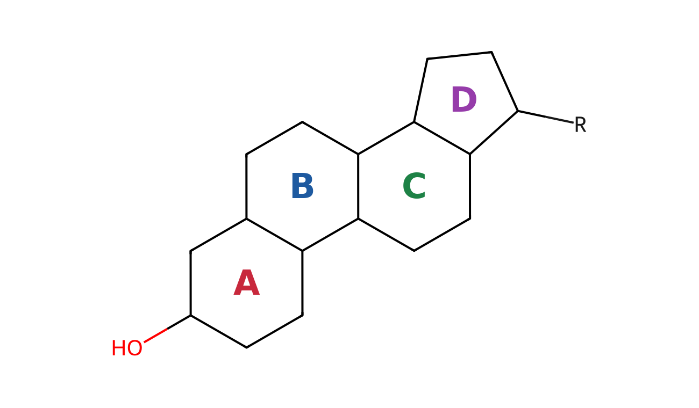

> [!explain] نواة الستيرول
> كيف نكتبها: 1) ارسم ثلاثة **سداسيات متلاصقة** بشكل درج (A ثم B ثم C). 2) ألصق **خماسياً** (D) بالسداسي الأخير. 3) اكتب **OH** على الطرف السفلي للحلقة A (الكربون 3). 4) اكتب **R** على الحلقة D (الكربون 17). 5) اكتب الحروف A B C D داخل الحلقات.
> لماذا: وجود **OH** يجعله **كحولاً** (ومنه الاسم: ستير**ول**، اللاحقة -ol = كحول)، والكحول اللاسكري هو ما يتحد مع السكر ليعطي غليكوزيداً.
> من أين: كل الستيرويدات في الجسم تُصنَّع من **الكوليسترول**، لذلك تشترك في هذه النواة، ويختلف فقط **R** والتفاصيل الصغيرة. مثال الدكتور: فيتامين D الفعّال هو **1,25-ثنائي هيدروكسي كولي كالسيفيرول**.
> كيف تحدث: عندما يتحد OH الحلقة A مع الهيمي أسيتال في سكر يتشكل **غليكوزيد ستيرولي** مثل السولانين والديجوكسين.

- **السولانين** (Solanine): **مادة سامة** توجد في **البطاطا المبرعمة (المنبتة) والخضراء**. وهو **ستيرول متحد مع سكر**. {ص 2} قال الدكتور: البطاطا التي صار عليها **لون أخضر** لا نأكلها.
- **الديجوكسين** (Digoxin): **مركب هام لعمل القلب** (أدوية القلب). {ص 2}

> [!why] لا نأكل البطاطا التي صار لونها أخضر أو التي برعمت.
> لأن: تتراكم فيها مادة **السولانين** السامة (غليكوزيد ستيرولي) تحت القشرة وفي البراعم، واللون الأخضر علامة على ذلك.

> [!note] الدكتور قال "ديجيتونين" ثم "ديجوكسين... هذه تبع القلب" [00:47:08]، والملخص كتب "ديجوتونين". **دواء القلب هو الديجوكسين** (ومعه الديجيتوكسين) من نبات **الديجيتال** (قمعية)، والأغليكون فيه ستيرويدي. أما **الديجيتونين** فمن النبات نفسه لكنه **صابونين** وليس دواءً للقلب. في الامتحان اكتب: **الديجوكسين مركب هام لعمل القلب**.

### 7. الصابونينات (Saponins) {ص 2}
- **تعطي رغوة** (مثل الرغوة التي تتشكل عند صب شراب **السوس**).
- **تسبب انحلال خلايا الدم الحمراء**.
- **مقشّعة** و**رافعة للضغط**، كما في **السوس**. {ص 2}

تركيبها: **كحول لاسكري (ستيرول) + سكر**. {ص 2}

> [!doctor] قال الدكتور: "**عرّف السابونينات... تستطيع تقوليها بثلاث كلمات: كحول لاسكري هو الستيرول متحد مع سكر، تاخدي العلامة التامة**".

> [!exam] عرّف السابونينات.
> الجواب: **كحول لاسكري (ستيرول) متحد مع سكر**. وتعطي رغوة، وتحل كريات الدم الحمراء، ورافعة للضغط (السوس).

> [!note] السوس يرفع الضغط لأن الصابونين فيه (الغليسيريزين) يجعل الجسم **يحتفظ بالصوديوم والماء**. لذلك يجب أن ينتبه **مريض ارتفاع الضغط** من الإكثار من شراب السوس (مثلاً في رمضان). وفي المراجع: الأغليكون في بعض الصابونينات (ومنها صابونين السوس) **تربيني** وليس ستيرولاً، لكن الفكرة واحدة: كحول لاسكري + سكر.

### 8. المضادات الحيوية {ص 2}
**الستربتومايسين، الجنتامايسين** (وذكر الدكتور أيضاً **الكانامايسين والنيومايسين**): هي من **الأمينوغليكوزيدات**، وقال الدكتور والملخص: هي **أغليكون (ستيرول) + سكر**. {ص 2}

> [!note] **تصحيح علمي:** الأمينوغليكوزيدات فعلاً **غليكوزيدات** (أغليكون + سكريات أمينية)، لكن الأغليكون فيها ليس ستيرولاً، بل حلقة سداسية أمينية اسمها **أمينو سيكليتول** (الستربتيدين في الستربتومايسين، و 2-ديوكسي ستربتامين في الجنتامايسين). في الامتحان اكتب الفكرة الأساسية: **أغليكون + سكر**.

### 9. الغليكوزيدات المحلّية: الستيفيا (Stevia) {ص 2}
تحتوي على **الستيفيول** (Steviol) الذي يُستخرج من نبات **الستيفيا** كـ **أغليكون**، يتحد مع **الغلوكوز** فيعطي الغليكوزيد **ستيفيوزيد** (Stevioside)، وهو **أحلى من السكر** بمئات المرات. {ص 2} قال الدكتور: **أحلى من السكر بـ 250 مرة**، فتكفي كمية صغيرة جداً، ويتحمل الحرارة (يوضع على الساخن).

**تستفيد منه البكتيريا النافعة في الأمعاء، لذلك لا يرفع سكر الدم لأنه لا يُمتص.** {ص 2} لذلك هو **مناسب لمرضى السكري**. ونبّه الدكتور: يُستعمل **المستحضر المحضّر** بكمية محددة، لا أوراق النبات مباشرة، لأن النبات نفسه قد يسبب **هبوطاً في الضغط**.

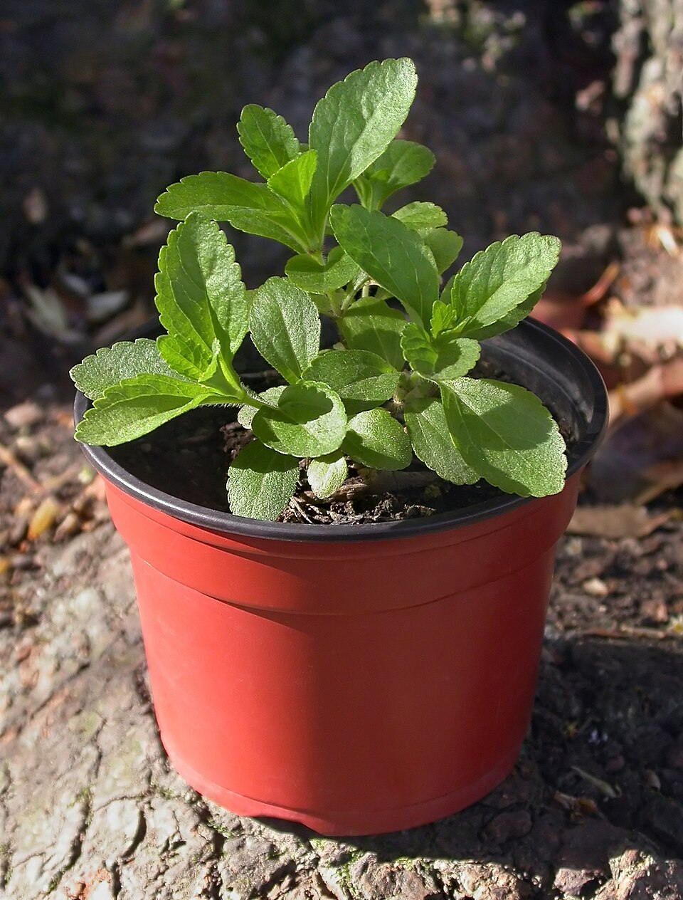

> [!exam] علّل: الستيفيوزيد يحوي سكراً ومع ذلك لا يرفع سكر الدم.
> الجواب: لأنه **لا يُمتص** من الأمعاء الدقيقة، و**تستهلكه البكتيريا النافعة في الأمعاء**، فلا يصل سكر إلى الدم.

> [!note] الرقم في الملخص مكتوب بخط غير واضح، والدكتور قال بالتسجيل **250 مرة** (مرتين، [00:52:56] و[00:54:55]). والمراجع تذكر أن الستيفيوزيد **أحلى من السكروز بنحو 250–300 مرة** (حسب النقاوة وطريقة القياس). في الامتحان اكتب **250 مرة** (رقم الدكتور).

> [!note] الدكتور ذكر أن الستيفيول قد يتحد مع **الغلوكوز أو المانوز أو الرامنوز**. وأن له أبحاثاً على الستيفيا على حيوانات التجربة (خفض سكر الدم وأثبتت الدراسات سلامتها على الكلية).

## جدول الحفظ: أنواع الغليكوزيدات

| النوع | الأغليكون | المثال | أين يوجد | التأثير |
| أغليكون بسيط | ساليجينين | الساليسين | الصفصاف | ← حمض الساليسيليك: مسكن، خافض حرارة، مضاد التهاب |
| أغليكون بسيط | أنثراكينون | (غليكوزيدات الأنثراكينون) | الصبّار | مليّن للأمعاء |
| كوماريني | الكومارين | الأبترين | نباتات | يوسّع الشرايين التاجية، يحصر قنوات الكالسيوم |
| سياني | فينيل غلايكوليك نتريل | الأميغدالين | اللوز المر، بذور المشمش والتفاح والكرز | طعم مر، يحرر HCN السام |
| فينولي | نواة فينولية/بيريميدين | الفيسين والكونفيسين | الفول | التفوّل (انحلال الدم) |
| فينولي | هيدروكينون | الأربوتين | عنب الدب | مطهّر للمجاري البولية |
| ستيرولي | ستيرول | السولانين | البطاطا الخضراء/المبرعمة | سام |
| ستيرولي | ستيرول | الديجوكسين | الديجيتال | مهم لعمل القلب |
| صابونينات | ستيرول | (صابونين السوس) | السوس | رغوة، انحلال دم، مقشّع، رافع للضغط |
| مضادات حيوية | (أمينو سيكليتول) | ستربتومايسين، جنتامايسين | بكتيريا | مضادات حيوية |
| محلّ | الستيفيول | الستيفيوزيد | الستيفيا | أحلى من السكر 250 مرة، لا يرفع سكر الدم |

> [!tip] للحفظ: فكّر بكل غليكوزيد كـ **"سكر + شيء آخر"**، والشيء الآخر هو الذي يعطي التأثير. رتّبها بقصة: **الصفصاف يسكّن الألم، الصبّار يليّن، الكومارين يوسّع الشريان، اللوز المر يسمّم (HCN)، الفول يحل الدم، عنب الدب يطهّر البول، البطاطا الخضراء تسمّم، الديجيتال للقلب، السوس يرغي ويرفع الضغط، الستيفيا تحلّي**.

> [!summary] **الخلاصة:** الهيمي أسيتال (OH على C1) + كحول ← غليكوزيد وماء. إذا كان الكحول سكراً ← رابطة غليكوزيدية. إذا لم يكن سكراً ← اسمه **أغليكون**. والأغليكون هو الذي يعطي التأثير الدوائي أو السام بعد الحلمهة في الجسم.

# السكريات الأحادية في الأغذية

**السكريات الأحادية** لا يمكن تحليلها (لا مائياً ولا إنزيمياً) إلى سكريات أبسط. وتتوزع في الأغذية هكذا: {ص 2}

- **الثلاثية والرباعية** (غليسر ألدهيد، ثنائي هيدروكسي الأسيتون، إريثروز...): **لا توجد بشكل حر** في الغذاء، بل **مرتبطة أو كمركبات وسطية** في الاستقلاب. {ص 2}
- **الخماسية** (ريبوز، زيلوز، أرابينوز...): **كثيرة الانتشار** في الأغذية، لكنها **صعبة التخمر (الهضم) عند الإنسان**. {ص 2} مثال الدكتور: الملفوف يسبب **نفخة**.
- **السداسية**: **D-غلوكوز** و**D-مانوز** (مانان جوز الهند) و**D-غالاكتوز** و**D-فركتوز**. {ص 2}

> [!note] سطر الخماسية في الملخص فيه كلمة مشطوبة ("صعبة ~~الهضم~~ التخمر جزئياً عند الإنسان")، والدكتور قال: "صعبة التخمر أنزيمياً عند الإنسان" [01:06:20]. المعنى: **إنزيمات الإنسان لا تهضمها جيداً**، فتصل للأمعاء الغليظة وتخمّرها البكتيريا (نفخة).

## السكريات السداسية المهمة
- **D-غلوكوز**: سكر **ألدهيدي** سداسي، وهو الأهم.
- **D-مانوز**: يوجد على شكل **مانان** (Mannan) في **جوز الهند** {ص 2}، وذكر الدكتور أيضاً **قشور البرتقال** [01:09:09] (المراجع تؤكد وجود المانوز في قشور البرتقال وبكميات صغيرة حرّاً في البرتقال والتفاح). وهو **إبيمر** للغلوكوز على **الكربون 2**.
- **D-غالاكتوز**: **إبيمر** للغلوكوز على **الكربون 4** (سأل الدكتور عن هذا).
- **D-فركتوز**: سكر **كيتوني** سداسي.

> [!exam] ما الفرق بين الفركتوز والغلوكوز؟ (سؤال سأله الدكتور)
> الجواب: الغلوكوز **ألدهيدي** (CHO على C1) والفركتوز **كيتوني** (C=O على C2)، وكلاهما **سداسي** C~6~H~12~O~6~. الغلوكوز يشكّل حلقة **سداسية** (بيرانوز) والفركتوز حلقة **خماسية** (فورانوز). و**الفركتوز أحلى**.

> [!explain] لماذا حلقة الفركتوز خماسية وحلقة الغلوكوز سداسية؟
> كيف نكتبها: الغلوكوز: الحلقة = C1 إلى C5 + أكسجين = 6 ذرات. الفركتوز: الحلقة = C2 إلى C5 + أكسجين = 5 ذرات، ويبقى C1 و C6 خارجها كـ CH~2~OH.
> لماذا: في الفركتوز الزمرة الوظيفية على **C2** (لا C1)، وهي تتفاعل مع OH على **C5** أيضاً، فالمسافة بينهما أقصر بذرة واحدة، فتنتج حلقة أصغر بذرة.
> من أين: هذا نفس تفاعل الهيمي أسيتال (في الكيتون اسمه هيمي كيتال).

### سلسلة الكيتوزات (سمّعها الدكتور)
ثنائي هيدروكسي الأسيتون (3C) ← **D-إريثرولوز** (4C) ← **D-ريبولوز و D-زيلولوز** (5C) ← **D-بسيكوز، D-فركتوز، D-سوربوز، D-تاغاتوز** (6C).

> [!note] **البسيكوز** (Psicose، ويسمى أيضاً ألولوز): قال الدكتور إن عنده طالب دكتوراه يدرسه، وإنه **مثل الفركتوز لكن أحلى ولا يُمتص**، فهو مناسب لمرضى السكري. في المراجع: حلاوته نحو **70% من حلاوة السكروز**، ويُمتص جزء منه لكنه **لا يُستقلب** ويُطرح مع البول، فسعراته الحرارية **شبه معدومة**.

## الأغذية تختلف بنوع السكر السائد فيها {ص 2}

| الغذاء | السكريات فيه (حسب الدكتور) |
| اللحم | كمية **قليلة جداً** (الغليكوجين يتحول لحمض اللبن بعد الذبح) |
| الحليب | **4–5 غ** لاكتوز (سكر الحليب) في كل 100 مل |
| العسل | نحو **70%** سكريات، أغلبها **فركتوز** |
| الفواكه (مثل التفاح) | السكر السائد **الفركتوز** |
| الطحين، البطاطا | **نشاء** (سكر معقد) |

> [!exam] لماذا تكون كمية السكريات في اللحم قليلة رغم أن العضلة تخزّن الغليكوجين؟
> الجواب: لأن **الغليكوجين** يتحول بعد الذبح (تحلل لاهوائي) إلى **حمض اللبن**. لذلك نترك الذبيحة نحو **يوم إلى يوم ونصف** قبل أكلها، فيتحول الغليكوجين إلى حمض اللبن، والحمض يجعل **اللحم طرياً**.

> [!explain] تحوّل الغليكوجين إلى حمض اللبن في اللحم
> كيف نكتبها: غليكوجين ← غلوكوز ← (تحلل سكري لاهوائي) ← **حمض اللبن** (C~3~H~6~O~3~).
> لماذا: بعد الذبح **يتوقف وصول الأكسجين** إلى العضلة، فلا يستطيع الجسم حرق الغلوكوز حتى النهاية (هوائياً)، فيتوقف عند **حمض اللبن** (لاهوائياً) كما يحدث في عضلاتك عند الجهد الشديد.
> من أين: هذا هو التحلل السكري اللاهوائي الذي تدرسه في الكيمياء الحيوية.
> كيف تحدث: يتراكم حمض اللبن فينخفض الـ pH، فتحدث **دنترة (تمسّخ)** لبروتينات العضلة وتنشط إنزيمات تقطّع البروتين، فيصير اللحم **طرياً**.

> [!note] **الدنترة** (Denaturation) كما شرحها الدكتور: تخلخل **البنية الرابعية والثالثية والثانوية** للبروتين، أما **البنية الأولية** (تسلسل الأحماض الأمينية) فلا تتأثر. مثال: **البيضة المسلوقة** (دنترة). أما إذا تكسّرت الأحماض الأمينية نفسها (مثل **حرق الشعر** وخروج رائحة الأحماض الأمينية الكبريتية) فهذا **تحلّل** وليس دنترة.

## نوع السكر وتصميم الوجبات
عند **تصميم وجبة غذائية** لمريض، ننظر إلى **السكر السائد** في الغذاء:
- إذا كان **سكراً بسيطاً** (يرفع سكر الدم بسرعة) ← **لا يُعطى لمريض السكري**.
- إذا كان **سكراً معقداً** (نشاء، ألياف) ← **أفضل لمريض السكري**.

> [!note] **المؤشر السكري** (Glycemic Index) شرحه الدكتور عند توزيع حلقات البحث: هو **سرعة ارتفاع سكر الدم** بعد غذاء ما مقارنة بالغلوكوز (= 100). إذا كان مؤشر غذاء 40 مثلاً فالسكر يُمتص، لكن **أبطأ**، وهذا جيد لمريض السكري. مثاله: كأس **الكريفون** وكأس **البرتقال** كلاهما يرفع السكر، لكن البرتقال يرفعه **أسرع**، لأن الكريفون **يبطئ امتصاص السكر**. ومثله بسكويت "دايجستيف" الذي فيه **ألياف** تبطئ الامتصاص.

# السكريات المركّبة: الثنائية والثلاثية

الروابط الثلاث من الملخص {ص 2}، والتفاصيل الباقية من شرح الدكتور:

| السكر | يتألف من | الرابطة | ملاحظة |
| **المالتوز** (سكر الشعير) | غلوكوز + غلوكوز | **α(1→4)** | ينتج من التحلل المائي للنشاء |
| **اللاكتوز** (سكر الحليب) | غالاكتوز + غلوكوز | **β(1→4)** | |
| **السكروز** (سكر القصب) | غلوكوز + فركتوز | **α1→β2** | غير مُرجِع |

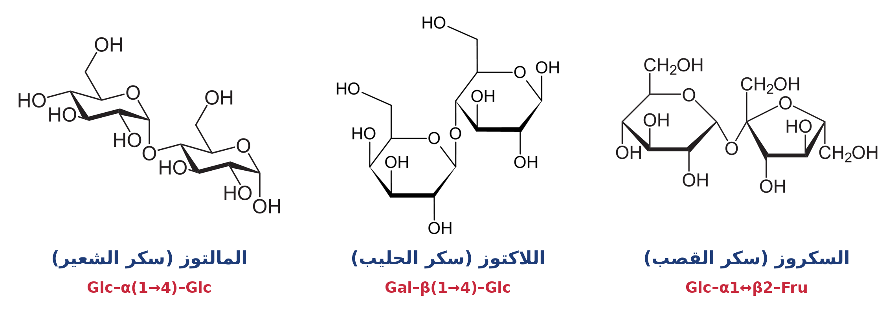

> [!explain] كيف نقرأ رمز الرابطة α(1→4)؟
> كيف نكتبها: **الحرف** (α أو β) = اتجاه OH على **C1 للسكر الأول** (تحت = α، فوق = β). **الرقم الأول** = ذرة السكر الأول التي دخلت في الرابطة (دائماً 1 للألدوز). **الرقم الثاني** = ذرة السكر الثاني (4 أو 6 أو 2...).
> لماذا: لأن نوع الرابطة يحدد هل يهضمها الإنسان أم لا: إنزيمات الإنسان تكسر **α(1→4)** (نشاء، مالتوز) ولا تكسر **β(1→4)** في السيللوز.
> من أين: في السكروز كتبنا **α1→β2** لأن الرابطة بين **C1 للغلوكوز (α)** و**C2 للفركتوز (β)**، أي بين **الذرتين الأنوميريتين** معاً.
> كيف تحدث: كل رابطة تتشكل بخروج **جزيء ماء**: مثلاً غلوكوز + غلوكوز ← مالتوز + ماء (المعادلة تحت).

$$ 2 C~6~H~12~O~6~ → C~12~H~22~O~11~ + H~2~O

> [!exam] في رسم المالتوز واللاكتوز، لماذا رسم الدكتور OH على C1 للسكر الثاني **أفقياً** (لا α ولا β)؟
> الجواب: لأن هذا الطرف **حر (هيمي أسيتال حر)** فيحدث له **تدوير متبدّل**: يمكن أن يكون α ويمكن أن يكون β، فلا نحدده.

> [!why] السكروز **سكر غير مُرجِع** ولا يحدث له تدوير متبدّل.
> لأن: رابطته **α1→β2** تربط **الذرتين الأنوميريتين** (C1 للغلوكوز و C2 للفركتوز) معاً، فلا تبقى زمرة هيمي أسيتال حرة تنفتح وتتأكسد.

> [!remember] التدوير المتبدّل كما أعاده الدكتور: الغلوكوز المبلوَر من **الماء** = **α** (زاوية دورانه **+113°**)، والمبلوَر من **حمض الخل** = **β** (زاويته **+19°**). إذا تُرك كل منهما فترة يصل إلى **52.7°**، وعند التوازن **⅓ α و ⅔ β**.

> [!note] ملف المحاضرة 1 (من الملخص) كتب أن β يُبلوَر من **الكحول**. الدكتور قال اليوم **حمض الخل**، والمراجع تؤيد ذلك (β-D-غلوكوز يُبلوَر من **حمض الخل الساخن** أو البيريدين). اعتمد **حمض الخل**.

## الرافينوز (Raffinose): سكر ثلاثي {ص 2}
يتألف من **غلوكوز + فركتوز + غالاكتوز**، ويوجد في **الملفوف والقرنبيط** {ص 2} و**البقوليات والبروكلي**. الروابط: **α(1→6)** بين الغالاكتوز والغلوكوز، و**α1→β2** بين الغلوكوز والفركتوز، أي أن **الرافينوز = غالاكتوز + سكروز**.

يحتاج هضمه إلى إنزيم **الغالاكتوزيداز**، و**هذا الإنزيم لا يوجد عند الإنسان**، فيصل الرافينوز للأمعاء الغليظة حيث **يتخمّر ويعطي غاز CO~2~ والميتان**. {ص 2}

> [!exam] علّل: أكل الملفوف أو القرنبيط أو البقوليات يسبب **نفخة** (غازات).
> الجواب: لأنها تحوي **الرافينوز**، والإنسان **لا يملك إنزيم الغالاكتوزيداز** لهضمه، فتخمّره بكتيريا الأمعاء وتنتج **CO~2~ والميتان**.

> [!note] اسم الإنزيم الدقيق **α-غالاكتوزيداز** (لأن رابطة الغالاكتوز في الرافينوز من نوع α). وهو موجود كدواء/مكمّل يؤخذ قبل أكل البقوليات لتقليل الغازات.

# الدكسترينات والسيكلودكسترينات

## الدكسترينات (Dextrins)
**الدكسترين** هو **ناتج التحلل المائي الجزئي للنشاء**: قطع من سلسلة النشاء أقصر منه. يتشكل عندما يتحلل النشاء بإنزيم **الأميلاز** (مثلاً في الفم عند مضغ الخبز)، أو بالحرارة الشديدة (مثل **تحميص** الخبز أو النشاء). وهو **أحلى من النشاء**، و**مع اليود لا يعطي اللون الأزرق** بل يتغير اللون.

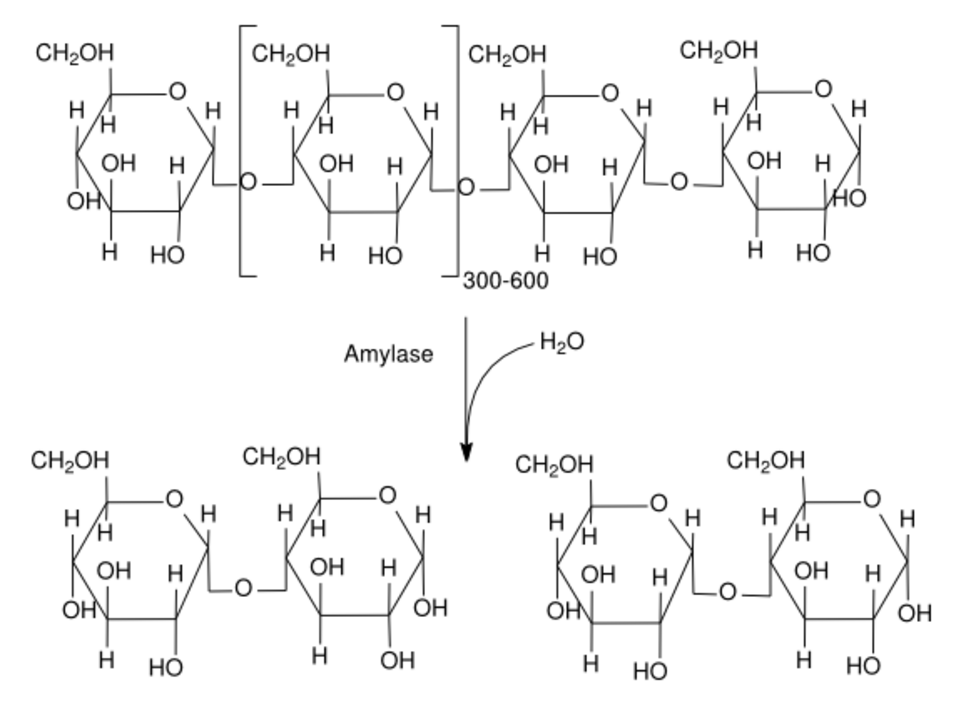

## السيكلودكسترينات (Cyclodextrins) {ص 3}
تتألف من **6–12 جزيئة من الغلوكوز** مرتبطة على شكل **حلقة**. نحصل عليها بواسطة **إنزيم سيكلومالتودكسترين** (من بكتيريا *Bacillus*). {ص 3}

أنواعها: **α، β، γ** {ص 3}، وهي: **α = 6** وحدات غلوكوز، **β = 7**، **γ = 8**.

**استعمالاتها:** {ص 3}
- **مُحلٍّ خفيف**.
- **تثبيت الفيتامينات والمواد العطرية**.
- **تحميل المواد المرّة** (تغطية طعمها، مثلاً المادة الفعالة المرة في الدواء).
- **مادة حاملة للمواد الفعالة في الأدوية**.

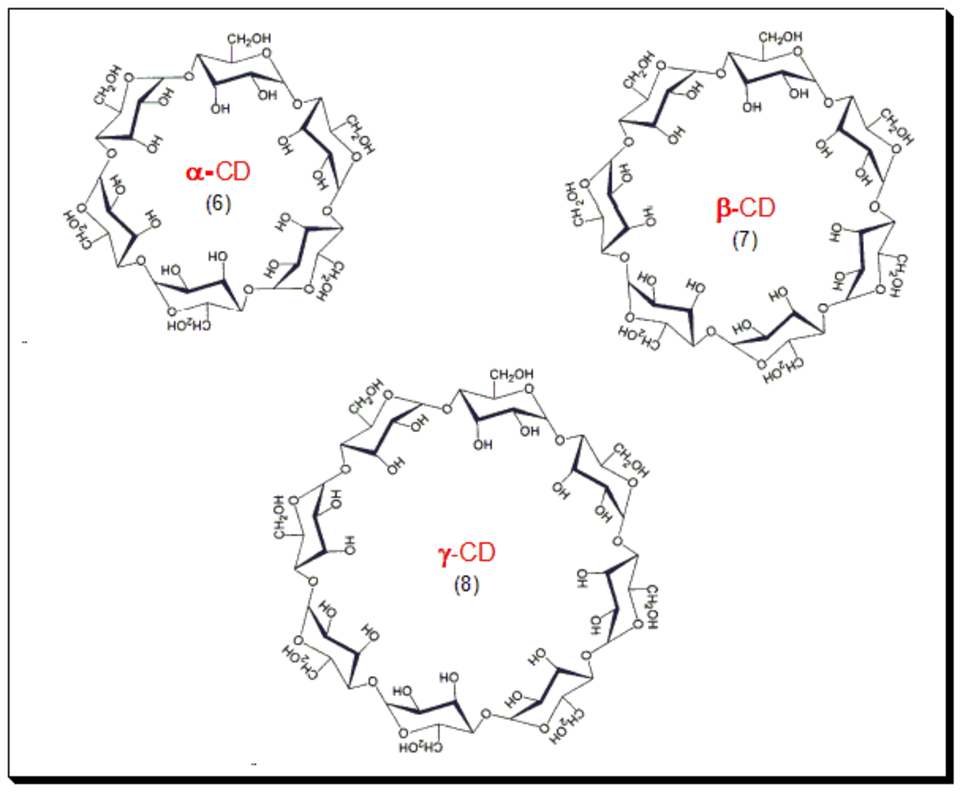

> [!doctor] سأل الدكتور أكثر من مرة: "**السيكلودكسترينات كم جزيئة من الغلوكوز؟**" والجواب **من 6 إلى 12**، وما هي **استعمالاتها**.

> [!explain] كيف تحمل السيكلودكسترين مادة أخرى؟
> كيف نكتبها: ارسمها **حلقة (أو كأس مقطوع القاع)** من وحدات غلوكوز مرتبطة **α(1→4)**، والمادة المحمولة **داخل** الحلقة.
> لماذا: **السطح الخارجي** للحلقة عليه زمر OH فهو **محب للماء** (يذوب)، و**التجويف الداخلي** **كاره للماء** فتدخل فيه الجزيئات الدهنية (الفيتامينات، العطور، المواد المرة) وتختبئ.
> من أين: من النشاء: إنزيم بكتيري يقطع سلسلة النشاء ويصل طرفيها بعضهما ببعض فتصير حلقة.
> كيف تحدث: المادة المرة داخل الحلقة **لا تلمس براعم التذوق** فيخف طعمها، والفيتامين داخلها **محمي من الأكسدة والضوء** فيثبت.

# السكريات المتعددة في التصنيع الغذائي

## استعمالاتها العامة {ص 3}
تستخدم في التصنيع الغذائي **كمنتجات طبيعية أو معدّلة**، مثل: **مغلّظات** و**مهلّمات** (النشاء، البكتين...)، أو **مثبتات للمستحلبات**، أو في **تشكيل أغشية أو أغلفة** للأغذية، و**كألياف غذائية**. {ص 3}

ومن حيث الذوبان: **أغلبها لا ينحل بالماء**، و**بعضها يمتص الماء وينتفخ**، و**بعضها ينحل بالماء الساخن**، و**بعضها يشكّل محاليل لزجة** في التراكيز العالية والمنخفضة. {ص 3}

> [!note] عبارة "تشكيل أغشية أو أغلفة" مأخوذة من كلام الدكتور بالتسجيل [01:39:27]. وفي سطر الأمثلة في الملخص كلمة ثالثة بين "النشاء" و"البكتين" خطها غير مقروء حتى بعد التكبير، فلم أكتبها حتى لا أخمّن. المغلّظات والمهلّمات المهمة كلها مشروحة في هذا الفصل (البكتين، الآغار، الألجينات، الكاراجينان، الصمغ العربي، النشاء، CMC).

مثال الدكتور: **لبن (زبادي) مائي** تُضاف إليه مواد **مغلّظة أو مهلّمة** فيبدو ثخيناً، وقال إن هذا **غش**.

**المستحلبات** (أمثلة الدكتور): **المايونيز** = صفار البيض + زيت + خل/حامض. الزيت لا يمتزج بالخل، لكن **صفار البيض فيه الليسيتينات** التي **تمسك الجزء القطبي (الماء) من طرف والجزء اللاقطبي (الزيت) من طرف** فيتشكل **استحلاب**. و**الشوكولاتة** مستحلب أيضاً: **السكر مع زبدة الكاكاو** (التي لا تمتزج بالماء).

وعندما **ينفصل** المستحلب تظهر مشاكل: الشوكولاتة المخزّنة طويلاً (من عيد لعيد) تظهر عليها **نقاط بيضاء** لأن **الدهن انفصل عن السكر**، والحليب غير المغلي في البراد يطفو فوقه بعد يومين **طبقة دهن** لأن **دهن الحليب انفصل عن الماء**، ومثله الجبن بعد أشهر. لذلك نضيف السكريات المتعددة **كمثبّتات للاستحلاب**: في الشوكولاتة فلا تتحول، وفي الحليب فلا ينفصل، وفي الجبن.

وتستخدم أيضاً في **تشكيل أغشية أو أغلفة**: مثل **المرينغ** (بياض البيض المخفوق مع السكر): الخفق يُدخل غازاً تحيط به **أغشية** رقيقة فتتشكل **رغوة**، والسكريات المتعددة تقوّي هذه الأغشية فتثبت الرغوة.

> [!explain] كيف يثبّت الليسيتين المستحلب؟
> كيف نكتبها: ارسم جزيء الليسيتين **رأساً (دائرة) وذيلين**: الرأس **قطبي** يتجه نحو **الماء/الخل**، والذيلان **لاقطبيان** يغوصان في **قطرة الزيت**. فتصبح كل قطرة زيت محاطة بطبقة من هذه الجزيئات.
> لماذا: الزيت والماء لا يمتزجان لأن الماء قطبي والزيت لاقطبي. جزيء له طرفان مختلفان (محب للماء + محب للدهن) يقف على الحدّ بينهما ويمنع القطرات من الاتحاد مجدداً.
> من أين: الليسيتين (فوسفاتيديل كولين) فوسفوليبيد موجود بكثرة في **صفار البيض** وفول الصويا.
> كيف تحدث: بالخفق تتكسر قطرات الزيت إلى قطرات صغيرة جداً، ويغلّفها الليسيتين فوراً، فيبقى المزيج متجانساً (المايونيز). أما السكريات المتعددة فتثبّت المستحلب بطريقة أخرى: **تزيد لزوجة** الطور المائي فتبطئ حركة القطرات وتمنع تجمّعها وصعودها.

> [!define] المغلّظ والمهلّم والمستحلب
> **المغلّظ** (Thickener): مادة تزيد **لزوجة** السائل (تثخّنه). **المهلّم** (Gelling agent): مادة تحوّل السائل إلى **هلام (جل)** متماسك. **مثبّت المستحلب** (Emulsion stabilizer): مادة تمنع انفصال الزيت عن الماء في المستحلب.

## البكتينات (Pectins) {ص 3–4}
مركبات تتألف من **حمض الغالاكتورونيك** متحدة مع بعضها **برابطة α(1→4)**. تستخدم في حالات **الإسهال والإمساك** حسب نسبة الماء فيها. {ص 3} وذكرت إحدى الطالبات أن هناك **دواءً للإسهال عند الأطفال** فيه البكتين، فأكّد الدكتور.

> [!why] البكتين نفسه يُستعمل **للإسهال** وللإمساك.
> لأن: البكتين **يمتص الماء ويشكّل هلاماً**. في **الإمساك** ننصح المريض أن يأخذه مع **كاسات ماء كبيرة** فيزيد حجم البراز وطراوته. وفي **الإسهال** نقول له أن يأخذه **بدون ماء (أو بماء قليل)** فيمتص الماء الزائد في الأمعاء ويجعل البراز أكثر تماسكاً. فالفرق هو **كمية الماء** المأخوذة معه.

**الدور التغذوي للبكتين** (كما شرحه الدكتور عند توزيع موضوع البكتينات):
- **يمتص الماء** فيفيد في **الإسهال**.
- **ينتفخ مع الماء** فيزيد حجم محتوى الأمعاء و**يحرّك الحركة الحوية (التمعّجية)** فيفيد في **الإمساك**.
- **يبطئ امتصاص السكر** فيكون ارتفاع سكر الدم **بطيئاً**.
- ويقال إنه **يخفّض الكوليسترول والغليسيريدات الثلاثية**.

**البكتين**: سلسلة بوليميرية من **α-D-غالاكتورونيك** برابطة **α(1→4)**، ومعها **غالاكتان وأرابينان وكزيلوز**. **غالباً تكون فيه المجموعات الكربوكسيلية مؤسترة بالميتانول**، وهي التي **تعطي القوام الهلامي**. {ص 4}

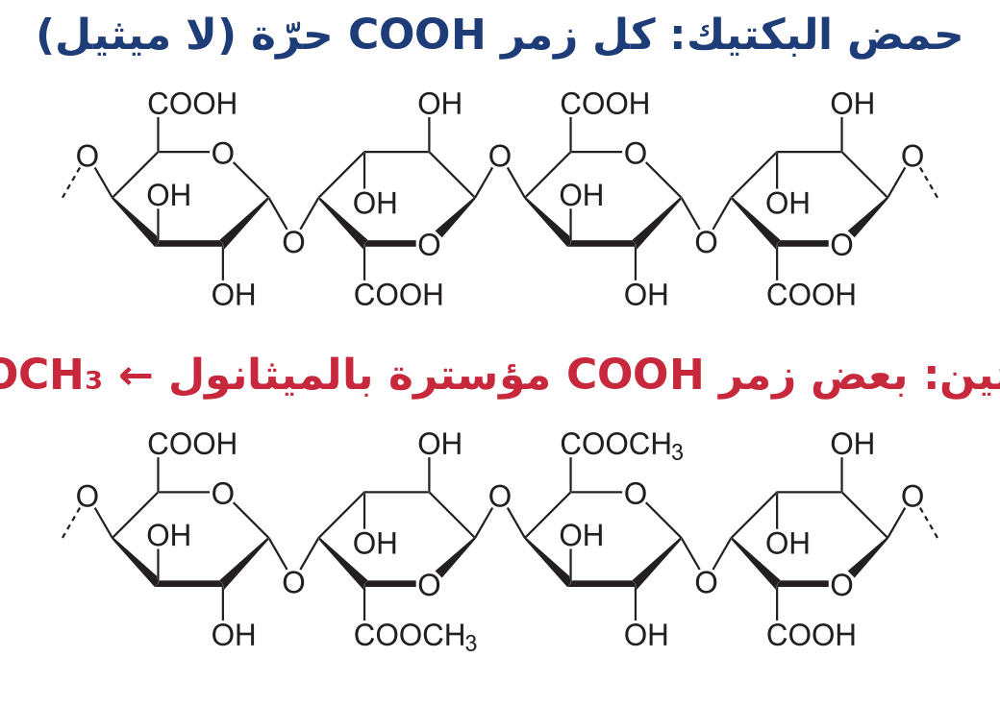

> [!explain] الأسترة بالميتانول في البكتين
> كيف نكتبها: على الكربون 6 لكل وحدة غالاكتورونيك زمرة **COOH**. إذا تفاعلت مع **الميتانول CH~3~OH** صارت **COOCH~3~** (إستر ميتيلي).
> لماذا: الزمر المؤسترة **أقل شحنة** فتقترب السلاسل من بعضها وتحبس الماء بينها فيتشكل **هلام** (مربى، جيلي). كلما زادت الأسترة زادت القدرة على تشكيل الهلام (مع السكر والحمض).
> من أين: هذا تفاعل **الأسترة** نفسه: حمض + كحول ← إستر + ماء.
> كيف تحدث: في النبات تصنع الثمرة البكتين مؤستراً. وفي المصنع نتحكم بدرجة الأسترة حسب المنتج.

$$ R–COOH + CH~3~OH → R–COOCH~3~ + H~2~O

**يقسم البكتين إلى:** {ص 4}
1. **البروتوبكتين** (طليعة البكتين): يُشتق منه البكتين، ويوجد في **الثمار غير الناضجة**. يتفكك **بفعل إنزيم البروتوبكتيناز** (Protopectinase). {ص 4}
2. **حمض البكتيك** (Pectic acid): **لا يحوي مجموعة الإستر ميتيل**، و**يتمتع بقدرة ضعيفة على تشكيل الهلام**. وعندما نريد الحصول على **عصائر رائقة** نقوم **بتنشيط الإنزيمات البكتينية**. {ص 4}
3. **حمض البكتينيك** (Pectinic acid): **ناتج وسطي لتشكل البكتين**. {ص 4}

مثال الدكتور: **التفاحة** في أولها **قاسية ولامعة** (فيها البروتوبكتين)، وبعد فترة **تطرى وتتجعّد**، لأن إنزيم **البروتوبكتيناز** فكّك البروتوبكتين. والترتيب: **بروتوبكتين ← (بروتوبكتيناز) ← بكتين ← ناتج مرحلي (حمض البكتينيك) ← حمض البكتيك**. وقال الدكتور عن البروتوبكتين إنه **ينحل بالماء الساخن ويستطيع أن يشكّل هلاماً** [00:13:06 من التسجيل الثاني].

> [!note] في المراجع: البروتوبكتين نفسه **لا ينحل في الماء البارد**، لكن **بالتسخين في الماء (خاصة مع حمض)** يتحلمه إلى **بكتين ذوّاب** قادر على تشكيل الهلام، وهكذا يُستخرج البكتين صناعياً من قشور الحمضيات والتفاح. فالعبارة صحيحة بمعنى: بالماء الساخن يتحول إلى بكتين يتهلّم. وفي هامش الملخص كلمة مقطوعة "تقوم بإزا..." (على الأرجح "تقوم بإزالة" البكتين لترويق العصير).

قال الدكتور: إذا كانت الزمر الكربوكسيلية **مؤسترة بالميتانول** يتشكل **القوام الهلامي** (الجيلي)، وإذا **لم تكن مؤسترة** (حمض البكتيك) **لا يتهلّم**. وإذا أردنا **إزالة العكارة** من عصير **نخرّب البكتين** (بالإنزيمات)، وإذا أردنا **عصيراً عكراً** (مثل عصير التفاح) **نحافظ على البكتين**.

> [!why] عند صناعة العصائر **الرائقة** نضيف/ننشّط الإنزيمات البكتينية.
> لأن: البكتين يجعل العصير **عكراً ولزجاً** ويعلّق الجزيئات فيه، والإنزيمات تفككه إلى حمض البكتيك ووحدات أصغر لا تشكّل هلاماً، فتترسب العكارة ويصبح العصير **صافياً**.

> [!why] الثمار غير الناضجة **قاسية**، وتطرى عند النضج.
> لأن: فيها **البروتوبكتين** الذي يربط الخلايا بقوة. عند النضج يفككه إنزيم **البروتوبكتيناز** إلى بكتين قابل للذوبان، فتتراخى الروابط بين الخلايا وتطرى الثمرة.

## الآغار (Agar) {ص 3}
**منتج هلامي** يُعزل من **الطحالب البحرية الحمراء**، يتركب من **β-D-غالاكتوبيرانوز** و**α-L-غالاكتوبيرانوز**. {ص 3}

**يستخدم في:** {ص 3}
1. **الأوساط الميكروبية المغذية** (أطباق زراعة البكتيريا في المخبر).
2. في **الصناعات الغذائية**، فهو **غير قابل للهضم**، وله **فعالية مليّنة (إسهالية)**، و**مثبّت للّبن**.
3. **يعيق تيبّس الخبز**.
4. **يساعد في القوام الهلامي للحوم المعلّبة**: مثال الدكتور: **الطبقة الهلامية** التي تراها حول **المرتديلا** واللحوم المعلبة.

قال الدكتور إن الآغار فيه **D-غالاكتوز** و**L-غالاكتوز**، ثم سأل عن **الغالاكتوز** نفسه: هو **إبيمر للغلوكوز على الكربون 4**، والجسم يحوّله إلى غلوكوز بإنزيم، وإذا نقص هذا الإنزيم يرتفع **غالاكتوز الدم** (الغالاكتوزيميا).

> [!exam] ما اسم الإنزيم الذي يحوّل الغالاكتوز إلى غلوكوز، ونقصه يسبب ارتفاع غالاكتوز الدم؟ (سأله الدكتور أكثر من مرة)
> الجواب: **غالاكتوز-1-فوسفات يوريديل ترانسفيراز** (Galactose-1-phosphate uridyltransferase، واختصاره GALT).

> [!note] في المراجع الوحدة الثانية في الآغار هي **3,6-أنهيدرو-α-L-غالاكتوز** (أي L-غالاكتوز **نُزع منه جزيء ماء** بين C3 و C6 فتشكّل جسر أكسجين داخلي). الملخص كتبها α-L-غالاكتوبيرانوز.

## الألجينات (Alginates) {ص 3}
تتواجد في **الطحالب البحرية السمراء (البنية)**، وتتألف من **β-D-مانويورونيك** و**α-L-غولويورونيك**. {ص 3}

سأل الدكتور: ما هو **المانويورونيك**؟ هو **المانوز بعد أكسدة الكربون 6** (حمض يوروني). والمانوز سكر سداسي يختلف عن الغلوكوز **بالكربون 2 فقط** (إبيمر).

**تستخدم في:** {ص 3}
1. **مادة مغلّظة ومثبّتة ومشكّلة للهلام وتحسين القوام**.
2. **تمنع تشكل بلورات الثلج الكبيرة في البوظة**.
3. تُستخدم في **مختلف المنتجات الهلامية**.
4. **تثبيت عصائر الفواكه الطازجة** و**إعطاء رغوة البيرة**.

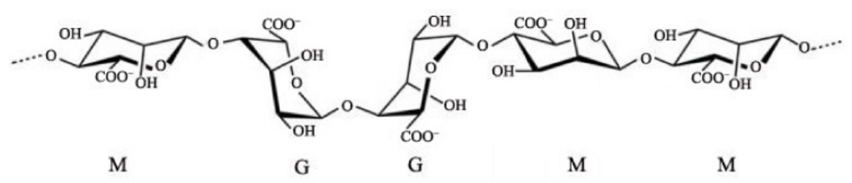

> [!why] تضاف الألجينات (وغيرها من المغلّظات) إلى **البوظة**.
> لأن: تمسك الماء الحر في شبكتها، فلا يتجمع الماء ليشكّل **بلورات ثلج كبيرة** تجعل البوظة خشنة، فتبقى **ناعمة القوام**. مثال الدكتور: إذا وضعت الحليب في الفريزر لتصنع بوظة، يجب أن تكون البلورات **صغيرة**، وإلا صار عندك **ثلج** وليس بوظة.

## الكاراجينانات (Carrageenans) {ص 3}
**منتج هلامي** يُعزل من **الطحالب الحمراء**، ويتركب من **β-D-غالاكتوبيرانوز** و**3,6-أنهيدرو-L-غالاكتوز** (أنهيدرو = **منزوع الماء**). {ص 3} قال الدكتور: "أنهيدرو" يعني أنه **نُزع جزيء ماء** بين الكربون **3** والكربون **6**.

**تستخدم في:** {ص 3}
- **زيادة لزوجة المحاليل**.
- **تثبيت الاستحلاب**.
- في **صناعة الشوكولاتة** لمنع **انفصال قطرات الدسم** وتثبيت **المعلّقات ودقائق الكاكاو**.
- **تحسين صفات العجين** (الدبقية، المطاطية، والانتفاخ).
- **منع تخثر بروتين الحليب**.
- **مروّق للعصائر والمشروبات**.

أمثلة الدكتور لكل استعمال:
- **تثبيت الاستحلاب** يعني ألا ينفصل **الجزء المائي عن الجزء الدهني**، كما في اللبن والجبن.
- **الشوكولاتة** = زبدة الكاكاو + سكر. إذا انفصلا بعد فترة يظهر السكر والدسم على السطح، والكاراجينان يمنع **انفصال قطرات الدسم عن السكر**.
- **العجين**: صفاته **الدبقية والمطاطية** تأتي من بروتين في الطحين اسمه **الدابوق (الغلوتين)**، ثم **الخميرة** تخمّر السكر فتعطي غاز **CO~2~** فينتفخ العجين.
- **المروّق**: هناك عصائر نريدها **عكرة**، فالعكارة في **عصير التفاح** من صفات جودته، وهناك عصائر نريدها **صافية** مثل **عصير العنب**. الكاراجينان يُستعمل **مروّقاً** للعصائر التي نريدها صافية.

> [!note] **كيف ينتفخ العجين وكيف يُصنع الخل** (استطراد الدكتور):
> الخميرة **في غياب الهواء** تحوّل الغلوكوز إلى **كحول إيتيلي + CO~2~**، فالغاز يُنفخ العجين، والكحول يتطاير بالخَبز:
> C~6~H~12~O~6~ → 2 C~2~H~5~OH + 2 CO~2~
> وفي صناعة **الخل**: نضع العنب فيتخمر **لاهوائياً** إلى كحول، ثم **نفتح الوعاء للهواء** فتؤكسد البكتيريا الكحول إلى **حمض الخل**:
> C~2~H~5~OH + O~2~ → CH~3~COOH + H~2~O
> (أما في عضلات الإنسان والحيوان فالتخمر اللاهوائي يعطي **حمض اللبن** بدل الكحول.)

> [!note] في المراجع: الكاراجينان فيه **3,6-أنهيدرو-D-غالاكتوز** (من السلسلة **D**)، وفيه **زمر كبريتات** كثيرة، بينما **الآغار** هو الذي فيه **L**. الملخص كتب L للاثنين.

> [!tip] للتمييز بين الطحالب: **الحمراء** ← **آغار وكاراجينان**، **السمراء (البنية)** ← **ألجينات**. والثلاثة **مهلّمات** من البحر.

## الصمغ العربي (Gum arabic) {ص 3–4}
**يُنتج من شجر الأكاسيا** (السنط)، ويتألف من **L-أرابينوز** و**رامنوز** و**D-غالاكتوز** و**D-غالاكتويورونيك**. {ص 3} (الأرابينوز سكر **خماسي**.)

**يستخدم في:** {ص 4}
1. **عامل استحلاب ومثبّت لمنتجات الجبن**.
2. **يمنع تشكل بلورات ثلجية كبيرة في البوظة**.
3. **يعيق تبلور السكر وانفصال الدسم في الحلويات**: مثال الدكتور: إذا وضعنا الصمغ العربي في **قطر الحلو العربي** لا يتسكّر.
4. **مثبّت رغوة في المشروبات والمواد المنكّهة**.

> [!note] في المراجع الحمض اليوروني في الصمغ العربي هو غالباً **D-غلوكورونيك**. الملخص كتب غالاكتويورونيك.

## النشاء (Starch) {ص 4}
- **مدّخر سكري في النباتات**. {ص 4}
- **يتكون من الأميلوز والأميلوبكتين** (راجع المحاضرة 1). {ص 4}
- **يتميز بحساسية للتأثيرات الميكانيكية** (تنعيم، طحن، تسخين) **أو الكيميائية** (المؤكسدات والحموض)، فيتشكل **النشاء المعدَّل**: النشاء **المتهلّم** (المسبق الطهي)، **المتدبّق** (أي الذي صار **دبِقاً لاصقاً**)، **المؤكسد**، **الفوسفاتي**، **كربوكسي ميتيل النشاء**. {ص 4}
- **يستخدم كعوامل مغلّظة ورابطة** في **إنتاج الحلويات والصلصات وحشوات المعجنات والمايونيز**. {ص 4}

من شرح الدكتور: إذا عاملنا النشاء **بالحمض** تنقطع السلسلة فنحصل على **نشاء سلسلته أقصر**. وبالمعاملات الميكانيكية (تنعيم، طحن، ترطيب) نحصل على أنواع مختلفة من الطحين والنشاء: **طحين أبيض**، **طحين الكاتو**، **طحين الخبز**... ومن النشاء المعدّل مثلاً **نشاء السحلب** (يعطي القوام الثخين للسحلب). ويستعمل كمغلّظ في **اللبن**، وفي **الحلويات** و**حشوات المعجنات** و**البودينغ**.

> [!define] النشاء المعدَّل (Modified starch)
> نشاء **غُيّرت خواصه** بمعاملة **ميكانيكية** (طحن، تسخين) أو **كيميائية** (أكسدة، حموض، فوسفات) ليناسب استعمالاً معيناً في التصنيع (مغلّظ أقوى، يذوب بالبارد، يتحمل الحرارة والتجميد...).

## السيللوز (Cellulose) {ص 4}
**سكر داعم في النباتات**، **صعب الهضم**، يتكون من **β-D-غلوكوبيرانوز** **برابطة من النوع β(1→4)**. {ص 4}

**الميكروكريستالين** (السيللوز الدقيق البلورات): **يتشكل نتيجة تحليل الروابط بين السلاسل**، أي **تقطيع السيللوز إلى جزيئات قصيرة** ثم الحصول عليه. وهو **غير منحل بالماء**، و**ليس له قيمة سعرية**، ويستخدم في **الأغذية منخفضة السعرات** ومنها **السلطات والفواكه والبوظة**. {ص 4} قال الدكتور: السيللوز الطويل **يُقطَّع بالحمض** إلى قطع **قصيرة**، فيُستعمل مثلاً في **كاتو أو بوظة "منخفضة الكالوري"**.

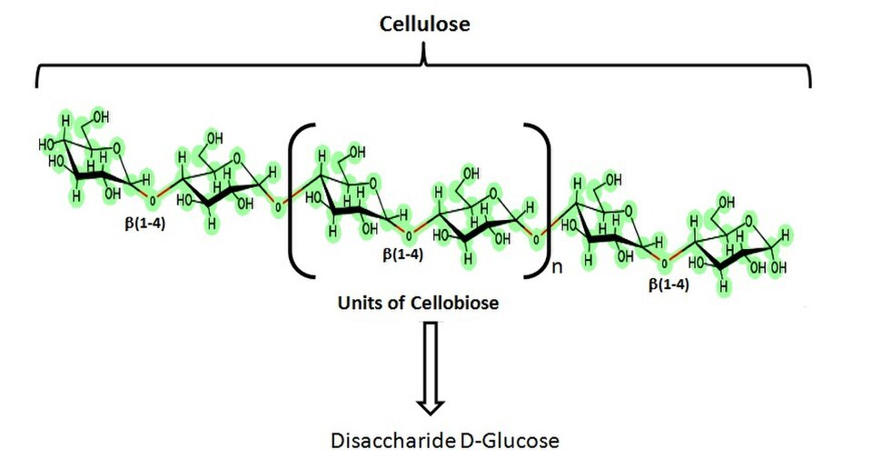

> [!why] الإنسان **لا يهضم السيللوز** مع أنه مصنوع من الغلوكوز مثل النشاء.
> لأن: الرابطة في السيللوز **β(1→4)**، والإنسان **لا يملك إنزيم السيلولاز** القادر على كسرها. أما النشاء فرابطته **α(1→4)** ويكسرها الأميلاز.

> [!doctor] **وظائف الألياف** (مكتوبة في الملخص داخل غيمة بعنوان **"تنويه"**، وشرحها الدكتور وقال "عندي عشر وظائف"):
> 1. **مالئة**: لا يهضمها الإنسان فتملأ المعدة فتشعر **بالشبع**.
> 2. **تمنع السرطان** عن طريق **ادمصاص العناصر الثقيلة**: في الألياف زمر **COO^−^** (من الغلوكورونيك والغالاكتورونيك والمانورونيك) عليها **شحنة سالبة**، فتمسك العناصر الثقيلة الموجبة مثل **الرصاص والزرنيخ والكادميوم** (التي تدخل الجسم مثلاً من الأغذية الملوثة والمعلبات) وتخرجها مع البراز.
> 3. **دورها في تنظيم سكر الدم**: تجعل السكر **يُمتص ببطء** (مثل ألياف **الشوفان**)، فلا يرتفع سكر الدم بسرعة عند **مريض السكري**. ويقال أيضاً إنها تخفض الكوليسترول.

> [!exam] كيف تقي الألياف من السرطان؟
> الجواب: تحتوي زمر **COO^−^ سالبة الشحنة** (من الأحماض اليورونية) **تمتز العناصر الثقيلة الموجبة** (رصاص، زرنيخ، كادميوم) وتطرحها مع البراز فلا تُمتص.

## كربوكسي ميتيل السيللوز (CMC) {ص 4}
ينتج من **معاملة السيللوز مع حمض كلورو الأستيك** (حمض الكلورو أسيتيك). {ص 4} وقال الدكتور: **السيللوز القلوي** (المعامل بالقلوي) مع **كلورو الأسيتيك**.

$$ Cell–OH + Cl–CH~2~–COOH → Cell–O–CH~2~–COOH + HCl

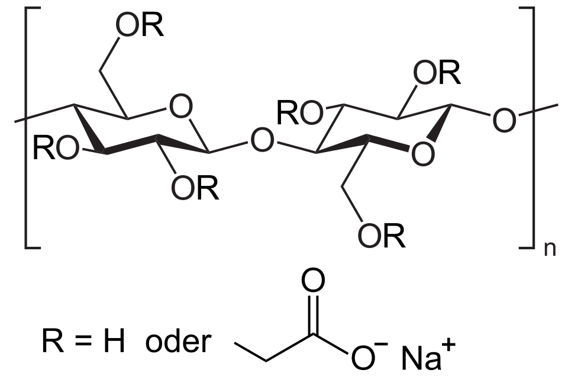

**هو:** {ص 4}
- **عامل مغلّظ لتعديل قوام المنتجات** (الجيلي، الهلام، الحشوات، العصائر).
- **يعيق تبلور السكروز**.
- **يمنع تخرّب النشاء والتيبّس غير المرغوب فيه**.
- **يحسّن من الصفات الثباتية والترطيب** لـ**أغلب المنتجات المجففة**.

أمثلة الدكتور: **المربيات** التي فيها CMC **لا تتسكّر**، و**الكاتو** يبقى طرياً ولا ييبس بسرعة. و**التين المجفف** أحياناً يصير **مثل الحجر**، فنضيف له CMC **كمرطّب**، لأن فيه زمر **OH** كثيرة **تمسك الماء** فيبقى طرياً.

> [!explain] لماذا يذوب الـ CMC بالماء والسيللوز لا يذوب؟
> كيف نكتبها: في السيللوز نستبدل H في بعض زمر **OH** بـ **–CH~2~–COOH** (أو –CH~2~–COO^−^ Na^+^).
> لماذا: السيللوز لا يذوب لأن سلاسله ملتصقة ببعضها بروابط هيدروجينية كثيرة. المجموعات الجديدة **كبيرة ومشحونة** فتباعد بين السلاسل وتجذب الماء، فيذوب ويعطي محلولاً **لزجاً** (مغلّظ).
> من أين: من تفاعل **الإيثرة**: أكسجين OH في السيللوز يهاجم الكربون المرتبط بالكلور في حمض كلورو الأستيك، فيخرج الكلور (HCl، وفي المصنع يُعادَل بـ NaOH).
> كيف تحدث: في المصنع يُنقع السيللوز في **NaOH** ثم يضاف **حمض كلورو الأستيك**، فنحصل على ملح الصوديوم Cell–O–CH~2~–COONa.

> [!summary] **الخلاصة:** السكريات المتعددة في التصنيع: **البكتين** (غالاكتورونيك α(1→4) مؤستر بالميتانول ← هلام، والبروتوبكتين في الثمار الفجة، وحمض البكتيك بلا ميتيل ← هلام ضعيف). **الآغار والكاراجينان** من الطحالب **الحمراء**، و**الألجينات** من **السمراء**. **الصمغ العربي** من الأكاسيا (استحلاب، بوظة، حلويات، رغوة). **النشاء** يُعدَّل ليصير مغلّظاً ورابطاً. **السيللوز** β(1→4) لا يُهضم، ومنه **الميكروكريستالين** (بلا سعرات) و**CMC** (مغلّظ يمنع التبلور والتيبس). والألياف: مالئة، ضد السرطان، تنظّم سكر الدم.

# صفحات الملخص الأصلي

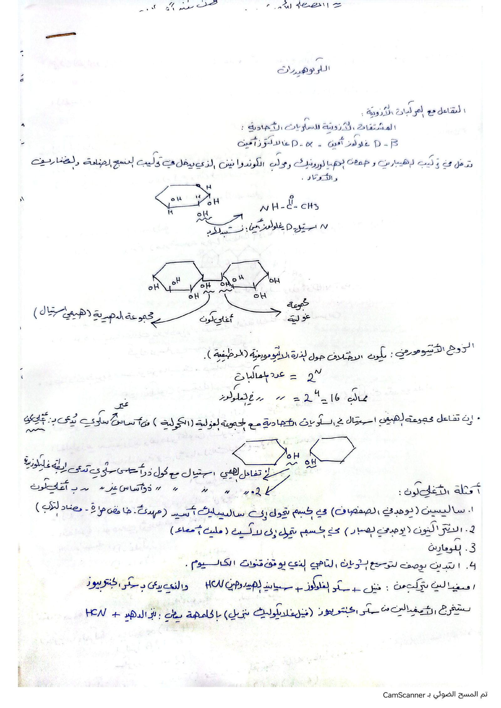

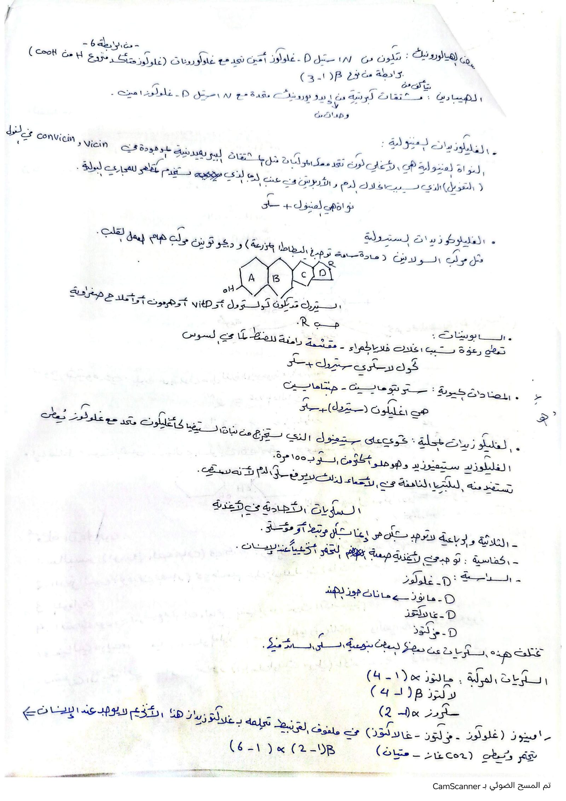

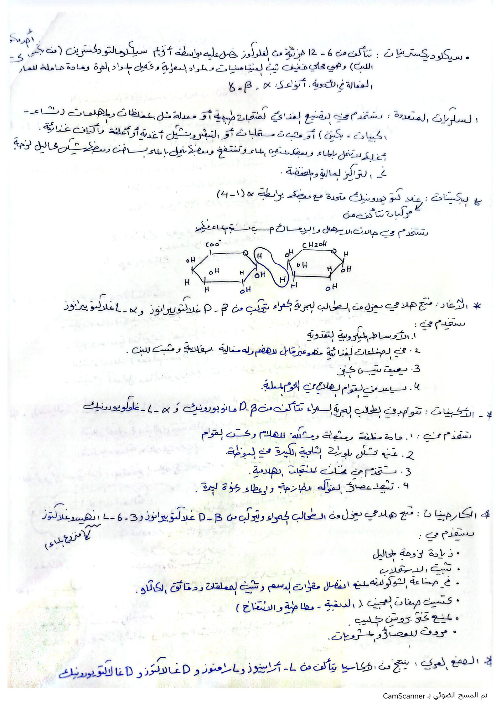

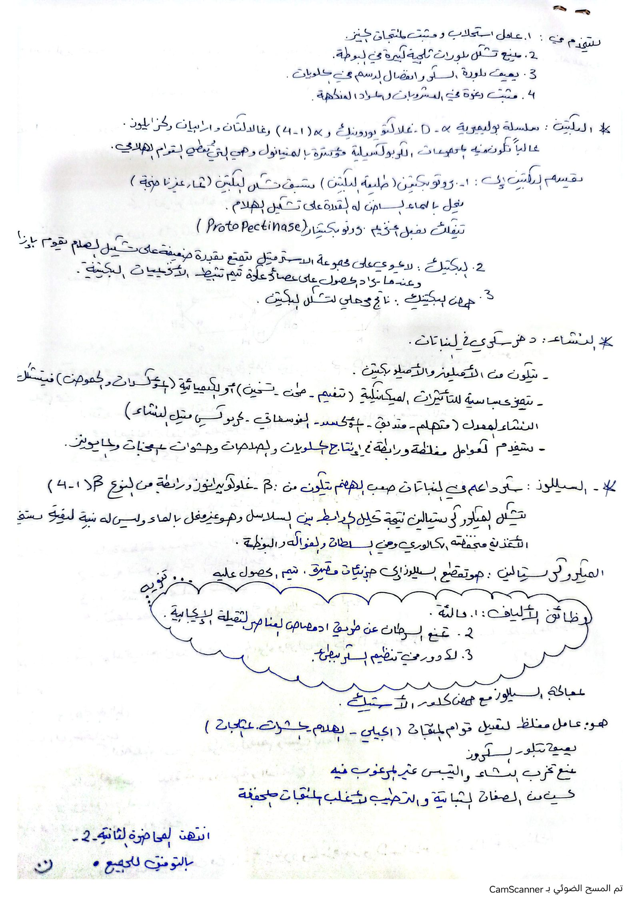
