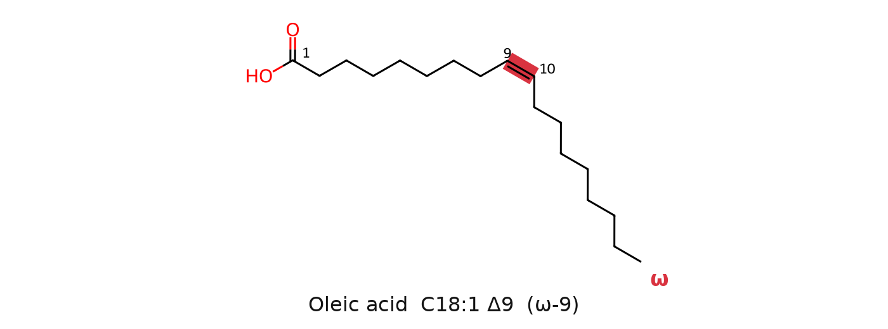
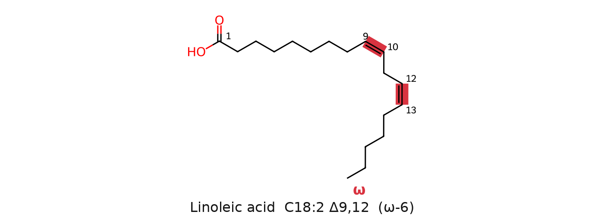
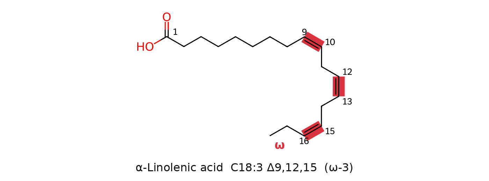

# الليبيدات

> [!define] الليبيدات
> مركبات لا تذوب في الماء، تذوب في المحلات العضوية، لا يوجد لها صيغة معينة تجمعها، تجمعها صيغتها المعقدة التي تجعلها لا تذوب في الماء.

## فوائد الليبيدات

1. مصدر للطاقة.
2. مصدر تخزيني للطاقة.
3. قد تلعب دور بنائي مثل الفوسفوليبيدات التي تدخل في بناء الأغشية الخلوية، قد تلعب دور حماية وعازل حراري وميكانيكي فتتركز حول الأحشاء الداخلية فتحميها، ولها دور هرموني، قد تكون حالة للفيتامينات.

# الأحماض الدهنية

أحادية مجموعة الكربوكسيل R–COOH، و R مشبع وزوجي أو غير مشبع.

## الأحماض الدهنية المشبعة

| الحمض | ذرات الكربون | الصيغة | |
| البيوتيريك | 4 | CH~3~(CH~2~)~2~COOH | قصيرة |
| الكابرويك | 6 | CH~3~(CH~2~)~4~COOH | قصيرة |
| الكابريليك | 8 | CH~3~(CH~2~)~6~COOH | قصيرة |
| الكابريك | 10 | CH~3~(CH~2~)~8~COOH | متوسطة |
| اللوريك (صابون) | 12 | CH~3~(CH~2~)~10~COOH | متوسطة |
| ميرستيك (شمع) | 14 | CH~3~(CH~2~)~12~COOH | طويلة |
| بالمتيك (نخل) | 16 | CH~3~(CH~2~)~14~COOH | طويلة |
| ستياريك (شحم) | 18 | CH~3~(CH~2~)~16~COOH | طويلة |
| أراكيديك | 20 | CH~3~(CH~2~)~18~COOH | طويلة |

• كلما ازداد طول السلسلة ارتفعت نقطة الانصهار.

## الأحماض الدهنية غير المشبعة

| الحمض | الرمز | نقطة الانصهار | |
| الأوليك (حمض زيت) | C18:1Δ9 | 16° | W9 |
| اللينوليك (عباد الشمس) | C18:2Δ9,12 | −5° | W6 (أساسي غير مشبع) |
| اللينولينيك (زيت سمك) | C18:3Δ9,12,15 | −10° | W3 (أساسي غير مشبع) |
| الأراكيدونيك | C20:4Δ5,8,11,14 | −15° | W6 |

* كلما زادت عدد الروابط المشبعة كلما قلت نقطة الانصهار.

> [!note] كُتبت في الدفتر "الروابط المشبعة"، والمقصود الروابط **غير** المشبعة. وبجانب العنوان ملاحظة صغيرة: "(كلمة غير واضحة) طبخ ⇐ عدة أحماض"، وتحت الرسم كلمتا "سيس كرابطة ..." والكلمة الأخيرة غير واضحة.

# الغليسيريدات

$$ CH~2~–OH / OH–CH / CH~2~–OH  +  R–COOH   →   غليسريد أحادي

$$ CH~2~–O–CO–R
$$ OH–C–H
$$ CH~2~OH

$$ CH~2~–OH / OH–CH / CH~2~–OH  +  2 R–COOH   →   غليسريد ثنائي

$$ CH~2~–O–CO–R
$$ R–CO–O–C–H
$$ CH~2~–OH

$$ CH~2~–OH / OH–CH / CH~2~–OH  +  3 R–COOH   →   غليسريد ثلاثي

$$ CH~2~–O–CO–R
$$ R–CO–O–C–H
$$ CH~2~–O–CO–R

* يعتمد قوام الغليسيريدات على نوعية الأحماض الدهنية: فإذا كانت R طويلة مشبعة يكون القوام شحمي، أما إذا كانت R قصيرة فهي زبدة، أما إذا كانت R غير مشبعة فهي زيت.

# الفوسفوليبيدات

> [!define] الفوسفوليبيدات
> غليسريد ثنائي مرتبط مع حمض الفوسفور وقاعدة آزوتية.

$$ CH~2~–O–CO–R~1~
$$ R~2~–CO–O–CH
$$ CH~2~–P(=O)(O)–O–X

(P: حمض الفوسفور، X: قاعدة آزوتية)

## قد تكون القاعدة الآزوتية كولين

$$ OH–CH~2~–CH~2~–N^+^(CH~3~)~3~

$$ CH~2~–O–CO–R~1~
$$ R~2~–CO–O–CH
$$ CH~2~–P(=O)(O)–CH~2~–CH~2~–N(CH~3~)~3~

**فوسفاتيدين كولين** ← **ليستين**.

## القاعدة الثانية إيتانول أمين

$$ OH–CH~2~–CH~2~NH~3~^+^

**فوسفاتيدين إيتانول أمين (سيفالين)**.

## الخلاصة

| إذا كانت القاعدة الآزوتية | فالناتج |
| كولين | ليستين |
| ايتانول أمين | إما سيفالين أو كيفالين |
| سيرين | فوسفاتيدين سيرين |
| إينوزيتول | (إينوزيتول) |

$$ CH~2~OH–CH(NH~2~)–COOH

# صفحات الدفتر

