> [!style] نمط الدكتور جورج في هذه المحاضرة:
> - **يحفّظ بالتكرار الجماعي**: ردّد أسماء الأحماض الدهنية المشبعة مع الطلاب عشرات المرات (أكثر من ربع ساعة). **الأسماء مع عدد ذرات الكربون حفظ إجباري.**
> - **يُخرج الطلاب إلى اللوح** ليرسموا الحمض بالشكل المتعرج ويعدّوا ذرات الكربون، ويكتبوا الرمز المختصر.
> - **يربط بالتغذية العلاجية**: "إذا واحد معه مرارة، إسهال دهني، داء زلاقي، شو ياكل؟".
> - **الأرقام للفهم**: عن درجات الانصهار قال "ما تحفظوا، افهموا"؛ المطلوب القاعدة.
> - عباراته: "احفظوا"، "يلا نعيد"، "فهمنا شي؟"، "برافو عليكي".

> [!note] **مصادر هذا الملف:** تسجيل المحاضرة من جهازين، والملخص المكتوب "كيمياء الأغذية.pdf" (الصفحات 3 إلى 6، والرقم الرمادي [ص N] يعني صفحته)، وتسجيل **شعبة الشباب** لنفس المحاضرة مع صور اللوح ودفتر طالب منها: منها أُخذ فصل **تفاعلات الأحماض الدهنية** لأن شعبتكم لم تصله بعد. الأوقات [hh:mm:ss] من تسجيل شعبتكم ما لم يُذكر غير ذلك.

# الليبيدات: تعريفها وفوائدها

بدأ الدكتور بالمقارنة مع السكريات: السكريات لها **صيغة عامة** هي C~n~(H~2~O)~n~ (الغلوكوز C~6~H~12~O~6~، والريبوز C~5~H~10~O~5~). أما الليبيدات (Lipids) فليس لها صيغة عامة، لأنها مجموعة كبيرة من مركبات مختلفة جداً: **السمن، الشحم، الدهن، الشمع، الهرمونات الستيروئيدية، الهرمونات الجنسية، الكوليسترول**... كلها تسمى ليبيدات [00:01:06]. فما الذي يجمعها؟

> [!define] الليبيدات
> مركبات **لا تذوب بالماء** ولكنها **تذوب بالمحلّات العضوية**، لا يوجد لها صيغة معينة تجمعها، والذي يجمعها هو **صيغتها المعقدة التي تجعلها لا تذوب بالماء**. {ص 3}

> [!doctor] أملى الدكتور هذا التعريف وكرّره **ثلاث مرات** [00:01:31–00:02:13]: "مركبات لا تذوب بالماء ولكنها تذوب بالمحلات العضوية... لا يوجد لها صيغة تجمعها".

> [!explain] تعريف الليبيدات
> كيف نكتبها: ثلاثة أجزاء لا تُنسى: (1) لا تذوب بالماء، (2) تذوب بالمحلات العضوية، (3) لا صيغة عامة تجمعها، والذي يجمعها صيغتها المعقدة.
> لماذا لا تذوب بالماء: معظم جزيء الليبيد **سلاسل هيدروكربونية** (روابط C–H) غير قطبية، والماء قطبي. والقاعدة: **الشبيه يذيب الشبيه**؛ فالمادة غير القطبية تذوب في مذيب غير قطبي.
> من أين: المحلّات (المذيبات) العضوية مثل **الإيثر، الكلوروفورم، الهكسان، البنزين**.
> كيف تحدث (في المخبر): لأنها تذوب في هذه المذيبات، نستخلص الدهن من الغذاء بالهكسان أو الإيثر (جهاز سوكسليه) ثم نبخّر المذيب ونزن الدهن، فنعرف **نسبة الدهن في الغذاء**. هذه من أهم تحاليل مادتكم.

## فوائد الليبيدات {ص 3}

1. **مصدر للطاقة**: كل **1 غرام** دهن يعطي **9 كيلوكالوري** [00:02:40].
2. **مصدر تخزيني للطاقة**: الجسم يخزّن الطاقة الزائدة على شكل دهن، ومثال الدكتور **البدانة**: "البدانة شو هي؟ تخزين الدهون" [00:02:52].
3. **قد تلعب دوراً بنائياً**: مثل **الفوسفوليبيدات في الأغشية الخلوية** [00:03:08].
4. **قد تلعب دور حماية، وعازل حراري، وعازل ميكانيكي**: فيتركز الدهن **حول الأحشاء الداخلية فيحميها** من الصدمات [00:03:26–00:04:27]. مثال الدكتور: المولود الجديد محاط بطبقة من الدهن تحميه، وأعضاؤنا الداخلية محاطة بالدهن، وطبقة الدهن تحت الجلد تعزلنا عن البرد.
5. **قد تلعب دوراً هرمونياً**: مثل **الهرمونات الجنسية** (وهي ستيروئيدات مشتقة من الكوليسترول) [00:04:32].
6. **قد تكون حالّة للفيتامينات** المنحلة بالدهون: **A و D و E و K** [00:04:41].

> [!explain] لماذا يعطي الدهن 9 كيلوكالوري والسكر 4 فقط؟
> لماذا: الطاقة تأتي من **أكسدة** الكربون والهيدروجين حتى CO~2~ و H~2~O. جزيء الحمض الدهني (مثلاً البالميتيك C~16~H~32~O~2~) فيه ذرتا أكسجين فقط مقابل 16 كربون، أي أنه **مُرجَع جداً** وما زال "يتسع" لأكسدة كثيرة. أما الغلوكوز C~6~H~12~O~6~ ففيه ذرة أكسجين على كل كربون، أي أنه **نصف مؤكسد أصلاً**، فطاقته أقل.
> ولماذا يُخزَّن بالدهن لا بالسكر: الدهن لا يذوب بالماء، فيُخزَّن **بلا ماء** وبحجم صغير، أما الغليكوجين فيُخزَّن مع كمية كبيرة من الماء، فهو أثقل بكثير لنفس الطاقة.

> [!tip] لحفظ الفوائد الست بالترتيب: **طاقة، تخزين، بناء، حماية، هرمون، فيتامين**.

# الأحماض الدهنية: الصفات العامة

> [!define] الأحماض الدهنية
> أحماض **أحادية مجموعة الكربوكسيل**، صيغتها العامة **R–COOH**، حيث R سلسلة هيدروكربونية **زوجية العدد** (من ذرات الكربون)، وقد تكون **مشبعة** أو **غير مشبعة**. {ص 3}

$$ R–COOH

> [!doctor] [00:06:50] "يلا احفظوا: **زوجي العدد، قد يكون مشبع، قد يكون غير مشبع، أحادية مجموعة الكربوكسيل**". كرّر هذه الصفات الأربع عدة مرات قبل أن يبدأ بالأسماء.

> [!explain] الصفات الأربع للحمض الدهني
> كيف نكتبها: R–COOH. الزمرة **COOH** (الكربوكسيل) هي التي تجعله "حمضاً"، و**R** هي "الذيل" الهيدروكربوني الطويل الذي يجعله "دهنياً".
> لماذا "أحادية الكربوكسيل": فيه زمرة COOH **واحدة** فقط، في طرف السلسلة. (بالمقارنة: حمض الليمون فيه 3 زمر COOH، فهو ليس حمضاً دهنياً).
> من أين "مشبع / غير مشبع": **مشبع** يعني كل ذرة كربون في R أخذت أكبر عدد ممكن من الهيدروجين، أي **كل الروابط أحادية**. **غير مشبع** يعني يوجد **رابطة زوجية** (C=C) أو أكثر، فيمكن إضافة هيدروجين إليها (راجع الهدرجة).

> [!why] الأحماض الدهنية الطبيعية **زوجية العدد** من ذرات الكربون.
> لأن: الإنزيم الذي يصنع الحمض الدهني في الجسم (وفي النبات) يضيف ذرات الكربون **ذرتين ذرتين**، كما قال الدكتور [00:10:06]: "أنزيم... تطلع عنّا ذرتين ذرتين".

> [!note] توضيح: الذرتان تأتيان من **الأسيتيل CoA** (وحدة فيها ذرتا كربون)، فيبدأ البناء بذرتين ثم يزيد 2 في كل دورة: 4، 6، 8 ... 16، 18. لذلك الأحماض **الفردية** (مثل C15 و C17) نادرة جداً، وتوجد بكميات صغيرة في دهن الحليب ودهن الحيوانات المجترّة (تصنعها بكتيريا الكرش).

# الأحماض الدهنية المشبعة

هذه القائمة **أهم ما في المحاضرة للحفظ**. كتبها الدكتور على اللوح وردّدها مع الطلاب بصوت واحد عشرات المرات [00:07:19–00:23:33]، ثم أعادها في محاضرة تداخل الغذاء والدواء: **الاسم + عدد ذرات الكربون + الصيغة**. {ص 3}

| الحمض | عدد ذرات الكربون | الصيغة | أصل الاسم |
| **البيوتيريك** | 4 | CH~3~(CH~2~)~2~COOH | حمض **الزبدة** |
| **الكابرويك** | 6 | CH~3~(CH~2~)~4~COOH | من حليب **الماعز** |
| **الكابريليك** | 8 | CH~3~(CH~2~)~6~COOH | من حليب **الماعز** |
| **الكابريك** | 10 | CH~3~(CH~2~)~8~COOH | من حليب **الماعز** |
| **اللوريك** | 12 | CH~3~(CH~2~)~10~COOH | حمض **الغار** |
| **الميريستيك** | 14 | CH~3~(CH~2~)~12~COOH | من **جوزة الطيب** |
| **البالميتيك** | 16 | CH~3~(CH~2~)~14~COOH | حمض **النخيل** |
| **الستياريك** | 18 | CH~3~(CH~2~)~16~COOH | حمض **الشحم** |
| **الأراكيديك** | 20 | CH~3~(CH~2~)~18~COOH | من **الفول السوداني** |

$$ Butyric · Caproic · Caprylic · Capric · Lauric · Myristic · Palmitic · Stearic · Arachidic

> [!doctor] أطول وقت في المحاضرة كان لهذه القائمة: الدكتور يقول اسماً والطلاب يكملون، ثم يعيد من البداية، وقال "هدول كلهم بيتحفظوا... انتبهوا على ذرات الكربون" [00:08:55]، وختم بـ "يلا آخر مرة: بيوتريك، كابرويك، كابريليك، كابريك، لوريك، ميريستيك، بالميتيك، ستياريك، أراكيديك" [00:23:25]. ويقول الأراكيديك أو **الأراشيديك**، كلاهما صحيح.

> [!mistake] على اللوح وفي دفتر شعبة الشباب كُتب رقم **26** بجانب الأراكيديك والصيغة CH~3~(CH~2~)~24~COOH. هذا **خطأ نسخ**: الدكتور قال بالتسجيل "**20 ذرة كربون** الأراكيديك" [00:15:55] وكذلك في محاضرة تداخل الغذاء والدواء، والقائمة تزيد **2** كل مرة (16، 18، **20**). الصيغة الصحيحة CH~3~(CH~2~)~18~COOH. (الحمض ذو 26 ذرة اسمه السيروتيك، وهو غير مطلوب).

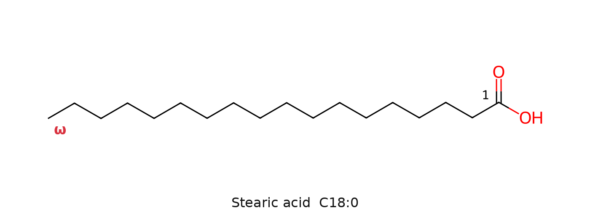

> [!explain] كيف نكتب صيغة أي حمض دهني مشبع
> كيف نكتبها: نبدأ بـ **CH~3~** (الطرف)، وننتهي بـ **COOH**، وبينهما زمر **CH~2~** عددها = **عدد ذرات الكربون − 2** (لأن CH~3~ فيها كربون، و COOH فيها كربون). مثال البيوتيريك: 4 − 2 = 2 ← CH~3~(CH~2~)~2~COOH، ومثال الستياريك: 18 − 2 = 16 ← CH~3~(CH~2~)~16~COOH.
> من أين (الصيغة الجزيئية): كل حمض مشبع صيغته **C~n~H~2n~O~2~**: البيوتيريك C~4~H~8~O~2~، والبالميتيك C~16~H~32~O~2~، والستياريك C~18~H~36~O~2~.
> كيف تحدث (الرسم المتعرج): كل **رأس** في الخط المتعرج = ذرة كربون. نضع COOH في طرف ونعدّ الرؤوس: 1 (كربون COOH)، 2، 3 ... حتى آخر رأس (CH~3~). هكذا رسمها الطلاب على اللوح وهم يعدّون "واحد، اتنين، تلاتة...".
> تحقّق سريع: عدّ ذرات الكربون في صيغتك، يجب أن يطابق الرقم في الجدول.

> [!tip] طريقة لحفظ الترتيب (4 ← 20، يزيد 2 كل مرة):
> - **بيوتيريك = زبدة** (أول حمض، أقصر واحد، 4).
> - الثلاثة **كابر**: كابر**و**يك 6، كابر**يل**يك 8، كابر**يك** 10. "كابرا" باللاتيني = **العنزة**، ولذلك توجد بكثرة في **حليب الماعز** وتعطيه رائحته المميزة.
> - **لوريك = غار** 12: انظر على علبة **صابون الغار**، تجد مكتوباً "لورات الصوديوم" أي ملح حمض اللوريك، كما قال الدكتور [00:11:19].
> - **ميريستيك** 14، ثم **بالميتيك = نخيل** 16، ثم **ستياريك = شحم** 18، ثم **أراكيديك** 20.
> - جملة للحفظ: **ب**نت **ك**بيرة **ك**تبت **ك**تاب **ل**يلة **م**طر، **ب**عدها **س**افرت **أ**مس.

> [!note] أصل الاسم: الميريستيك سُمّي من نبات **جوزة الطيب** (اسمها العلمي Myristica)، وقد كُتب بجانبه في دفتر شعبة الشباب "دارشين" (القرفة)، والصحيح جوزة الطيب. وأغنى مصادره الحقيقية **زيت جوز الهند وزيت نوى النخيل** ودهن الحليب.

## درجة الانصهار وطول السلسلة

قال الدكتور: "بدي أحكيلكم نقطة الانصهار... بس انتو **ما تحفظوا معي، انتو بس افهموا**" [00:19:25]، ثم أملى درجات الانصهار:

| الحمض | عدد ذرات الكربون | درجة الانصهار كما أملاها | حالته بحرارة الغرفة |
| البيوتيريك | 4 | −5.5°م | سائل |
| الكابرويك | 6 | −1.5°م | سائل |
| الكابريليك | 8 | 16.5°م | سائل |
| الكابريك | 10 | 31.5°م | صلب (طري) |
| اللوريك | 12 | نحو 44°م | صلب |
| الميريستيك | 14 | 54°م | صلب |
| البالميتيك | 16 | 63°م | صلب |
| الستياريك | 18 | 70°م | صلب |
| الأراكيديك | 20 | 77°م | صلب |

> [!define] قاعدة الدكتور
> **كلما زاد طول السلسلة كلما ارتفعت نقطة الانصهار.** [00:20:17]

> [!why] كلما زاد طول السلسلة ارتفعت درجة انصهار الحمض الدهني.
> لأن: السلاسل الهيدروكربونية تتجاذب مع بعضها بقوى ضعيفة (**قوى فان دير فالس**) على طولها كله؛ فكلما **طالت السلسلة زادت مساحة التماس** بين الجزيئات وزادت قوى التجاذب، فنحتاج **حرارة أكبر** لنفصلها عن بعضها (أي لتنصهر).

> [!note] عن الأرقام: الدكتور قال صراحة لا تحفظوها، المطلوب القاعدة. وأرقامه قريبة من المراجع (مثلاً الكابريليك 16.7، الكابريك 31.6، الميريستيك 54.4، البالميتيك 62.9، الستياريك 69.6، الأراكيديك 75.5°م). رقم **اللوريك** سُمع من التسجيل "...وأربعين ونص" ولم يتضح الرقم الأول، وقيمته في المراجع **44°م**. وبعد الأراكيديك ذكر الدكتور شفهياً 80 و 86: وهي لأحماض أطول (C22 و C24) غير مطلوبة.

> [!remember] حرارة الغرفة نحو 25°م: الأحماض **القصيرة** (4 إلى 8) **سائلة**، ومن **الكابريك (10)** فما فوق **صلبة**. ولهذا الدهون الغنية بالأحماض الطويلة المشبعة (الشحم) صلبة.

# تصنيف الأحماض الدهنية حسب طول السلسلة

قسّم الدكتور الأحماض المشبعة إلى ثلاث مجموعات [00:20:37–00:21:26]: {ص 3}

| المجموعة | عدد ذرات الكربون | الأحماض |
| **قصيرة السلسلة** | 4 إلى 8 | البيوتيريك، الكابرويك، الكابريليك |
| **متوسطة السلسلة** | 10 إلى 12 | الكابريك، اللوريك |
| **طويلة السلسلة** | 14 إلى 20 | الميريستيك، البالميتيك، الستياريك، الأراكيديك |

> [!doctor] ربط الدكتور هذا التصنيف بمادة **التغذية العلاجية** أكثر من مرة: "بكرا إذا واحد معه **مرارة**، إذا واحد معه **إسهال دهني**، إذا واحد معه **داء الزلاقي**، شو ياكل؟" [00:14:45] و [00:21:08]، ثم أجاب في آخر المحاضرة: "بالتغذية العلاجية يجب أن نأخذ **غليسيريدات ثلاثية متوسطة السلسلة**، يعني يا لوريك يا كابريك" [01:08:28]. وفي شعبة الشباب أضاف: سرطان البنكرياس، وأمراض الأوعية اللمفية والزغابات المعوية.

> [!exam] مريض استؤصلت مرارته، أو عنده إسهال دهني، أو داء زلاقي: أي نوع من الدهون نعطيه؟ ولماذا؟
> الجواب: **غليسيريدات ثلاثية متوسطة السلسلة** (أحماضها الكابريك واللوريك، وتسمى زيوت MCT)، لأنها تُهضم وتُمتص بسهولة وتذهب مباشرة إلى الدم عبر الوريد البابي، دون حاجة إلى الصفراء ولا إلى الكيلوميكرونات.

> [!explain] لماذا الدهون متوسطة السلسلة لهؤلاء المرضى؟
> كيف تحدث (امتصاص الدهون الطويلة): الحمض الدهني الطويل لا يذوب بالماء، فيحتاج **أملاح الصفراء** (من المرارة) لتجعله قطرات صغيرة، وإنزيم **الليباز** من البنكرياس ليهضمه، ثم **زغابات معوية** سليمة تعيد تشكيله غليسيريدات وتغلّفه **كيلوميكرونات** وترسله في **الأوعية اللمفية**.
> لماذا تفشل عند المرضى: مستأصل المرارة ينقصه الصفراء، ومريض البنكرياس ينقصه الليباز، ومريض الزلاقي زغاباته متضررة، ومريض الأوعية اللمفية لا تمر فيها الكيلوميكرونات. فيبقى الدهن الطويل بالأمعاء ويخرج ← **إسهال دهني**.
> من أين الحل: الأحماض **القصيرة والمتوسطة** أصغر وأكثر ذوباناً بالماء، فتُمتص **مباشرة إلى الوريد البابي** (مثل السكر) دون صفراء ولا كيلوميكرونات. وهذا ما شرحه الدكتور في محاضرة **تداخل الغذاء والدواء** (امتصاص الأحماض الدهنية).

> [!note] دقة علمية: في كتب التغذية العلاجية تُعدّ **الكابريليك (8) والكابريك (10)** هما أساس زيوت MCT، وتصنّف المراجع الأحماض المتوسطة غالباً **من 6 أو 8 إلى 12** ذرة. الدكتور وضع الكابريليك مع القصيرة؛ **اكتب في امتحانه تقسيمه** (4–8 قصيرة، 10–12 متوسطة، 14–20 طويلة)، واعرف أن الفكرة نفسها: كلما قصرت السلسلة سهل الامتصاص.

# الأحماض الدهنية غير المشبعة

> [!define] الحمض الدهني غير المشبع
> حمض دهني تحوي سلسلته **رابطة زوجية واحدة أو أكثر** (C=C)، أما المشبع فلا يحوي أي رابطة زوجية [00:36:54].

حفظ الدكتور منها أربعة {ص 4}:

| الحمض | الرمز المختصر | عدد الروابط الزوجية | العائلة |
| **الأولييك** (حمض الزيت) | C18:1 Δ9 | 1 | أوميغا 9 |
| **اللينولييك** | C18:2 Δ9,12 | 2 | أوميغا 6 |
| **اللينولينيك** | C18:3 Δ9,12,15 | 3 | أوميغا 3 |
| **الأراكيدونيك** | C20:4 Δ5,8,11,14 | 4 | أوميغا 6 |

$$ Oleic · Linoleic · Linolenic · Arachidonic

## الرمز المختصر: كيف نقرأه ونكتبه

شرح الدكتور الرمز على الأولييك [00:25:39]: "نكتب **C18** يعني 18 ذرة كربون، **نضع نقطتين**، نكتب **1** معناه فيه رابطة زوجية واحدة، **نضع مثلث (Δ)** ونكتب **9** معناه على ذرة الكربون رقم 9".

> [!explain] الرمز المختصر للحمض الدهني (مثل C18:2 Δ9,12)
> كيف نكتبها: **C** ثم عدد ذرات الكربون، ثم **نقطتان** وعدد الروابط الزوجية، ثم **Δ** (دلتا) ومواقع الروابط مفصولة بفواصل. اللينولييك = C18:2 Δ9,12. والحمض المشبع: C18:0 بلا Δ.
> من أين (الترقيم): نبدأ العدّ من **كربون COOH = رقم 1**، ورقم الرابطة هو رقم **أول** ذرة كربون فيها: Δ9 = رابطة بين الكربون 9 والكربون 10.
> لماذا نستعمله: الاسم العلمي الكامل للينولييك مثلاً "cis,cis-9,12-octadecadienoic acid" طويل، أما الرمز فيعطي في سطر واحد: طول السلسلة، وعدد الروابط، ومكانها. ومنه نرسم الحمض كاملاً.
> كيف تحدث (رسم الحمض من رمزه): نرسم خطاً متعرجاً بعدد ذرات الكربون، نضع COOH عند الذرة 1، ثم نعدّ ونضع خطاً ثانياً (رابطة زوجية) بين 9 و 10، وبين 12 و 13، ونرسم ذرتي H على طرفي كل رابطة **بنفس الجهة** (هذا شكل cis الطبيعي، انظر الفصل التالي).

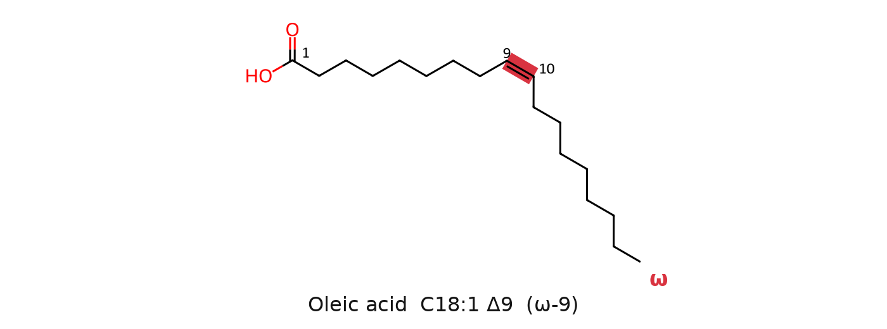

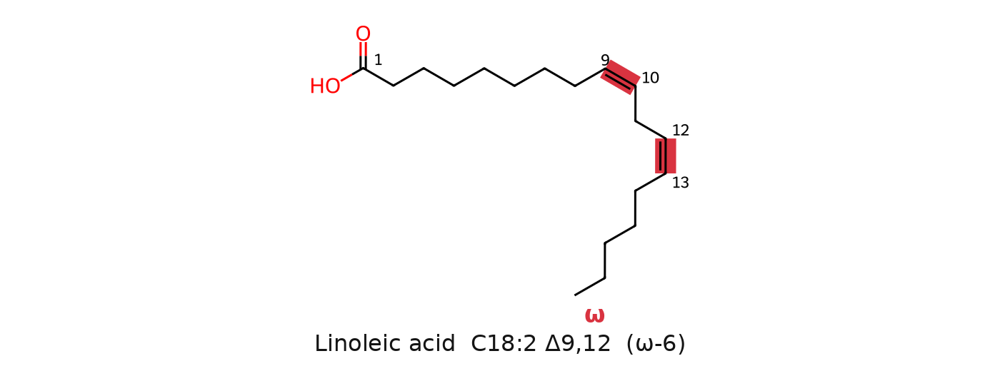

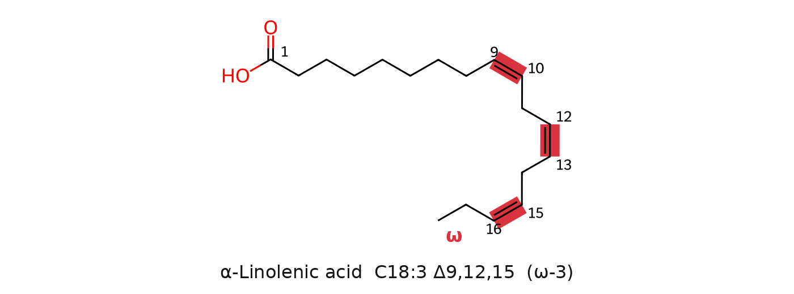

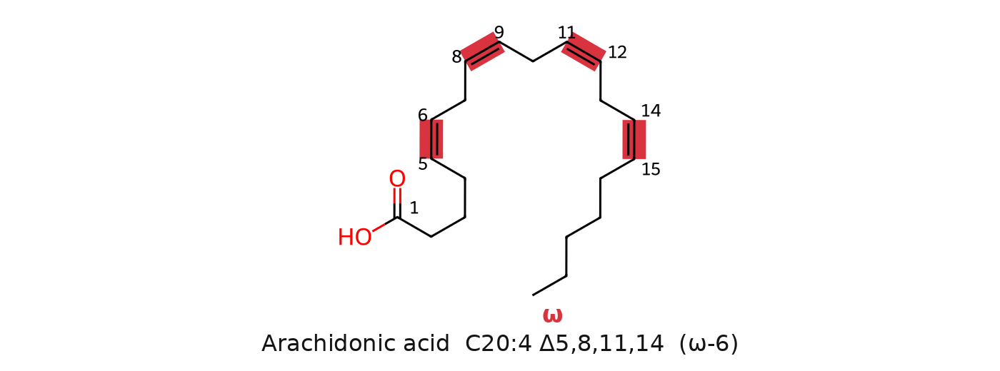

> [!mistake] لا تخلط بين **الأراكيديك** و**الأراكيدونيك**: كلاهما **20 ذرة كربون**، لكن الأراكيديك **مشبع** (C20:0، آخر القائمة المشبعة)، والأراكيدونيك **غير مشبع** فيه 4 روابط زوجية (C20:4). نبّه الدكتور على هذا [00:36:15–00:37:00]: "الأراكيديك مشبع 20 ذرة كربون، الأراكيدونيك غير مشبع 20 ذرة كربون".

> [!mistake] في الملخص المكتوب {ص 4} كُتب الأراكيدونيك **C18:4** وبجانبه **ω4**، والصحيح **C20:4** و **أوميغا 6** (20 − 14 = 6). وكُتبت القاعدة "كلما زادت عدد روابط **مشبعة**..."، والصحيح "روابط زوجية **غير مشبعة**".

## درجة الانصهار وعدد الروابط الزوجية

أملى الدكتور [00:37:30]:

| الحمض | عدد الروابط الزوجية | درجة الانصهار كما أملاها | حالته بحرارة الغرفة |
| الستياريك (للمقارنة) | 0 | 70°م | صلب |
| الأولييك | 1 | 16°م | سائل |
| اللينولييك | 2 | −5°م | سائل |
| اللينولينيك | 3 | −10°م | سائل |
| الأراكيدونيك | 4 | −15°م | سائل |

> [!define] قاعدة الدكتور
> **كلما زاد عدد الروابط الزوجية غير المشبعة كلما انخفضت نقطة الانصهار.** [00:39:37]

> [!doctor] [00:39:27] "شوفي نقطة الانصهار... **ما تحفظها**، بس كلما زادت عدد الروابط الزوجية غير المشبعة كلما انخفضت نقطة الانصهار"، وكرّر الجملة مرتين.

> [!why] كلما زاد عدد الروابط الزوجية انخفضت درجة الانصهار.
> لأن: كل رابطة زوجية بشكل **cis** تُحدث **انثناءً** في السلسلة، فلا تستطيع الجزيئات أن تتراصّ قريبة من بعضها كما تفعل السلاسل المستقيمة المشبعة، فتضعف قوى التجاذب بينها، وتنصهر بحرارة أقل.

> [!why] **زيت الزيتون يتجمد إذا وضعناه في البراد، أما زيت دوار الشمس وزيت السمك فلا يتجمدان.**
> لأن: زيت الزيتون غني بالأولييك (رابطة زوجية **واحدة**، درجة انصهاره فوق حرارة البراد)، أما دوار الشمس فغني باللينولييك (**رابطتان**) وزيت السمك غني بأوميغا 3 (**ثلاث روابط أو أكثر**)، فدرجة انصهارهما أخفض بكثير من حرارة البراد. هذا مثال الدكتور [00:39:48]: "ليش؟ لأنه فيه روابط زوجية".

> [!note] أرقام المراجع: الأولييك 13 إلى 16°م، اللينولييك −5°م، اللينولينيك −11°م، أما **الأراكيدونيك فنحو −49.5°م** في المراجع وليس −15°م. الدكتور قال لا تحفظوا الأرقام؛ إن سألك عنها بامتحانه فاكتب أرقامه، والمهم أن تكتب **القاعدة** وسببها.

# التماكب الهندسي: cis و trans

رسم الدكتور مركباً بسيطاً فيه رابطة زوجية بين ذرتي كربون، وعلى كل ذرة زمرة COOH وذرة H [00:40:36]: "إذا كانوا **بجهة واحدة** نسميها **cis**، أما إذا كانوا **بجهتين** نسميها **trans**".

> [!define] الشكل cis (سيس)
> تكون المجموعتان المتشابهتان (أو ذرتا الهيدروجين) على طرفي الرابطة الزوجية **في جهة واحدة**.

> [!define] الشكل trans (ترانس)
> تكون المجموعتان المتشابهتان (أو ذرتا الهيدروجين) على طرفي الرابطة الزوجية **في جهتين متعاكستين**.

> [!define] شرط وجود cis و trans
> **وجود رابطة زوجية غير مشبعة لا تسمح للمجموعات الوظيفية بالحركة فتثبّتها**: فإذا كانت بجهة واحدة سميناها cis، وإذا كانت بجهتين متعاكستين سميناها trans. [00:41:18]

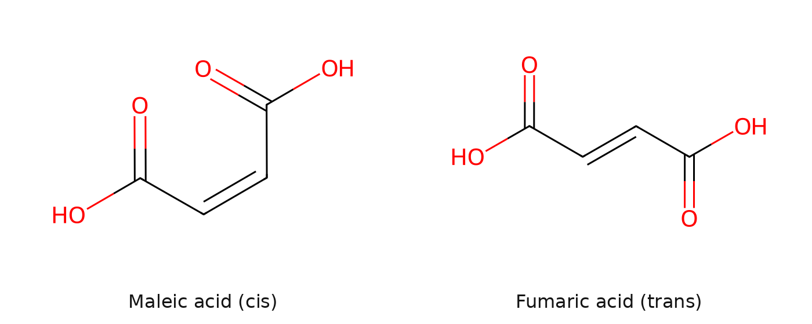

> [!explain] لماذا لا يحدث cis و trans في الرابطة الأحادية؟
> لماذا: حول الرابطة **الأحادية** C–C تدور الذرتان بحرية مثل عجلة على محور، فلا يبقى شكل ثابت. أما الرابطة **الزوجية** C=C ففيها رابطة ثانية (رابطة π) فوق المحور وتحته، تنكسر إذا حاولنا التدوير؛ لذلك **تتثبّت** المجموعات في مكانها، ويصبح للجزيء شكلان مختلفان لا يتحول أحدهما للآخر إلا بطاقة كبيرة (حرارة عالية أو وسيط).
> كيف نكتبها: نرسم C=C، ثم على كل كربون نرسم H في الأعلى أو الأسفل: **H و H فوق** (أو كلاهما تحت) = cis، **H فوق و H تحت** = trans.

ثم سأل الدكتور عن الأحماض الدهنية التي رسمها: "عندي هون H وعندي هون H، cis أم trans؟... cis" [00:41:39–00:42:09]، وقال: "**هادا طبيعي**". أي أن:

> [!remember] الأحماض الدهنية الموجودة **في الطبيعة** كلها تقريباً بشكل **cis**.

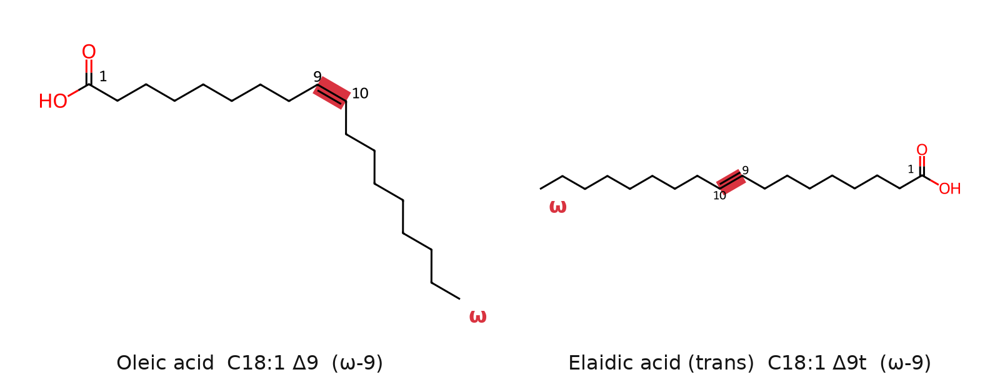

## الهدرجة: من الزيت إلى السمنة، ومن cis إلى trans

شرح الدكتور هذه القصة مطوّلاً [00:42:09–00:47:37]:

1. عندي **زيت** (فيه أولييك، 18 ذرة كربون غير مشبع)، وأريد أن أصنع منه **سمنة**.
2. أضيف إليه **الهيدروجين** (هدرجة) فتُشبَع الروابط الزوجية: الأولييك يصبح **ستياريك** (18 ذرة كربون مشبع). "شو اسم الحمض اللي 18 ذرة كربون ومشبع؟ ستياريك".
3. لو هدرجتُ **كل** الروابط، يصبح الدهن **صلباً** مثل **شحمة الخروف**: لا أستطيع أن أغرفه بالملعقة.
4. لكن السمنة بالسوق **طرية** تُغرف بالملعقة، لأن المصنع **يهدرج جزءاً ويترك جزءاً** (والنسبة "سر الشركة المصنّعة").
5. الجزء الذي لم يُهدرج **يتعرض لحرارة مرتفعة** أثناء التصنيع، فتتحول بعض روابطه من **cis إلى trans**.
6. بعدها يضيفون **الكاروتين** (للون الأصفر) ويسمّونها "سمنة **عربية**"، وقال الدكتور: "ما إلها علاقة لا بالعربية ولا بالتركية" [00:47:08].
7. ويضيفون **مضادات أكسدة** (مثل فيتامين E) "حتى يحموا الروابط الزوجية" الباقية من الأكسدة [00:47:22].

> [!why] السمنة النباتية التجارية طرية تُغرف بالملعقة، وليست صلبة مثل شحم الخروف.
> لأن: الزيت **يُهدرج جزئياً**: يُشبَع جزء من روابطه الزوجية فيرتفع قوامه، ويبقى جزء غير مشبع فيبقى طرياً.

> [!why] السمنة المهدرجة جزئياً تحوي أحماضاً دهنية بشكل **trans**.
> لأن: الروابط الزوجية التي لم تُهدرج تتعرض **للحرارة المرتفعة** (ووجود الوسيط) أثناء الهدرجة، فتتحول من الشكل الطبيعي **cis** إلى **trans**.

> [!note] **الدهون المتحوّلة (trans) ضارة**: ترفع الكوليسترول الضار LDL وتخفض المفيد HDL، فتزيد خطر **أمراض القلب والشرايين**، ولذلك تطالب منظمة الصحة العالمية بإزالتها من الأغذية المصنّعة. وكما في دفتر شعبة الشباب: الزيت الذي **نقلي به مرات كثيرة** يتعرض للحرارة طويلاً فتتشكل فيه أحماض trans ومركبات أكسدة ضارة، بعضها يُشتبه بأنه **مسرطن**؛ لذلك لا يُعاد استعمال زيت القلي كثيراً.

# الأحماض الدهنية الأساسية ونظام أوميغا

> [!define] الأحماض الدهنية الأساسية غير المشبعة
> أحماض دهنية **لا يصنعها الجسم**، وبالتالي **يجب أن نأكلها يومياً**: وهي **اللينولييك** و**اللينولينيك**. [00:47:50–00:48:14] و [00:53:18–00:53:30]

> [!doctor] أعاد الدكتور السؤال عدة مرات: "**الأولييك أساسي؟ لا**... جسمه يصنعه من الأسيتيل CoA" [00:51:47]، ثم: "لينولييك ولينولينيك، **هدول الأساسيات**" [00:53:28].

> [!note] في دفتر شعبة الشباب وُضع **الأراكيدونيك** أيضاً مع الأساسية. والأدق: الجسم يصنع الأراكيدونيك **من اللينولييك**، فإذا نقص اللينولييك احتاجه الجسم من الغذاء، ولذلك تسميه بعض المراجع "**شبه أساسي**". إن سُئلت فالأساسيان المؤكدان: **اللينولييك (أوميغا 6) واللينولينيك (أوميغا 3)**.

> [!why] حمض الأولييك **ليس أساسياً** بينما اللينولييك واللينولينيك أساسيان.
> لأن: الجسم يصنع الأولييك بنفسه (من الأسيتيل CoA ثم يضع رابطة زوجية عند الكربون 9)، لكنه **لا يملك إنزيماً** يضع رابطة زوجية بعد الكربون 9 (نحو نهاية الميثيل)، فلا يستطيع صنع روابط أوميغا 6 وأوميغا 3، فيجب أن تأتي من الغذاء.

## نظام أوميغا (ω)

> [!define] أوميغا (ω)
> **أوميغا باللغة اليونانية تعني "النهاية"**: نعدّ ذرات الكربون **من النهاية** (من جهة CH~3~) حتى نصل إلى أول رابطة زوجية؛ فإذا وقعت الرابطة الزوجية على ذرة الكربون رقم **9 من النهاية** سمّيناه **أوميغا 9**، وإذا وقعت على ذرة الكربون رقم **6 من النهاية** سمّيناه **أوميغا 6**. [00:50:06–00:52:09]

> [!doctor] بعد أن شرحها وعدّ مع الطلاب على اللوح قال: "يلا نلخّص: إيش معنى أوميغا؟ **من النهاية**" [00:51:54]، ثم حذّر: "يا صبايا، والله العظيم إذا الأسبوع الجاي ما حفظتوها..." [00:52:13]. أي أنه سيسأل عنها.

> [!admin] الدكتور طلب حفظ أسماء الأحماض الدهنية (المشبعة وغير المشبعة) ومعنى أوميغا قبل المحاضرة القادمة، وهدّد بأنه سيسأل عنها الأسبوع القادم [00:52:13].

| الحمض | آخر رابطة من جهة COOH | العدّ من النهاية | العائلة |
| الأولييك | Δ9 | 18 − 9 = 9 | **أوميغا 9** |
| اللينولييك | Δ12 | 18 − 12 = 6 | **أوميغا 6** |
| اللينولينيك | Δ15 | 18 − 15 = 3 | **أوميغا 3** |
| الأراكيدونيك | Δ14 | 20 − 14 = 6 | **أوميغا 6** |

$$ رقم أوميغا  =  عدد ذرات الكربون  −  رقم آخر رابطة Δ

> [!explain] كيف نحسب رقم أوميغا
> كيف نكتبها: إما **نعدّ على الرسم** من طرف CH~3~ (CH~3~ = 1) حتى أول ذرة في أول رابطة زوجية، كما فعل الدكتور على اللوح؛ أو **نحسب**: عدد ذرات الكربون − رقم **آخر** رابطة Δ.
> من أين جاء القانون: الكربون رقم k من جهة COOH هو نفسه الكربون رقم (n + 1 − k) من جهة الميثيل. الرابطة Δ15 في اللينولينيك هي بين C15 و C16؛ ذرتها الأقرب للنهاية هي C16، ورقمها من النهاية 18 + 1 − 16 = **3**. وهذا يساوي ببساطة 18 − 15 = 3.
> لماذا نحتاج نظامين: نظام Δ يصف **مكان كل رابطة** بدقة، أما أوميغا فيصنّف الأحماض في **عائلات** غذائية: الجسم حين يطيل السلسلة يضيف ذرات الكربون من جهة COOH، فيبقى العدّ من النهاية **ثابتاً**؛ فاللينولييك (أوميغا 6) يتحول في الجسم إلى الأراكيدونيك وهو أيضاً **أوميغا 6**.

> [!problem] (تدريب على طريقة الدكتور) حدّد عائلة أوميغا لحمض رمزه C20:4 Δ5,8,11,14.
> المعطيات: عدد ذرات الكربون = 20، آخر رابطة زوجية = Δ14
> القانون: رقم أوميغا = عدد ذرات الكربون − رقم آخر رابطة Δ
> الحل: 1. آخر رابطة من جهة COOH هي 14. 2. 20 − 14 = 6.
> النتيجة: الحمض **أوميغا 6** (وهو الأراكيدونيك).

> [!problem] (تدريب) حوّل مواقع الروابط في اللينولينيك C18:3 Δ9,12,15 إلى العدّ من النهاية.
> المعطيات: n = 18، الروابط Δ9 و Δ12 و Δ15
> القانون: الموقع من النهاية = 18 − موقع Δ
> الحل: 1. 18 − 15 = 3. 2. 18 − 12 = 6. 3. 18 − 9 = 9.
> النتيجة: الروابط عند ω3 و ω6 و ω9 من النهاية، وأولها من النهاية عند 3، فهو **أوميغا 3**.

> [!tip] للحفظ: **أولييك = 9 = زيت الزيتون**، **لينولييك = 6**، **لينولينيك = 3** (كلما زاد طول الاسم بمقطع "نين" نقص رقم أوميغا وزادت الروابط)، و**أراكيدونيك = 6** مثل أبيه اللينولييك.

## من أين نأخذها؟

سأل الدكتور [01:09:07–01:10:39]: إذا كان الزيت...
- **زيت الزيتون** ← غني بـ **الأولييك** (أوميغا 9).
- **زيت الذرة أو دوار الشمس** ← غني بـ **اللينولييك** (أوميغا 6).
- **زيت السمك** ← غني بأحماض **أوميغا 3**.
- **الزبدة** ← تتميز بـ **البيوتيريك**.
- **شحم البقر** ← أحماض **طويلة السلسلة** مشبعة (ستياريك).
- **دهن الفروج** ← خليط: "يمكن يكون فيه أولييك وشوية ستياريك"؛ "يعني كلها أحماض دهنية تختلف بطول السلسلة".

> [!note] دقة: أوميغا 3 في **زيت السمك** هو بالأساس حمضا **EPA و DHA** (سلاسل أطول من 20 و 22 ذرة)، أما **اللينولينيك** (ألفا) فمصدره النباتي **بذور الكتان والجوز وزيت الكانولا**. والدكتور سمّى زيت السمك "لينولينيك" بمعنى أنه من نفس العائلة **أوميغا 3**. وكذلك الزبدة: أكثر أحماضها البالميتيك والأولييك، لكن **البيوتيريك** هو الحمض الذي يميّزها (لا يوجد بكمية مهمة إلا في دهن الحليب، وهو الذي يعطي الزبدة المتزنخة رائحتها).

# تفاعلات الأحماض الدهنية

هذا الفصل من **شعبة الشباب** (صور اللوح ودفتر الطالب والتسجيل). قسّم الدكتور التفاعلات إلى قسمين: تفاعلات تابعة **للمجموعة الكربوكسيلية**، وتفاعلات تابعة **للرابطة الزوجية**.

## أولاً: التفاعلات التابعة للمجموعة الكربوكسيلية

كتب الدكتور على اللوح: "**التفاعلات التابعة للمجموعة الكاربوكسيلية**"، وفي الدفتر: "يعني يتبع لها **المشبع وغير المشبع**"، لأن كل حمض دهني فيه COOH.

### 1. الأسترة

> [!define] الأسترة
> هي عبارة عن **تفاعل كحول وحمض**، ينتج **إستر** ويخرج **ماء**.

$$ R–COOH  +  R′–OH   →   R–COO–R′  +  H~2~O

> [!explain] تفاعل الأسترة
> كيف نكتبها: نكتب الحمض R–COOH + الكحول R′–OH، ثم السهم، ثم الإستر R–COO–R′ + H~2~O. وكما فعل الدكتور على اللوح: **نحوّط OH من الحمض و H من الكحول**، هذه الذرات تخرج **ماءً**، وما يبقى من الجزيئين يرتبط ببعضه.
> لماذا تخرج OH من الحمض لا من الكحول: كربون الزمرة C=O في الحمض يحمل شحنة موجبة جزئية (لأن الأكسجين يسحب الإلكترونات)، فيهاجمه أكسجين الكحول ويرتبط به، فتنفصل OH الحمض. وهذا ثابت تجريبياً: إذا وسمنا أكسجين الكحول بنظير مشع ظهر في **الإستر** لا في الماء.
> من أين (في الغذاء): **الدهون والزيوت نفسها إسترات** (الغليسيرول كحول + أحماض دهنية، انظر فصل الغليسيريدات)، وكثير من **روائح الفواكه** إسترات طيّارة. وقد رسم الدكتور سهماً صاعداً بجانب الإستر، وكُتب في الدفتر "**يعني يتطاير**": الإسترات الصغيرة متطايرة ولها رائحة.
> كيف تحدث: بالتسخين بوجود حمض وسيط، والتفاعل **عكوس**: عكسه **الحلمهة** (تفكك الإستر بالماء إلى حمض وكحول).

### 2. تشكيل الأميدات

$$ R–COOH  +  H–NH~2~   →   R–CO–NH~2~  +  H~2~O

ينتج **الأميد المناظر** للحمض. والمادة H–NH~2~ هي **النشادر NH~3~**، كتبها الدكتور هكذا "فصلناها للفهم": H تخرج مع OH الحمض ماءً، و NH~2~ ترتبط بالكربون مكان OH.

> [!explain] تشكيل الأميد
> كيف نكتبها: مثل الأسترة تماماً، لكن بدل الكحول نضع **النشادر** (أو أميناً R′–NH~2~): نحوّط OH من الحمض و H من النشادر ← ماء، ويبقى R–CO–NH~2~.
> من أين نعرف هذه الرابطة: الرابطة –CO–NH– هي نفسها **الرابطة الببتيدية** التي تربط الحموض الأمينية في البروتينات (COOH حمض أميني + NH~2~ حمض أميني آخر).

### 3. تشكيل الصابون

$$ R–COOH  +  NaOH   →   R–COONa  +  H~2~O

> [!define] الصابون
> **ملح الحمض الدهني** مع قلوي (R–COONa)، ينتج من تفاعل الحمض الدهني مع **القلوي** (مثل NaOH).

> [!remember] ملاحظات هامة (من الدفتر):
> - إذا كان القلوي **صوديوم أو بوتاسيوم**: الصابون **يذوب** بالماء.
> - إذا كان القلوي **كالسيوم أو مغنيزيوم**: الصابون **لا يذوب** بالماء.

> [!why] الصابون لا يرغي في **الماء العسر** ويترك طبقة بيضاء (كلسة) على المغسلة.
> لأن: الماء العسر غني بشوارد **الكالسيوم والمغنيزيوم**، فتحل محل الصوديوم وتشكّل صابون كالسيوم/مغنيزيوم **لا يذوب** بالماء، فيترسب.

> [!explain] كيف يغسل الصابون؟
> كيف تحدث: جزيء الصابون له طرفان: الذيل R الطويل **يحب الدهن** فيدخل في بقعة الدهن، والرأس –COO^−^Na^+^ **يحب الماء** فيبقى في الماء. فتحيط جزيئات الصابون بقطرة الدهن وتجعلها معلّقة في الماء فتُغسل. (هذه نفس فكرة **الاستحلاب** في فصل الفوسفوليبيدات).
> من أين (مثال الدكتور): **صابون الغار** مصنوع من زيت الغار الغني بحمض **اللوريك**، ولذلك نقرأ على علبته "**لورات الصوديوم**" = ملح الصوديوم لحمض اللوريك.

### 4. الإرجاع

$$ R–COOH  +  2H~2~   →   R–CH~2~OH  +  H~2~O

بالهيدروجين تُرجَع زمرة الكربوكسيل إلى **كحول** (كتبها الدكتور: R–COOH ثم H~2~ فوق السهم ثم R–CH~2~OH).

> [!note] كتب الدكتور H~2~ فوق السهم فقط، والمعادلة الموزونة تحتاج **جزيئي H~2~**: الأول يحوّل C=O إلى CH–OH، والثاني ينزع الأكسجين الآخر على شكل ماء. والناتج **كحول دهني** (مثل الكحول الستياريلي من الستياريك)، ويحتاج في المخبر مُرجِعاً قوياً.

### 5. نزع الكربوكسيل

$$ R–COOH   →   R–H  +  CO~2~

تُنزع زمرة الكربوكسيل على شكل **CO~2~**، ويبقى **الهيدروكربون المناظر** R–H. (رسم الدكتور دائرة حول COOH وسهماً يخرج منها CO~2~).

> [!tip] لحفظ التفاعلات الخمسة: **أستر، أميد، صابون، إرجاع، نزع**؛ الثلاثة الأولى كلها "حمض + شيء ← ناتج + ماء"، والفرق فقط في "الشيء": **كحول** ← إستر، **نشادر** ← أميد، **قلوي** ← صابون.

## ثانياً: تفاعلات الأحماض الدهنية غير المشبعة (الرابطة الزوجية)

> [!define] تفاعل الضم (الإضافة)
> تستطيع الأحماض الدهنية غير المشبعة أن **تضم إليها الهالوجينات**، فتتحول الرابطة الزوجية **من غير مشبعة إلى مشبعة** بسبب ضم الهالوجين. والهالوجينات هي: **الكلور، البروم، الفلور، اليود**؛ وبنفس الطريقة يُضم **الهيدروجين** (الهدرجة).

### 1. ضم البروم

$$ R–CH=CH–COOH  +  Br~2~   →   R–CHBr–CHBr–COOH

### 2. ضم اليود (على حمض الأولييك)

$$ CH~3~(CH~2~)~7~–CH=CH–(CH~2~)~7~–COOH  +  I~2~   →   CH~3~(CH~2~)~7~–CHI–CHI–(CH~2~)~7~–COOH

الناتج اسمه **9,10-ثنائي يوديد الستياريك**.

> [!why] ناتج ضم اليود إلى الأولييك يسمى **9,10-ثنائي يوديد الستياريك**.
> لأن: بعد الضم تنكسر الرابطة الزوجية فتصبح السلسلة **مشبعة بـ 18 ذرة كربون**، وهذا هيكل **الستياريك**، وترتبط ذرتا اليود بالكربونين **9 و 10** حيث كانت الرابطة الزوجية (Δ9).

> [!explain] تفاعل الضم
> كيف نكتبها: ننسخ الحمض كما هو، ونكسر الخط الثاني من C=C فيصبح C–C، ونضع ذرة من الهالوجين على **كل** كربون من الكربونين. ولتسمية الناتج: نسمّي الحمض المشبع الذي له نفس عدد ذرات الكربون، ونسبقه بأرقام الكربونات و"ثنائي ...يد".
> لماذا تنكسر الرابطة الزوجية لا الأحادية: الرابطة الزوجية فيها رابطة ثانية (π) ضعيفة وإلكتروناتها مكشوفة، فتهاجمها جزيئات الهالوجين بسهولة، أما الرابطة الأحادية فقوية.
> كيف تحدث في المخبر: **ماء البروم** لونه برتقالي، فإذا أضفناه إلى زيت غير مشبع **زال لونه** لأن البروم يُضم إلى الروابط الزوجية. هذا كشف بسيط لعدم الإشباع.

> [!define] الرقم اليودي
> هو **كمية اليود بالغرام** اللازمة **لتمام إشباع الروابط الزوجية** الموجودة في **100 غرام زيت**.

> [!explain] لماذا نقيس الرقم اليودي؟
> لماذا: كل رابطة زوجية تضم جزيء يود واحداً، فكلما زادت الروابط الزوجية **زاد اليود** المستهلك. فالرقم اليودي **مقياس لدرجة عدم الإشباع**: زيت دوار الشمس رقمه اليودي مرتفع، وزيت الزيتون متوسط، والشحم منخفض، والحمض المشبع رقمه **صفر**.
> كيف تحدث في المخبر: نضيف كمية معروفة من اليود (عملياً كلوريد اليود ICl، طريقة **ويجس**) إلى وزن معروف من الزيت، ثم نعاير اليود الزائد الذي لم يتفاعل، فنعرف كم يوداً استُهلك، ونحسبه لكل 100 غ.

> [!problem] (تدريب إضافي، ليس من الدكتور) احسب الرقم اليودي لحمض الأولييك النقي، علماً أن M(أولييك) = 282.5 g/mol و M(I~2~) = 253.8 g/mol.
> المعطيات: رابطة زوجية واحدة ← مول I~2~ واحد لكل مول حمض
> القانون: الرقم اليودي = (عدد الروابط × 253.8 ÷ M) × 100
> الحل: 1. كل 282.5 غ أولييك تضم 253.8 غ يود. 2. لكل 100 غ: 253.8 × 100 ÷ 282.5 = 89.9.
> النتيجة: الرقم اليودي للأولييك ≈ **89.9 g I~2~/100 g**. وبنفس الطريقة: اللينولييك (رابطتان) ≈ **181**، واللينولينيك (3 روابط) ≈ **273.5**، والستياريك = **0**.

### 3. ضم الهيدروجين: الهدرجة

$$ CH~3~(CH~2~)~7~–CH=CH–(CH~2~)~7~–COOH  +  H~2~   →   CH~3~(CH~2~)~16~–COOH

$$ الأولييك (16°م)   →   الستياريك (70°م)

كتب الدكتور تحت الأولييك **16°م** وتحت الستياريك **70°م**.

> [!why] الهدرجة تحوّل **الزيت السائل** إلى **دهن صلب**.
> لأن: إضافة الهيدروجين تُزيل الرابطة الزوجية (وانثناءها)، فيتحول الحمض غير المشبع إلى **مشبع مستقيم** (الأولييك ← الستياريك)، فتتراص الجزيئات وترتفع درجة الانصهار من **16°م إلى 70°م**.

> [!note] الهدرجة صناعياً تتم بالتسخين مع **غاز الهيدروجين** بوجود وسيط **النيكل (Ni)**، وهي طريقة صناعة **السمنة النباتية والمارغرين** من الزيوت (راجع قصة السمنة في فصل cis و trans).

# الغليسيريدات

> [!define] الغليسيرول
> كحول **ثلاثي الهيدروكسيل** (فيه 3 زمر OH) صيغته CH~2~OH–CHOH–CH~2~OH، ويرتبط مع الأحماض الدهنية R–COOH. [00:55:19–00:55:52]

$$ CH~2~OH – CHOH – CH~2~OH

> [!define] الرابطة الإسترية
> "هي ترابط **كحول مع حمض**" [00:56:34]: ترتبط زمرة OH من الغليسيرول مع زمرة COOH من الحمض الدهني ويخرج ماء.

حسب عدد الأحماض الدهنية المرتبطة بالغليسيرول نحصل على {ص 5}:
- **غليسيريد أحادي**: حمض دهني واحد (R) على الكربون الأول، وتبقى زمرتا OH.
- **غليسيريد ثنائي**: حمضان (R~1~ و R~2~)، وتبقى زمرة OH واحدة.
- **غليسيريد ثلاثي**: ثلاثة أحماض (R~1~ و R~2~ و R~3~)، ولا يبقى أي OH.

$$ غليسيرول  +  R–COOH   →   غليسيريد أحادي  +  H~2~O

$$ غليسيرول  +  3 R–COOH   →   غليسيريد ثلاثي  +  3 H~2~O

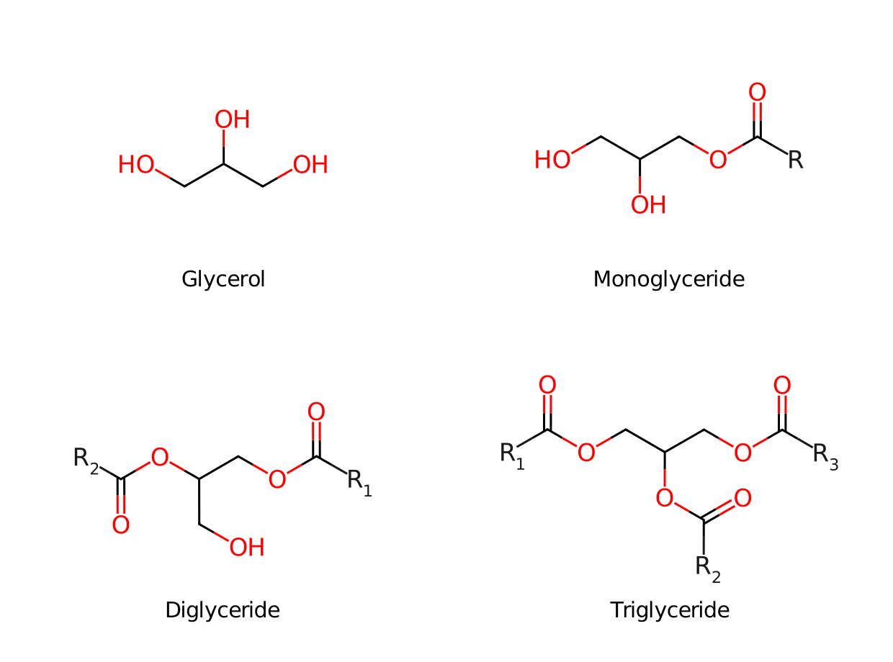

> [!explain] كيف نكتب الغليسيريد الثلاثي
> كيف نكتبها (كما في الدفتر {ص 5}): نكتب الغليسيرول عمودياً: CH~2~OH في الأعلى، ثم CHOH، ثم CH~2~OH. ثم في كل سطر نستبدل **H** زمرة OH بـ **CO–R**: فيصبح السطر الأول CH~2~O–CO–R~1~، والثاني R~2~–CO–O–CH، والثالث CH~2~O–CO–R~3~. ونرسم **=O** فوق كل C.
> لماذا تخرج 3 جزيئات ماء: كل رابطة إسترية تُخرج ماءً واحداً (OH من الحمض + H من الغليسيرول)، والغليسيريد الثلاثي فيه **3 روابط إسترية** ← 3 H~2~O.
> من أين الأسماء: "أحادي، ثنائي، ثلاثي" = عدد الأحماض الدهنية على الغليسيرول. و R~1~ و R~2~ و R~3~ قد تكون **متشابهة** (مثل ثلاثي الستيارين، فيه 3 ستياريك) أو **مختلفة** (وهذا الغالب في الطبيعة).

> [!doctor] [00:58:46] "بالسكريات إيش الرابطة؟ **غليكوزيدية**. بالبروتينات؟ **ببتيدية**. بالدهون؟ **استرية**".

> [!remember] الروابط الثلاث الكبرى: السكريات ← **غليكوزيدية**، البروتينات ← **ببتيدية**، الدهون ← **إسترية**.

> [!why] الغليسيريد الثلاثي **لا يذوب في الماء**.
> لأن: زمر OH الثلاث في الغليسيرول (وهي التي كانت تحب الماء) استُهلكت كلها في الروابط الإسترية، ولم يبقَ إلا السلاسل الهيدروكربونية الطويلة غير القطبية. أما الأحادي (فيه OH اثنتان) والثنائي (OH واحدة) فلهما جزء يحب الماء، ولذلك يُستعملان في الصناعة **مستحلبات** (يُكتب على الأغذية E471).

## قوام الغليسيريد الثلاثي

سأل الدكتور [01:06:17]: "سؤال: هل هو سمنة؟ أو زبدة؟ أو شحمة؟ أو زيت؟" والجواب: "**حسب الـ R**".

> [!define] قوام الغليسيريد الثلاثي
> **يعتمد قوام الغليسيريد الثلاثي على نوعية الأحماض الدهنية** (أي على R): فإذا كانت R **طويلة مشبعة** يكون القوام **شحمياً**، وإذا كانت R **قصيرة** يكون **زبدة**، وإذا كانت R **غير مشبعة** يكون **زيتاً**. {ص 5} [01:07:14–01:08:14]

> [!exam] ما الذي يحدد إن كان الغليسيريد الثلاثي زيتاً أو زبدة أو شحماً؟
> الجواب: نوعية الأحماض الدهنية (R): طويلة مشبعة ← شحم صلب، قصيرة ← زبدة، غير مشبعة ← زيت سائل. والمشبع يكون **صلباً بدرجة حرارة الغرفة** مثل الشحم، وغير المشبع **سائلاً**.

> [!explain] قوام الدهن من R
> لماذا: هي نفس قاعدتي درجة الانصهار: السلسلة **الطويلة المشبعة** درجة انصهارها عالية (الستياريك 70°م) ← صلب؛ السلسلة **غير المشبعة** منثنية ودرجة انصهارها منخفضة (الأولييك 16°م) ← سائل؛ و**القصيرة** درجة انصهارها منخفضة لكنها مشبعة ← طرية بينهما (زبدة).
> كيف تحدث في الواقع: كل دهن طبيعي **خليط** من غليسيريدات مختلفة، وقوامه حسب **الغالب** فيه: زيت الزيتون غالبه أولييك ← سائل، وشحم البقر غالبه ستياريك وبالميتيك ← صلب.

# الفوسفوليبيدات

> [!define] الفوسفوليبيدات
> عبارة عن **غليسيريد ثنائي مرتبط مع حمض الفوسفور ومع قاعدة آزوتية**. {ص 5} [01:13:30]

أي: نأخذ الغليسيرول، ونربط حمضين دهنيين (R~1~ و R~2~) على الكربونين الأول والثاني، و**حمض الفوسفور** على الكربون الثالث، ثم نربط بالفوسفور **قاعدة آزوتية** رمز لها الدكتور بـ **X** [01:15:09].

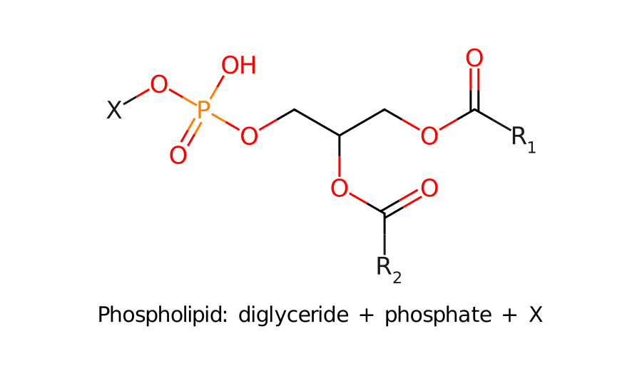

> [!explain] كيف نكتب الفوسفوليبيد
> كيف نكتبها (كما في الدفتر {ص 5}): نكتب الغليسيريد الثنائي: CH~2~O–CO–R~1~، ثم R~2~–CO–O–CH، ثم في السطر الثالث CH~2~O–P(=O)(O^−^)–O–X: الفوسفور عليه **=O** في الأعلى و **O^−^** في الأسفل، ثم O ثم القاعدة الآزوتية X.
> لماذا يُسمّى "فوسفو-ليبيد": لأنه **ليبيد** (فيه أحماض دهنية) يحمل **فوسفاتاً**.
> كيف يتصرف: الجزء الذي فيه الفوسفات والقاعدة الآزوتية **مشحون فيحب الماء** (رأس)، والسلسلتان R~1~ و R~2~ **تحبان الدهن** (ذيلان). لذلك يبني الأغشية الخلوية، ويعمل **مستحلباً**.

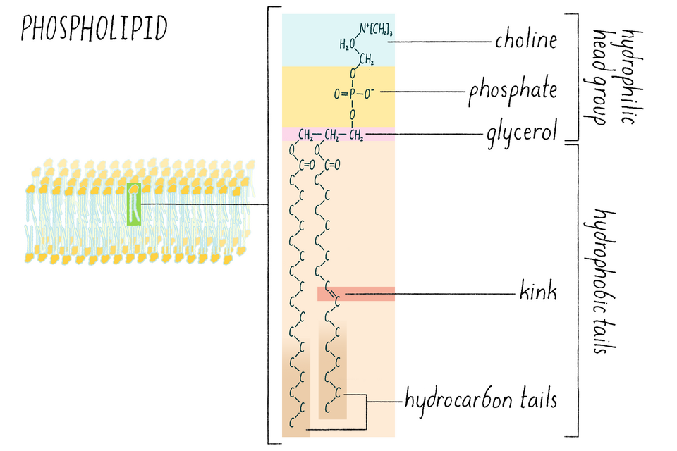

## القواعد الآزوتية وأسماء الفوسفوليبيدات

| القاعدة الآزوتية | صيغتها | اسم الفوسفوليبيد | اسمه المختصر |
| **الكولين** | HO–CH~2~–CH~2~–N^+^(CH~3~)~3~ | فوسفاتيديل كولين | **الليسيتين** |
| **الإيتانول أمين** | HO–CH~2~–CH~2~–NH~3~^+^ | فوسفاتيديل إيتانول أمين | **السيفالين** (أو الكيفالين) |
| **السيرين** (حمض أميني) | HO–CH~2~–CH(NH~2~)–COOH | فوسفاتيديل سيرين | — |
| **الإينوزيتول** (كحول حلقي) | C~6~H~6~(OH)~6~ | فوسفاتيديل إينوزيتول | — |

{ص 5–6}

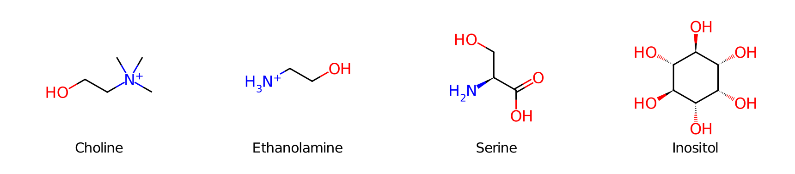

> [!define] الليسيتين
> **إذا كانت القاعدة الآزوتية كولين فالناتج اسمه فوسفاتيديل كولين، واختصاراً اسمه الليسيتين.** [01:33:00–01:33:49]

> [!define] السيفالين
> **إذا كانت القاعدة الآزوتية إيتانول أمين فالناتج يسمى فوسفاتيديل إيتانول أمين، واسمه السيفالين أو الكيفالين.** [01:33:51–01:34:06]

> [!doctor] أعاد الدكتور جملة "إذا كانت القاعدة الآزوتية كولين فالناتج فوسفاتيديل كولين، واختصاراً **ليسيتين**" أكثر من **عشر مرات** [01:30:37–01:33:49]، ثم السيفالين والسيرين والإينوزيتول. هذه الجمل الأربع تُحفظ كما هي.

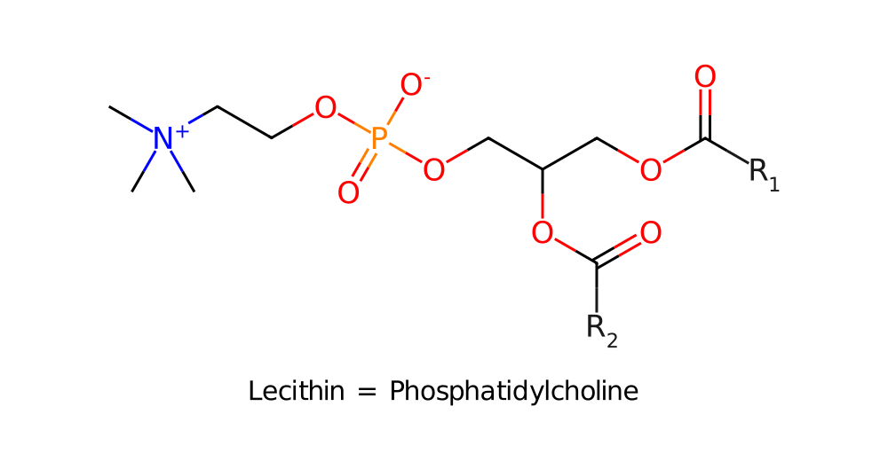

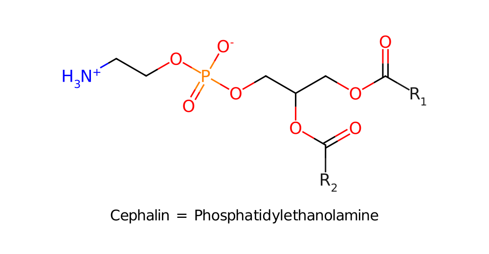

> [!explain] القواعد الأربع: من أين جاءت؟
> من أين: **الإيتانول أمين** = **إيتانول** (الكحول الإيتيلي CH~3~CH~2~OH) وضعنا على طرفه **أميناً** NH~2~ بدل H: HO–CH~2~–CH~2~–NH~2~، كما شرح الدكتور [01:26:20]. و**الكولين** = إيتانول أمين نفسه لكن على النيتروجين **3 زمر ميثيل** (N^+^(CH~3~)~3~). و**السيرين** حمض أميني فيه زمرة OH (أخذتموه في الكيمياء الحيوية). و**الإينوزيتول** حلقة سداسية عليها 6 زمر OH، "**كحول، مو سكر**" كما قال الدكتور [01:34:40].
> كيف نكتبها في الفوسفوليبيد: القاعدة ترتبط بالفوسفات **عن طريق زمرة OH فيها** (ويخرج ماء)، لذلك نكتب الفوسفات ثم O ثم بقية القاعدة: –P–O–CH~2~–CH~2~–N^+^(CH~3~)~3~ للكولين.
> لماذا يهمنا: الكولين مغذٍّ أساسي (يصنع منه الجسم الأسيتيل كولين الناقل العصبي)، ومصدره الأهم **صفار البيض** الغني بالليسيتين.

> [!tip] للحفظ: **ليسيتين** من اليونانية "ليكيثوس" = **صفار البيض** (أول ما اكتُشف فيه) ← فكّر بالمايونيز. و**سيفالين** من "كيفالي" = **الرأس** (اكتُشف في الدماغ). والترتيب: **كولين ← ليسيتين**، **إيتانول أمين ← سيفالين**، والسيرين والإينوزيتول اسمهما فوسفاتيديل + اسم القاعدة.

## الليسيتين عامل استحلاب

شرح الدكتور أن الليسيتين فيه **جزء محب للدهون** يرتبط مع الزيت، و**جزء محب للماء** يرتبط مع الماء (أو الخل)، فيجمع بينهما: "هاد اسمه **عوامل الاستحلاب**" [01:20:57–01:21:49].

> [!define] عوامل الاستحلاب
> مواد فيها **جزء محب للدهون** يرتبط مع الزيت، و**جزء محب للماء** يرتبط مع الماء، فتربط الزيت بالماء وتمنع انفصالهما. ومثالها **الليسيتينات**.

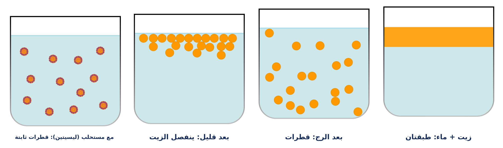

أمثلة الدكتور [01:20:57–01:24:11]:
- **المايونيز**: نضع **صفار البيض** ونضيف الزيت ونخفق، ثم الخل أو الماء. صفار البيض فيه **ليسيتين**، فيرتبط بالزيت من جهة وبالخل من جهة، فلا ينفصلان. "لو حطيت زيت مع خل لحالهم؟ بينفصلوا".
- **الشوكولا**: فيها **زبدة الكاكاو** (دهن) و**سكر**؛ "كيف أجمع السكر مع الدهن؟ بحط **ليسيتينات**".
- **الحليب**: الحليب فيه دهن، لكن لا نرى فيه قطرات زيت، لأن فيه ليسيتينات تربط دهن الحليب بماء الحليب. وعندما **يفسد الحليب** تظهر قطرات الدهن.
- **الدم**: إذا حلّلنا الدم لا يطفو فيه الدهن، لأن الدهون في الدم محمولة مع الليسيتين والبروتينات (**دهون بروتينية**).
- **الجبنة الطازجة**: لا ترشح منها قطرات دهن لوجود عوامل الاستحلاب؛ وحين تتحطم الليسيتينات ينفصل الدهن عن الجزء القطبي.

> [!why] لا تنفصل طبقة الزيت في المايونيز رغم أنه زيت وخل.
> لأن: **صفار البيض** يحوي **الليسيتين** وهو عامل استحلاب: جزؤه المحب للدهون يرتبط بقطرات الزيت، وجزؤه المحب للماء يرتبط بالخل/الماء، فتبقى قطرات الزيت موزعة ولا تتجمع.

> [!why] لا نرى قطرات دهن في الحليب الطازج، بينما تظهر عندما يفسد.
> لأن: في الحليب **ليسيتينات** (عوامل استحلاب) تربط دهن الحليب بالماء؛ وعند فساد الحليب تتحطم هذه الأغلفة فينفصل الدهن ويظهر.

## سم الأفعى وانحلال الدم

قال الدكتور [01:24:28–01:25:31]: **أغشية كريات الدم الحمراء** فيها **ليسيتينات**. وسم الأفعى (الكوبرا) أو العقرب فيه إنزيم سمّاه "**الليزوليسيتيناز**" يهاجم ليسيتين الغشاء فيحطّمه، فتتحطم كرية الدم: هذا اسمه **انحلال الدم**.

> [!why] لدغة الأفعى (الكوبرا) تسبب **انحلال الدم**.
> لأن: سمّها يحوي إنزيماً يحطّم **الليسيتين** الموجود في **أغشية كريات الدم الحمراء**، فيتحطم الغشاء وتنحل الكرية.

> [!note] دقة علمية: اسم الإنزيم في المراجع **الفوسفوليباز A~2~** (ويسمى أيضاً الليسيتيناز A): ينزع الحمض الدهني من الكربون الثاني في الليسيتين فيحوّله إلى **الليزوليسيتين** (ليسيتين بحمض دهني واحد). والليزوليسيتين يعمل **كالمنظّف** فيذيب غشاء الكرية الحمراء. أي أن الفكرة كما قال الدكتور، والاسم الأدق للإنزيم فوسفوليباز A~2~، وللناتج ليزوليسيتين.

> [!admin] قال الدكتور في آخر المحاضرة إنه في المحاضرة القادمة سيكمل "شغلات صغيرة" ثم يتابع في الدهون [01:35:15–01:35:30].

> [!summary] **خلاصة المحاضرة:**
> - **الليبيدات**: لا تذوب بالماء، تذوب بالمحلات العضوية، بلا صيغة عامة. فوائدها: طاقة (9 كيلوكالوري/غ)، تخزين، بناء، حماية وعزل، هرمونات، حالّة للفيتامينات A, D, E, K.
> - **الحمض الدهني**: R–COOH، أحادي الكربوكسيل، زوجي العدد، مشبع أو غير مشبع.
> - **المشبعة**: بيوتيريك 4، كابرويك 6، كابريليك 8، كابريك 10، لوريك 12، ميريستيك 14، بالميتيك 16، ستياريك 18، أراكيديك 20. كلما طالت السلسلة ارتفعت درجة الانصهار. قصيرة 4–8، متوسطة 10–12 (للمرضى: MCT)، طويلة 14–20.
> - **غير المشبعة**: أولييك C18:1 Δ9 (ω9)، لينولييك C18:2 Δ9,12 (ω6)، لينولينيك C18:3 Δ9,12,15 (ω3)، أراكيدونيك C20:4 Δ5,8,11,14 (ω6). كلما زادت الروابط الزوجية انخفضت درجة الانصهار. الأساسيان: اللينولييك واللينولينيك.
> - **cis / trans**: يشترط رابطة زوجية؛ الطبيعي cis؛ الهدرجة الجزئية والحرارة ← trans.
> - **التفاعلات**: الكربوكسيل (أسترة، أميد، صابون، إرجاع، نزع CO~2~)، والرابطة الزوجية (ضم الهالوجينات واليود ← الرقم اليودي، والهدرجة: أولييك 16°م ← ستياريك 70°م).
> - **الغليسيريدات**: غليسيرول + أحماض دهنية برابطة إسترية؛ القوام حسب R.
> - **الفوسفوليبيدات**: غليسيريد ثنائي + حمض الفوسفور + قاعدة آزوتية: كولين ← ليسيتين (مستحلب)، إيتانول أمين ← سيفالين، سيرين، إينوزيتول.

# صور اللوح كما كتبها الدكتور

صور اللوح من **شعبة الشباب**:

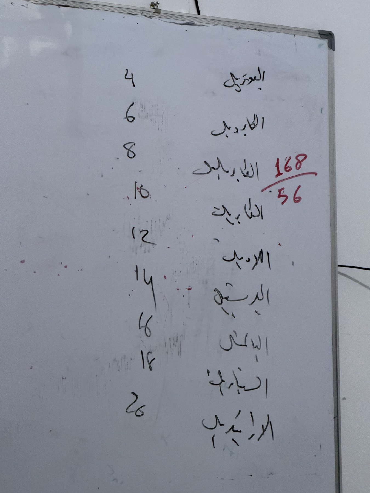

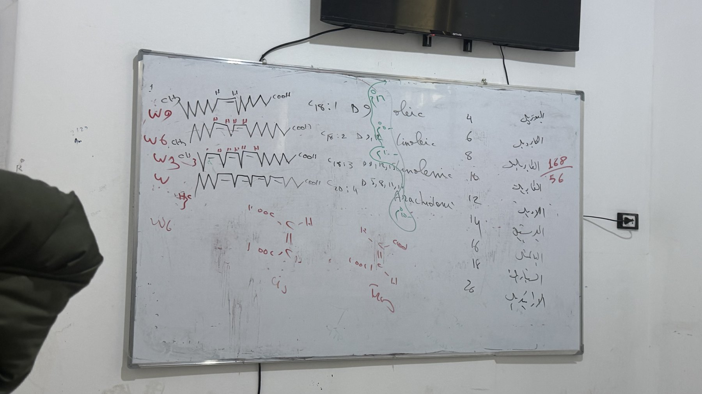

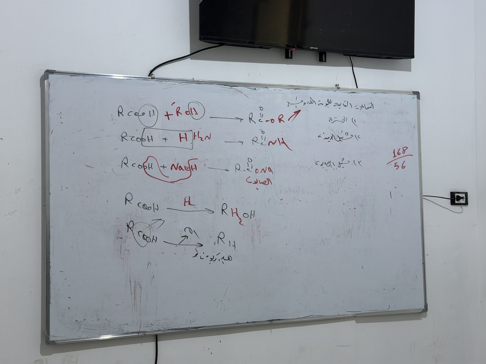

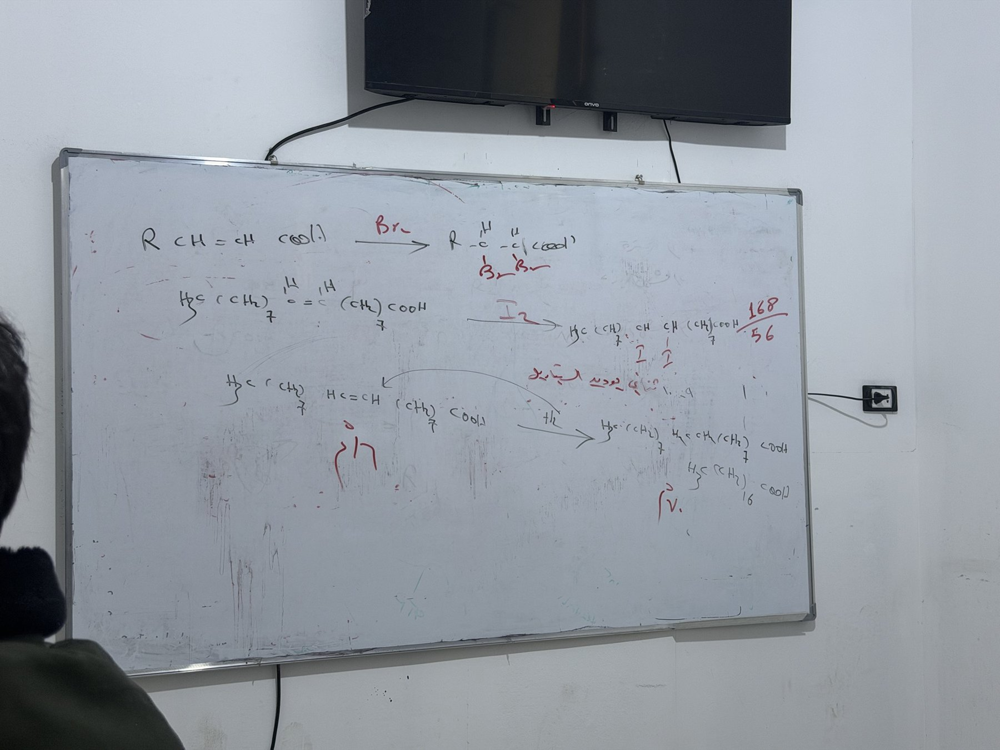
