> [!style] ملاحظات أولية من اللوح (تكتمل بعد سماع التسجيل):
> - يرسم الحموض الدهنية **بالشكل المتعرّج (zigzag)**، ويحدد ذرات H على الروابط المضاعفة ليوضّح أنها **cis**.
> - يستعمل **الرمز المختصر** (مثل C18:1 Δ9) ونظام **أوميغا ω** معاً، فتوقّع أسئلة تحويل بين النظامين.
> - **يربط البنية بالخواص الفيزيائية**: كتب درجات الانصهار بالأخضر وربطها بخط، ثم بيّن أن الهدرجة ترفعها من 17°م إلى 70°م.
> - يكتب التفاعلات **بصيغة عامة (R)**، ويحوّط الذرات التي تخرج على شكل ماء، ثم **يطبّق على مثال محدد** (حمض الأولييك) **ويسمّي الناتج**.
> - يركّز على **حفظ أسماء الحموض مع عدد ذرات الكربون** (كتب قائمة كاملة من C4 إلى C20).

# الحموض الدهنية المشبعة

الحموض الدهنية المشبعة (Saturated fatty acids) هي حموض كربوكسيلية ذات سلسلة هيدروكربونية **لا تحوي أي رابطة مضاعفة** بين ذرات الكربون، وصيغتها العامة:

$$ CH~3~–(CH~2~)~n~–COOH        أو        C~n~H~2n~O~2~

يُرمز لها بالرمز **Cn:0**: الرقم الأول هو عدد ذرات الكربون، والصفر يعني عدم وجود روابط مضاعفة.

> [!define] الحمض الدهني المشبع
> حمض كربوكسيلي ذو سلسلة كربونية طويلة غير متفرعة، كل الروابط بين ذرات الكربون فيها **أحادية**.

## قائمة الحموض المشبعة (كما كتبها الدكتور على اللوح)

| الحمض | ذرات C | الرمز | الصيغة المكثفة | M (g/mol) | أصل الاسم / مصدره |
| **البوتيريك** (Butyric) | 4 | C4:0 | CH~3~(CH~2~)~2~COOH | 88.1 | الزبدة (butyrum) |
| **الكابرويك** (Caproic) | 6 | C6:0 | CH~3~(CH~2~)~4~COOH | 116.2 | دهن حليب الماعز (capra) |
| **الكابريليك** (Caprylic) | 8 | C8:0 | CH~3~(CH~2~)~6~COOH | 144.2 | دهن حليب الماعز |
| **الكابريك** (Capric) | 10 | C10:0 | CH~3~(CH~2~)~8~COOH | 172.3 | دهن حليب الماعز |
| **اللوريك** (Lauric) | 12 | C12:0 | CH~3~(CH~2~)~10~COOH | 200.3 | زيت جوز الهند، الغار (laurel) |
| **الميريستيك** (Myristic) | 14 | C14:0 | CH~3~(CH~2~)~12~COOH | 228.4 | جوزة الطيب (Myristica) |
| **البالمتيك** (Palmitic) | 16 | C16:0 | CH~3~(CH~2~)~14~COOH | 256.4 | زيت النخيل (palm) |
| **الستياريك** (Stearic) | 18 | C18:0 | CH~3~(CH~2~)~16~COOH | 284.5 | الشحوم الحيوانية (stear = شحم) |
| **الأراشيديك** (Arachidic) | 20 | C20:0 | CH~3~(CH~2~)~18~COOH | 312.5 | زيت الفول السوداني (Arachis) |

> [!check] (من صور اللوح) الرقم المكتوب بجانب **الأراشيديك** يبدو "26"، لكن حمض الأراشيديك فيه **20** ذرة كربون (C20:0) باتفاق المراجع، والقائمة تزيد 2 كل مرة (…16، 18، 20). الأرجح أنه **20** مكتوب بخط سريع. تأكد من التسجيل أو من زملائك.

> [!tip] لحفظ الترتيب (4 ← 20، كل مرة +2): **B**ig **C**ats **C**an **C**atch **L**azy **M**ice, **P**retty **S**mart **A**nimals
> - **B**utyric 4 ← **C**aproic 6 ← **C**aprylic 8 ← **C**apric 10 ← **L**auric 12 ← **M**yristic 14 ← **P**almitic 16 ← **S**tearic 18 ← **A**rachidic 20
> - الثلاثة اللي بيبلشوا بـ **Capr**: حسب طول الاسم تقريباً: كابر**و**يك (6) ثم كابر**يل**يك (8) ثم كابريك (10).
> - **أصل الاسم يساعد بالحفظ**: بوتيريك من الزبدة، بالمتيك من النخيل، ستياريك من الشحم، أراشيديك من الفول السوداني.

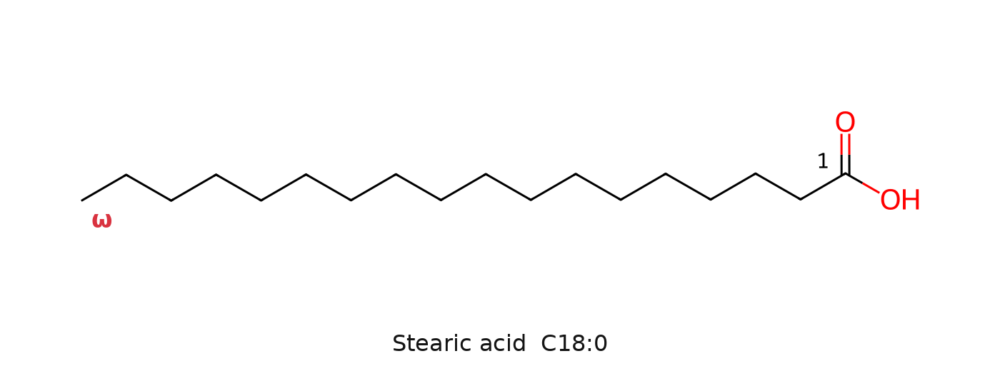

> [!why] كل الحموض الدهنية الطبيعية في القائمة **عدد ذرات الكربون فيها زوجي**.
> لأن: الجسم (والنبات) يصنّع الحموض الدهنية بإضافة **وحدات من ذرتي كربون** في كل مرة (من الأسيتيل CoA عبر المالونيل CoA)، فيكون الناتج دائماً زوجياً.

> [!note] **درجة الانصهار تزداد بزيادة طول السلسلة**: الحموض القصيرة (C4–C8) سائلة بدرجة حرارة الغرفة، والطويلة (C12 فما فوق) صلبة. السبب أن السلسلة الأطول تملك سطح تماس أكبر مع جاراتها، فتزداد **قوى فان دير فالس** بينها. (الدكتور كتب لاحقاً أن الستياريك C18 ينصهر عند **70°م**.)

# الحموض الدهنية غير المشبعة

الحموض الدهنية غير المشبعة (Unsaturated fatty acids) تحوي **رابطة مضاعفة واحدة أو أكثر** (C=C) في السلسلة:
- **أحادية عدم الإشباع (MUFA):** رابطة مضاعفة واحدة، مثل حمض الأولييك.
- **عديدة عدم الإشباع (PUFA):** رابطتان أو أكثر، مثل اللينولييك واللينولينيك والأراشيدونيك.

## طريقتا الترقيم: دلتا (Δ) وأوميغا (ω)

> [!define] نظام دلتا (Δ)
> تُرقَّم ذرات الكربون **بدءاً من كربون الزمرة الكربوكسيلية (COOH) = C1**، ويُكتب موقع كل رابطة مضاعفة برقم أول ذرة كربون فيها. مثال: Δ9 تعني رابطة مضاعفة بين C9 و C10.

> [!define] نظام أوميغا (ω)
> تُرقَّم ذرات الكربون **بدءاً من نهاية الميثيل (CH~3~) = ω1**، ويُصنَّف الحمض حسب موقع **أول رابطة مضاعفة من جهة الميثيل**. مثال: ω-3 تعني أن أول رابطة مضاعفة تبدأ عند الكربون الثالث من نهاية الميثيل.

$$ رقم أوميغا  =  عدد ذرات الكربون  −  آخر رقم Δ

الرمز الكامل **C18:2 Δ9,12** يعني: 18 ذرة كربون، **2** رابطة مضاعفة، في الموقعين 9 و 12 من جهة COOH.

## الحموض الأربعة التي كتبها الدكتور

| الحمض | الرمز | مواقع الروابط (Δ) | العائلة | درجة الانصهار (من اللوح) |
| **الأولييك** (Oleic) | C18:1 | Δ9 | ω-9 | 17°م |
| **اللينولييك** (Linoleic) | C18:2 | Δ9,12 | ω-6 | −5°م |
| **اللينولينيك (ألفا)** (α-Linolenic) | C18:3 | Δ9,12,15 | ω-3 | −11°م |
| **الأراشيدونيك** (Arachidonic) | C20:4 | Δ5,8,11,14 | ω-6 | −50°م |

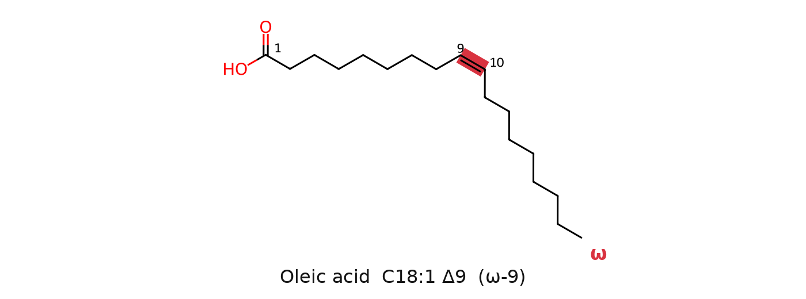

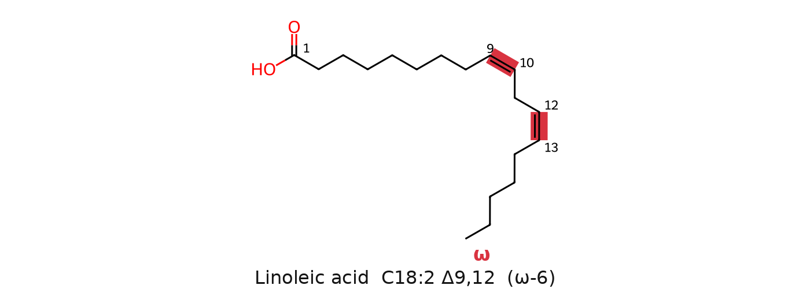

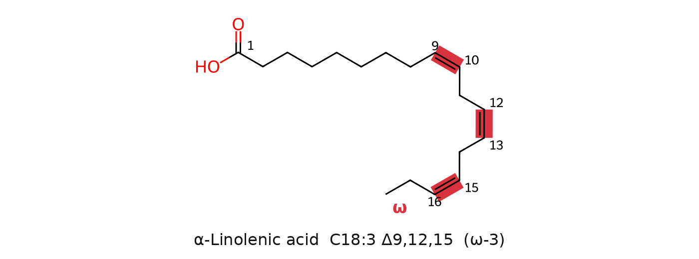

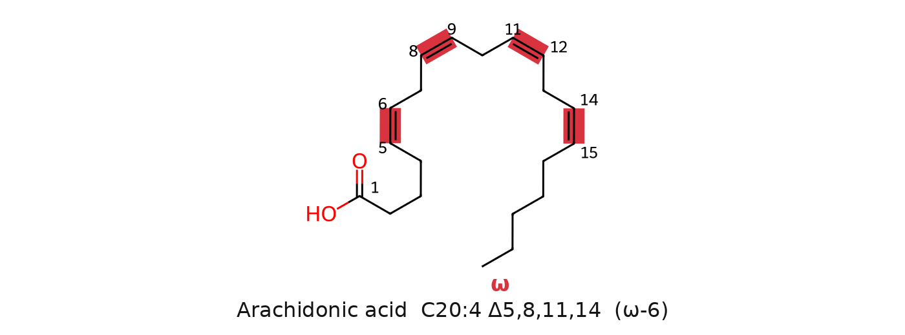

> [!why] كلما **زاد عدد الروابط المضاعفة** انخفضت درجة الانصهار (أولييك 17°م ← لينولييك −5°م ← لينولينيك −11°م ← أراشيدونيك −50°م).
> لأن: كل رابطة مضاعفة من نوع **cis** تُحدث **انثناءً** في السلسلة، فلا تستطيع الجزيئات أن تتراصّ بشكل منتظم قريب من بعضها، فتضعف **قوى فان دير فالس** بينها، وتحتاج طاقة أقل لتنصهر. لذلك الزيوت النباتية الغنية بهذه الحموض **سائلة**.

> [!check] (من صور اللوح) درجة انصهار الأولييك على اللوح **17°م**، بينما تذكر أغلب المراجع **13–16°م**. اعتمد رقم الدكتور بالامتحان.

> [!problem] (تدريب) حدّد عائلة أوميغا لحمض رمزه C20:4 Δ5,8,11,14.
> المعطيات: عدد ذرات الكربون = 20، وآخر رابطة مضاعفة عند Δ14
> القانون: رقم أوميغا = عدد ذرات الكربون − آخر رقم Δ
> الحل: 20 − 14 = 6
> النتيجة: الحمض من عائلة **ω-6** (وهو حمض الأراشيدونيك).

> [!problem] (تدريب) حوّل مواقع الروابط في حمض ألفا-لينولينيك C18:3 Δ9,12,15 إلى نظام أوميغا.
> القانون: موقع ω = عدد ذرات الكربون − موقع Δ
> الحل: 18 − 15 = 3، و 18 − 12 = 6، و 18 − 9 = 9
> النتيجة: الروابط عند **ω3 و ω6 و ω9**، وأول رابطة من جهة الميثيل عند ω3، فهو من عائلة **ω-3**.

> [!note] معلومات مكمّلة (ليست على اللوح):
> - **الحموض الدهنية الأساسية** هي **اللينولييك (ω-6)** و**ألفا-لينولينيك (ω-3)**: جسم الإنسان لا يستطيع إدخال رابطة مضاعفة بعد الكربون 9 (من جهة COOH)، فيجب أخذهما من الغذاء.
> - **الأراشيدونيك** يصنّعه الجسم من اللينولييك، لذلك يسمى **شبه أساسي**.
> - مصادرها: الأولييك ← زيت الزيتون؛ اللينولييك ← زيت دوار الشمس والذرة؛ ألفا-لينولينيك ← بذور الكتان والجوز؛ الأراشيدونيك ← اللحوم والبيض.

# التماكب الهندسي: cis و trans

وجود الرابطة المضاعفة C=C **يمنع الدوران** حولها، فتظهر صيغتان مختلفتان لنفس الجزيء حسب توضع ذرات الهيدروجين على طرفي الرابطة:

> [!define] الشكل cis (سيس)
> تكون ذرتا الهيدروجين المرتبطتان بكربونَي الرابطة المضاعفة **في الجهة نفسها**، فتنثني السلسلة. معظم الحموض الدهنية الطبيعية من هذا الشكل.

> [!define] الشكل trans (ترانس)
> تكون ذرتا الهيدروجين **في جهتين متعاكستين**، فتبقى السلسلة **مستقيمة** تقريباً مثل الحموض المشبعة.

الدكتور وضّح الفكرة على اللوح بمثال حمض ثنائي الكربوكسيل البسيط (HOOC–CH=CH–COOH):

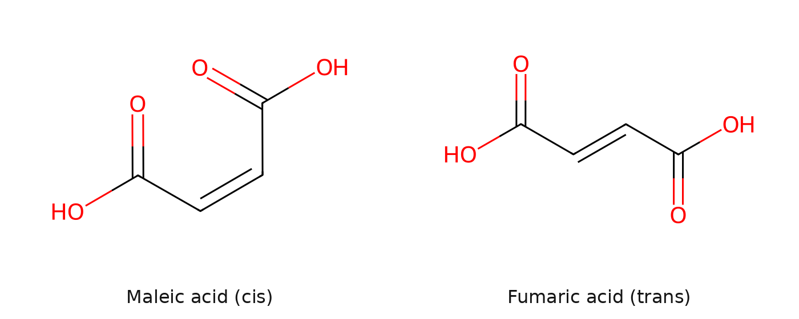

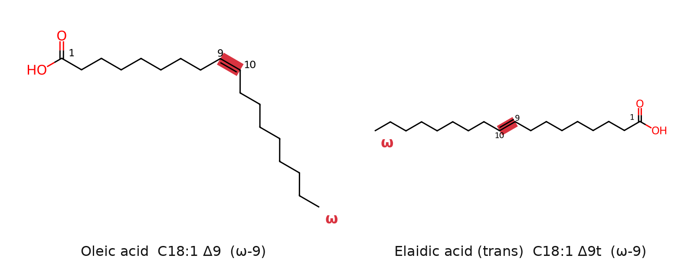

> [!why] الحمض الدهني **trans** درجة انصهاره **أعلى** من مماكبه **cis** (الإيلايديك ≈ 44°م مقابل الأولييك ≈ 13–17°م).
> لأن: سلسلة الـ trans مستقيمة فتتراصّ الجزيئات بشكل منتظم مثل الحموض المشبعة، فتزداد قوى التجاذب بينها.

> [!note] **الدهون المتحوّلة (Trans fats)** تتشكل غالباً أثناء **الهدرجة الجزئية** للزيوت في الصناعة (السمن النباتي والمارغرين)، وهي **ضارة صحياً**: ترفع الكوليسترول الضار LDL وتخفض المفيد HDL.

# تفاعلات الزمرة الكربوكسيلية (COOH)

كتب الدكتور على اللوح: **"التفاعلات التابعة للزمرة الكاربوكسيلية"**، وهي:

## 1. الأسترة (Esterification)
يتفاعل الحمض الدهني مع **كحول** فيتشكل **إستر** ويخرج **ماء**:

$$ R–COOH  +  R′–OH   →   R–COO–R′  +  H~2~O

> [!remember] الماء يتشكل من **OH الحمض** + **H الكحول** (وهذا ما حوّطه الدكتور على اللوح).

> [!note] التفاعل يحتاج **وسط حمضي وتسخين**، وهو **عكوس**: التفاعل المعاكس هو **الحلمهة**. والأهم غذائياً: **الغليسريدات الثلاثية (الدهون والزيوت)** هي إسترات للغليسرول مع ثلاثة حموض دهنية.

## 2. تشكيل الأميدات (Amide formation)
يتفاعل الحمض الدهني مع **أمين** (أو الأمونيا) فيتشكل **أميد** ويخرج ماء:

$$ R–COOH  +  H~2~N–R′   →   R–CO–NH–R′  +  H~2~O

> [!note] الرابطة **–CO–NH–** هي نفسها **الرابطة الببتيدية** التي تربط الحموض الأمينية في البروتينات. ومع الأمونيا NH~3~ يكون الناتج أميداً أولياً R–CONH~2~.

## 3. تشكيل الصابون (التصبّن)
يتفاعل الحمض الدهني مع **قلوي قوي** (NaOH أو KOH) فيتشكل **ملح الحمض الدهني = الصابون**:

$$ R–COOH  +  NaOH   →   R–COONa  +  H~2~O

> [!define] الصابون
> **أملاح الصوديوم أو البوتاسيوم للحموض الدهنية** (R–COONa أو R–COOK). صابون الصوديوم صلب، وصابون البوتاسيوم طري/سائل.

وعند تصبّن **غليسريد ثلاثي** (دهن أو زيت) يلزم **3 جزيئات** من القلوي:

$$ غليسريد ثلاثي  +  3 KOH   →   غليسرول  +  3 R–COOK

> [!define] رقم التصبّن (Saponification value)
> عدد **ملّيغرامات KOH** اللازمة لتصبين **1 غرام** من الدهن أو الزيت.

$$ رقم التصبن  =  (3 × 56 × 1000) ÷ M  =  168000 ÷ M

> [!check] (من صور اللوح) الكسر **168 / 56** مكتوب بالأحمر على طرف اللوح طوال المحاضرة. الأرجح أنه مرتبط **برقم التصبن**: 56 = الكتلة المولية لـ KOH، و 168 = 3 × 56 (ثلاث مولات KOH لكل غليسريد ثلاثي). تأكد من التسجيل.

> [!problem] (تدريب) احسب رقم التصبن لثلاثي ستيارين (Tristearin) علماً أن كتلته المولية 891.5 g/mol.
> المعطيات: M = 891.5 g/mol، و KOH = 56 g/mol، ويلزم 3 مول KOH لكل مول غليسريد
> القانون: رقم التصبن = 168000 ÷ M
> الحل: 168000 ÷ 891.5 = 188.4
> النتيجة: رقم التصبن = **188.4 mg KOH/g**.

> [!why] رقم التصبن **يتناسب عكساً** مع الكتلة المولية للدهن.
> لأن: كل مول غليسريد يحتاج دائماً 3 مول KOH مهما كان طول السلسلة، فالدهون ذات **السلاسل القصيرة** (مثل دهن الزبدة الغني بالبوتيريك) فيها عدد مولات أكبر في الغرام الواحد، فتحتاج KOH أكثر ويكون رقم تصبنها **أعلى**.

## 4. الإرجاع (Reduction)
تُرجَع الزمرة الكربوكسيلية بالهيدروجين إلى **كحول أولي**:

$$ R–COOH  +  4[H]   →   R–CH~2~OH  +  H~2~O

> [!note] الإرجاع يحتاج **مُرجِعاً قوياً** (مثل LiAlH~4~)، والناتج **كحول دهني**.

## 5. نزع الكربوكسيل (Decarboxylation)
تُنزع زمرة الكربوكسيل على شكل **CO~2~** ويبقى **هيدروكربون**:

$$ R–COOH   →   R–H  +  CO~2~

# تفاعلات الرابطة المضاعفة (C=C)

هذه التفاعلات خاصة **بالحموض غير المشبعة**، وكلها **تفاعلات إضافة**: تنكسر الرابطة المضاعفة ويضاف إلى كل كربون من طرفيها ذرة جديدة.

## 1. الهلجنة: إضافة البروم (Br~2~)

$$ R–CH=CH–COOH  +  Br~2~   →   R–CHBr–CHBr–COOH

> [!note] يُستعمل هذا التفاعل **للكشف عن عدم الإشباع**: ماء البروم البرتقالي **يزول لونه** عند إضافته لحمض أو زيت غير مشبع.

## 2. إضافة اليود (I~2~)
طبّقه الدكتور على **حمض الأولييك**:

$$ CH~3~(CH~2~)~7~–CH=CH–(CH~2~)~7~–COOH  +  I~2~   →   CH~3~(CH~2~)~7~–CHI–CHI–(CH~2~)~7~–COOH

الناتج اسمه **9,10-ثنائي يوديد الستياريك** (9,10-Diiodostearic acid).

> [!why] يُسمّى ناتج إضافة اليود إلى حمض الأولييك **9,10-ثنائي يوديد الستياريك**.
> لأن: بعد الإضافة تنكسر الرابطة المضاعفة فتصبح السلسلة **مشبعة بـ 18 ذرة كربون** وهو هيكل **حمض الستياريك**، وترتبط ذرتا اليود بالكربونين **9 و 10** (مكان الرابطة المضاعفة سابقاً).

> [!define] الرقم اليودي (Iodine value)
> عدد **غرامات اليود** التي يمتصها **100 غرام** من الدهن أو الزيت، وهو **مقياس لدرجة عدم الإشباع**: كلما زاد عدد الروابط المضاعفة زاد الرقم اليودي.

> [!problem] (تدريب) احسب الرقم اليودي لحمض الأولييك (M = 282.5 g/mol) علماً أن الكتلة المولية لـ I~2~ = 253.8 g/mol.
> المعطيات: رابطة مضاعفة واحدة = 1 مول I~2~ لكل مول حمض
> القانون: الرقم اليودي = (عدد الروابط × 253.8 ÷ M) × 100
> الحل: (1 × 253.8 ÷ 282.5) × 100 = 89.8
> النتيجة: الرقم اليودي لحمض الأولييك ≈ **90 g I~2~ / 100 g**.

> [!note] بنفس الطريقة: اللينولييك (رابطتان) ≈ 181، واللينولينيك (3 روابط) ≈ 273، والستياريك (مشبع) = **صفر**. عملياً في المخبر يُستعمل كلوريد اليود ICl (**طريقة Wijs**) بدل اليود النقي لأنه أسرع تفاعلاً.

## 3. الهدرجة (Hydrogenation)
إضافة **الهيدروجين** إلى الرابطة المضاعفة (بوجود وسيط مثل **النيكل Ni**) تحوّل الحمض غير المشبع إلى **مشبع**:

$$ CH~3~(CH~2~)~7~–CH=CH–(CH~2~)~7~–COOH  +  H~2~   →   CH~3~(CH~2~)~16~–COOH

$$ حمض الأولييك (17°م)    →    حمض الستياريك (70°م)

> [!why] الهدرجة تحوّل **الزيت السائل** إلى **دهن صلب**.
> لأن: إزالة الروابط المضاعفة تزيل انثناءات السلسلة فتصبح مستقيمة ومشبعة، فتتراصّ الجزيئات بشكل أفضل وترتفع درجة الانصهار (من 17°م للأولييك إلى 70°م للستياريك كما كتب الدكتور).

> [!note] هذه هي طريقة صناعة **السمن النباتي والمارغرين** من الزيوت. وإذا كانت الهدرجة **جزئية** قد تتحوّل بعض الروابط من cis إلى **trans** (الدهون المتحوّلة الضارة، راجع فصل التماكب).

> [!summary] **الخلاصة:** الحموض الدهنية إما مشبعة (Cn:0، القائمة من البوتيريك C4 إلى الأراشيديك C20) أو غير مشبعة (أولييك، لينولييك، لينولينيك، أراشيدونيك) تُسمّى بنظامي Δ و ω. الروابط cis تخفض درجة الانصهار، و trans ترفعها. تتفاعل الزمرة COOH بالأسترة وتشكيل الأميدات والتصبن والإرجاع ونزع الكربوكسيل، وتتفاعل الرابطة C=C بالإضافة (هلجنة، يودة، هدرجة).

# صور اللوح كما كتبها الدكتور

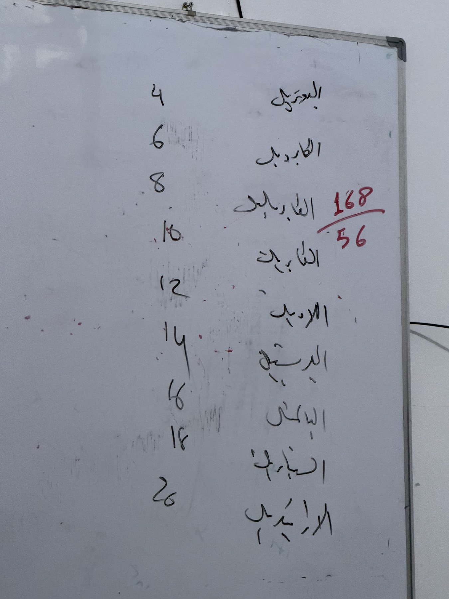

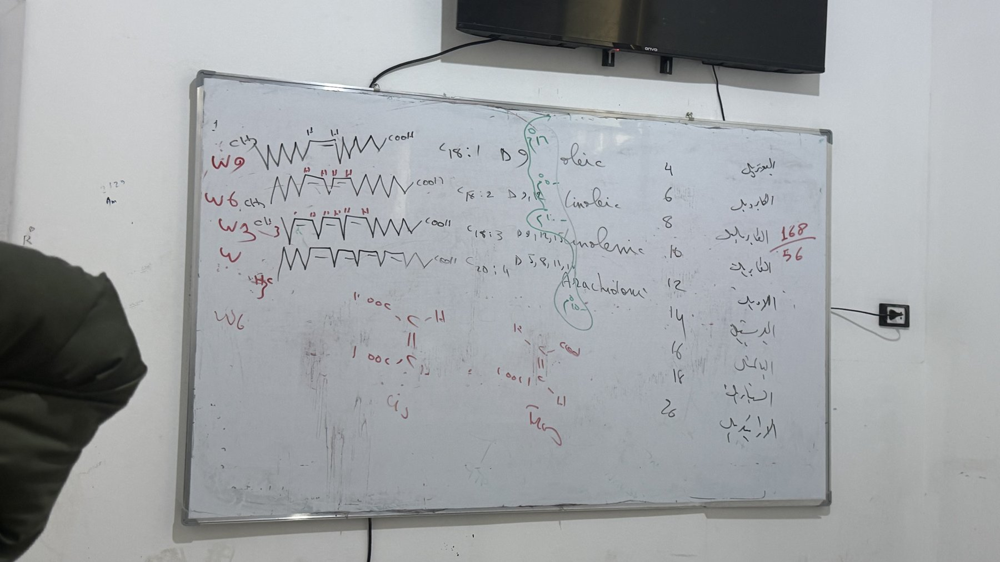

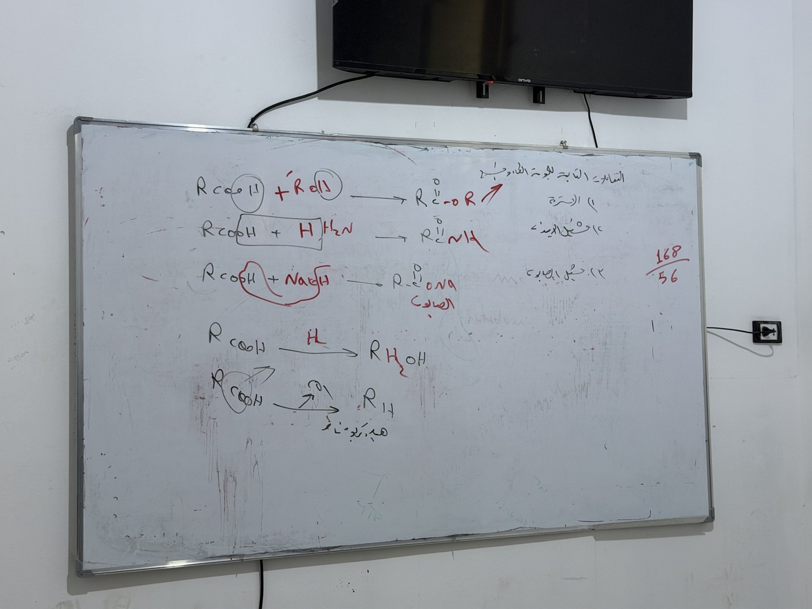

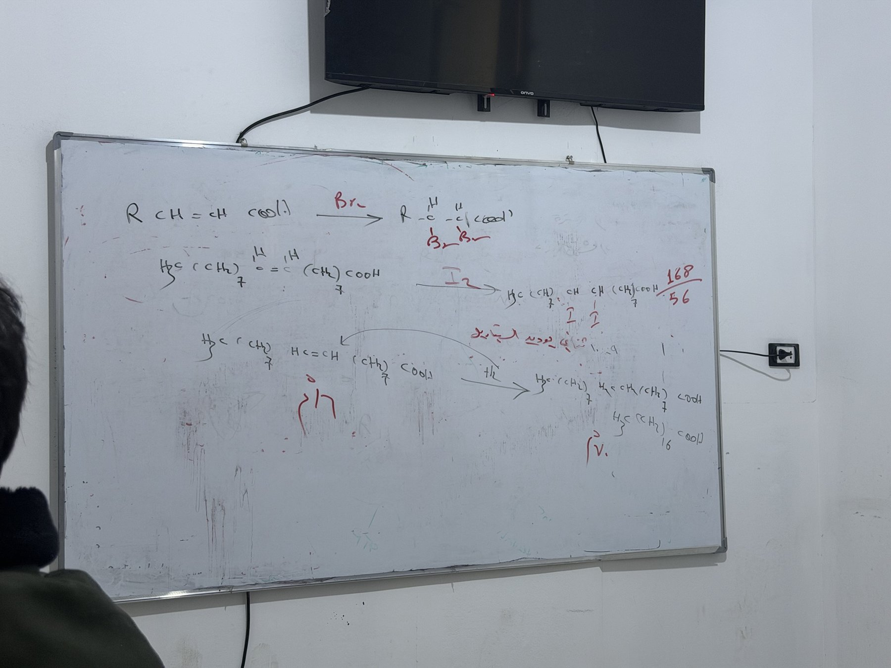
