> [!note] **كيف تقرأ هذا الملف:**
> - **الفصول 1 إلى 4 أساسيات** من الصفر: الذرة، الرابطة، المجموعات، السكر، ATP، الأنزيم. اقرأها مرة بهدوء، ولا تنتقل حتى تفهم الرسمة.
> - **الفصول 5 إلى 9** هي صفحات دفترك نفسها، خطوة خطوة، بالترتيب نفسه.
> - في كل الرسومات: **الأحمر = الشيء الذي تغيّر** في هذه الخطوة. ركّز على الأحمر فقط، والباقي ينتقل كما هو.
> - التفاعلات من دفترك، والشرح كله من عندي حتى تفهم. في آخر الملف صور صفحاتك الثلاث.

# الذرات والروابط: كل شيء مبني من ذرات

كل مادة (السكر، الماء، جسمك) مبنية من قطع صغيرة جداً اسمها **الذرّات**. في هذا الدرس كله نحتاج **5 ذرات فقط**:

| الرمز | اسم الذرة | عدد الأيادي (الروابط) |
| **C** | كربون | **4** |
| **H** | هيدروجين | **1** |
| **O** | أكسجين | **2** |
| **N** | آزوت (نيتروجين) | **3** |
| **P** | فوسفور | **5** |

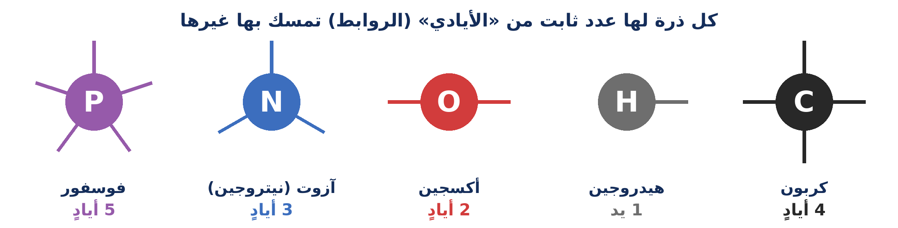

> [!define] الرابطة
> هي "يد بيد" بين ذرتين، ونرسمها **خطاً** بينهما. الخط الواحد = رابطة عادية، والخطان (=) = **رابطة مضاعفة** (يدان بيدين).

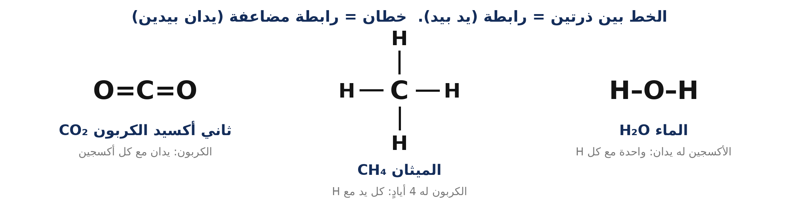

> [!define] الصيغة
> كتابة الجزيء بالرموز: الرقم الصغير تحت الرمز = **كم ذرة** من هذا النوع. مثلاً H~2~O = ذرتا هيدروجين + ذرة أكسجين واحدة، و C~6~H~12~O~6~ = 6 كربون + 12 هيدروجين + 6 أكسجين.

> [!tip] **أهم قاعدة لتكتب أي رسمة بلا خطأ:** كل **كربون** يجب أن يكون له **4 أيادٍ** بالضبط (فوق، تحت، يمين، يسار). إذا رسمت كربوناً بثلاث أيادٍ أو خمس، فهناك خطأ. ورابطة مضاعفة (=) تُحسب يدين.

# المجموعات: القطع التي تتكرر في دفترك

الجزيئات الكبيرة مبنية من **قطع صغيرة** تتكرر دائماً، مثل قطع الليغو. إذا عرفتها من شكلها، تفهم أي رسمة في الدفتر:

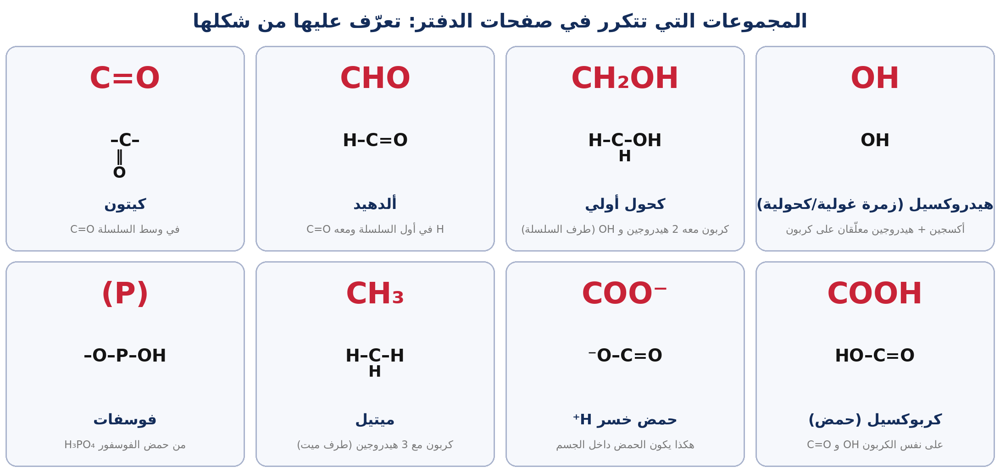

- **OH** (هيدروكسيل، ويسمّيها الدكتور **زمرة غولية أو كحولية**): أكسجين وهيدروجين معلّقان على كربون. السكر مليء بها.
- **CH~2~OH**: كربون معه 2 هيدروجين و OH. تأتي دائماً **في طرف** السلسلة.
- **CHO** (ألدهيد): كربون في **أول** السلسلة، عليه أكسجين برابطة مضاعفة (C=O) ومعه H.
- **C=O** في **وسط** السلسلة = **كيتون**.
- **COOH** (كربوكسيل): كربون عليه C=O و OH معاً. هذا الذي يجعل المادة **حمضاً**.
- **COO⁻**: هو COOH بعد أن **ترك** الهيدروجين (H⁺). هكذا تكون الأحماض داخل الجسم، لذلك يكتبها الدكتور COO⁻. الإشارة (−) تعني أن الأكسجين بقي معه يد فارغة (شحنة سالبة).
- **CH~3~** (ميتيل): كربون مع 3 هيدروجين، طرف لا يتفاعل تقريباً.
- **(P)**: **مجموعة فوسفات**، تحت.

> [!remember] **أربع قطع يجب أن تعرفها فوراً:** **CHO = ألدهيد** (فوق)، **C=O = كيتون** (بالوسط)، **COO⁻ = حمض**، **(P) = فوسفات**. كل الدرس تقريباً هو: "أين ذهبت (P)؟" و"متى صار CHO أو C=O أو COO⁻؟"

## رمز (P)

رسمه الدكتور في أعلى صفحتك الأولى: **حمض الفوسفور H~3~PO~4~**، فوسفور في الوسط، فوقه أكسجين برابطة مضاعفة، وحوله 3 زمر OH.

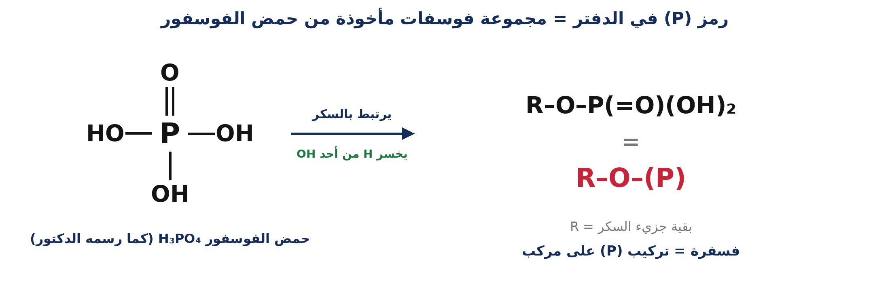

> [!define] الفسفرة
> **تركيب مجموعة فوسفات (P) على مركب.** بدل أن نرسم الفوسفات كاملة كل مرة، نكتب **(P)** داخل دائرة.

> [!explain] لماذا نهتم بالفوسفات؟
> لماذا: الفوسفات **مشحونة**، فالسكر الذي يحمل فوسفات **لا يستطيع الخروج من الخلية** (يبقى محبوساً)، ويصبح **أسهل في التفاعل**.
> من أين: الفوسفات تأتي إما من **ATP** (يعطي فوسفاته الأخيرة)، أو من **حمض الفوسفور الحر H~3~PO~4~** الموجود في الخلية.
> كيف تحدث: في كل خطوة من الدرس، تابع الـ (P): هل **دخلت** إلى السكر؟ هل **انتقلت** من كربون لكربون؟ هل **خرجت** إلى ADP فصنعت ATP؟

# الغلوكوز والفركتوز: السكر الذي سنكسّره

**الغلوكوز** هو سكر الدم، وصيغته C~6~H~12~O~6~: أي **6 ذرات كربون**. الدكتور (وكل الكتب) يرسمه بطريقتين: **سلسلة عمودية** أو **حلقة**.

## السلسلة العمودية: كيف أقرأها؟

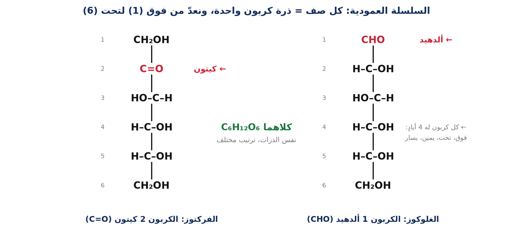

- **كل صف = ذرة كربون واحدة**، والخط العمودي بين الصفوف = الرابطة بين كربون والذي تحته.
- صف مثل **H–C–OH** معناه: الكربون في الوسط، على يساره H وعلى يمينه OH، وفوقه وتحته كربونان آخران. هكذا تكتمل أياديه الأربع.
- **نعدّ الكربونات من فوق**: الكربون 1، 2، 3... حتى 6. وأسماء المركبات تستعمل هذه الأرقام (مثلاً **غلوكوز-6-فوسفات** = فوسفات على الكربون **6**).

> [!define] الغلوكوز
> سكر من 6 كربونات (C~6~H~12~O~6~)، **الكربون 1 فيه ألدهيد (CHO)**.

> [!define] الفركتوز
> سكر الفواكه، له **نفس الصيغة** C~6~H~12~O~6~، لكن **الكربون 2 فيه كيتون (C=O)**.

> [!define] المماكب (الإيزومير)
> مركبان لهما **نفس الذرات** بالعدد نفسه، لكن **مرتبة بشكل مختلف**، مثل الغلوكوز والفركتوز. (ومن هنا اسم الأنزيم **إيزوميراز**: يحوّل المركب إلى مماكبه.)

## الحلقة: كيف أقرأها؟

في الماء (وفي جسمنا) تنغلق السلسلة على نفسها فتصبح **حلقة**. لذلك رسم الدكتور الخطوات الأولى بحلقات:

- **كل زاوية في الحلقة = ذرة كربون**، ما عدا الزاوية المكتوب فيها **O**.
- **الضلع السميك** في الأسفل = الجهة **الأقرب إليك** (كأن الحلقة صحن موضوع أمامك).
- كل كربون معلّق عليه شيئان: **واحد فوق وواحد تحت** (H أو OH).
- **الكربون 6** ليس داخل الحلقة: هو الـ **CH~2~OH المعلّق فوق الكربون 5**.
- **α-غلوكوز** (كما كتب في الدفتر) = OH على الكربون 1 **إلى الأسفل**.

> [!tip] **لا تخف من الحلقات:** في الخطوات 1 و 2 و 3 لا يتغيّر في الحلقة إلا **شيء واحد** (بالأحمر في الرسومات). انسخ الحلقة كما هي، وغيّر هذا الشيء فقط.

# أدوات الخلية: الأنزيم، ATP، و NAD⁺

## الأنزيم

> [!define] الأنزيم
> **بروتين يُسرّع تفاعلاً معيّناً** داخل الجسم. نكتب اسمه **فوق السهم**. ولكل خطوة أنزيمها الخاص.

اسم الأنزيم ينتهي غالباً بـ **"از"**، و**اسمه يقول لك ماذا يفعل**:

| اسم الأنزيم | ماذا يعمل | في أي خطوة |
| **كيناز** | ينقل فوسفات **من ATP أو إليه** | 1، 3، 7، 10 |
| **إيزوميراز** | يغيّر **ترتيب** الذرات (يصنع مماكباً) | 2، 5 |
| **ألدولاز** | **يقصّ** السكر إلى قطعتين | 4 |
| **ديهيدروجيناز** | **ينزع هيدروجين** أو **يعطيه** (مع NAD) | 6، 11 |
| **موتاز** | **ينقل الفوسفات** من كربون إلى كربون في الجزيء نفسه | 8 |
| **إينولاز** | **ينزع ماء** ويصنع رابطة مضاعفة | 9 |

## ATP: عملة الطاقة

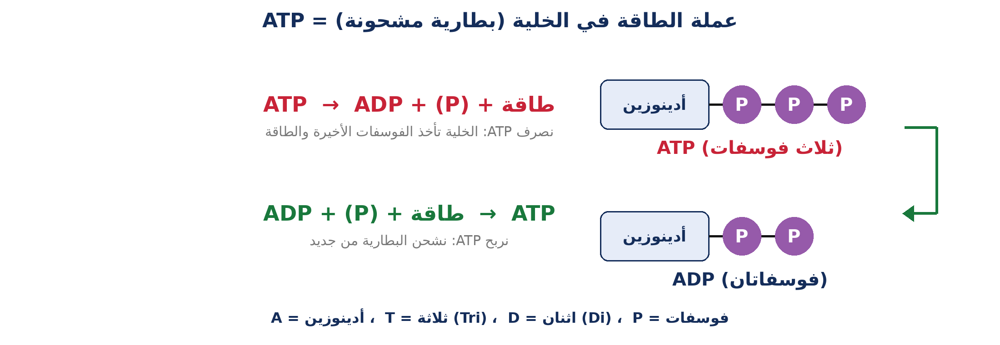

> [!define] ATP
> جزيء **يخزّن الطاقة** في الخلية، فيه **3 فوسفات** (A = أدينوزين، T = ثلاثة، P = فوسفات). عندما يعطي فوسفاته الأخيرة يصبح **ADP** (فوسفاتان فقط).

- **صرف ATP:** ATP يصير ADP. نكتبها تحت السهم في الخطوتين 1 و 3.
- **ربح ATP:** ADP يصير ATP. نكتبها تحت السهم في الخطوتين 7 و 10.
- **هدف الدرس كله:** كم ATP ربحنا من الغلوكوز؟

## NAD⁺: شاحنة الهيدروجين

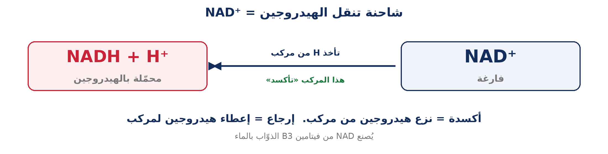

> [!define] الأكسدة والإرجاع
> **الأكسدة = نزع هيدروجين** من مركب. **الإرجاع = إعطاء هيدروجين** لمركب. والذي ينقل الهيدروجين هو **NAD⁺**: يأخذه فيصبح **NADH + H⁺**، ثم يعطيه فيرجع **NAD⁺**.

## مصطلحات صغيرة

> [!define] التفاعل العكوس وغير العكوس
> **عكوس:** يمكن أن يسير في الاتجاهين (نرسم سهمين ⇌). **غير عكوس:** يسير باتجاه واحد فقط. في دفترك رسم الدكتور بجانب الخطوة 1 سهماً راجعاً **مشطوباً** = غير عكوس.

> [!define] اللاهوائي
> يحدث **بغياب الأكسجين**، في **السيتوبلازم** (سائل الخلية خارج الميتوكوندريا). ينتهي بـ **حمض اللبن** ويعطي **2 ATP** فقط. أما **الهوائي** فيحدث بوجود الأكسجين في **الميتوكوندريا** ويعطي **38 ATP**، وهو الذي يكمل بعد البيروفات إلى **دورة كريبس** (المحاضرة 2).

# الصورة الكاملة قبل التفاصيل

قبل الخطوات، هذه القصة كلها في 3 جمل:
1. **المرحلة I:** نصرف **2 ATP** على الغلوكوز (6 كربون) ثم **نقصّه نصفين** (3 + 3) = جزيئتا **غليسر ألدهيد-3-فوسفات**.
2. **المرحلة II:** كل نصف يتحوّل إلى **بيروفات**، ونربح من كل نصف **2 ATP** (أي **4 ATP** للنصفين)، ونملأ **NADH**.
3. **المرحلة III:** بلا أكسجين، يأخذ البيروفات الهيدروجين من NADH فيصير **حمض اللبن**، ويرجع **NAD⁺** لنستعمله من جديد.

## فكّ أسماء المركبات

الأسماء طويلة، لكن **كل اسم يصف المركب**. هذا يوفّر عليك الحفظ:

| الاسم | معناه |
| **غلوكوز-6-فوسفات** | غلوكوز + فوسفات على الكربون **6** |
| **فركتوز-6-فوسفات** | فركتوز + فوسفات على الكربون **6** |
| **فركتوز-1,6-ثنائي الفوسفات** | فركتوز + **فوسفاتان** (ثنائي) على الكربونين **1 و 6** |
| **غليسر ألدهيد-3-فوسفات** | سكر من **3** كربونات فيه **ألدهيد** + فوسفات على الكربون **3** |
| **ثنائي هيدروكسي أسيتون فوسفات** | **أسيتون** = كيتون من 3 كربونات (C=O بالوسط)، **ثنائي هيدروكسي** = عليه OH اثنتان، وإحداهما صارت فوسفات |
| **1,3-ثنائي فوسفوغليسيرات** | **غليسيرات** = حمض من 3 كربونات + فوسفاتان على **1 و 3** |
| **3-فوسفوغليسيرات** | الحمض نفسه + فوسفات على **3** فقط |
| **2-فوسفوغليسيرات** | الحمض نفسه + فوسفات على **2** |
| **فوسفو إينول بيروفات** | **إينول** = رابطة مضاعفة C=C بجانب الأكسجين، وعليه فوسفات |
| **بيروفات** | COO⁻ ثم C=O ثم CH~3~ |
| **لاكتات** | **حمض اللبن** |

> [!tip] **الاسم الذي ينتهي بـ "ات"** (غليسيرات، بيروفات، لاكتات) يعني أنه **حمض** فيه **COO⁻**. والرقم قبل "فوسفات" = **رقم الكربون** الذي عليه الفوسفات.

# المرحلة الأولى (I): من الغلوكوز إلى جزيئتي غليسر ألدهيد-3-فوسفات

هذه **صفحتك الأولى وأول صفحتك الثانية**. خمس خطوات، نصرف فيها **2 ATP** ولا نربح شيئاً بعد.

## الخطوة 1: الغلوكوز يأخذ فوسفات

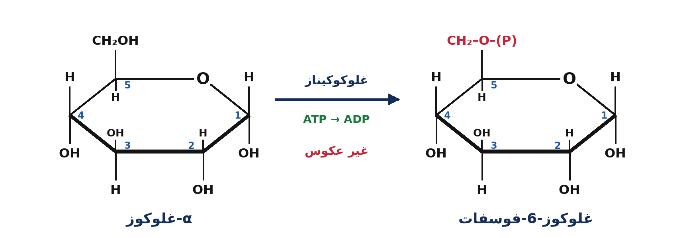

> [!explain] الخطوة 1: α-غلوكوز ← غلوكوز-6-فوسفات
> كيف نكتبها: ارسم حلقة الغلوكوز، ثم انسخها كما هي وغيّر **شيئاً واحداً**: **CH~2~OH** فوق الكربون 5 يصير **CH~2~–O–(P)**. فوق السهم: **غلوكوكيناز**، وبجانب الغلوكوز **+ ATP**. واكتب أنه **غير عكوس**.
> لماذا: حتى **يُحبس الغلوكوز داخل الخلية** (الفوسفات مشحونة فلا يخرج) ويصبح **جاهزاً للتفاعل**.
> من أين: الفوسفات جاءت من **ATP**، فصار ADP. (اسم الأنزيم: **غلوكو** = غلوكوز + **كيناز** = ينقل فوسفات من ATP.)
> كيف تحدث: الأنزيم يمسك الغلوكوز و ATP معاً، ويأخذ الفوسفات الأخيرة من ATP ويركّبها على OH الكربون 6.

**عدّاد الطاقة:** صرفنا **1 ATP**.

## الخطوة 2: الغلوكوز يصير فركتوز

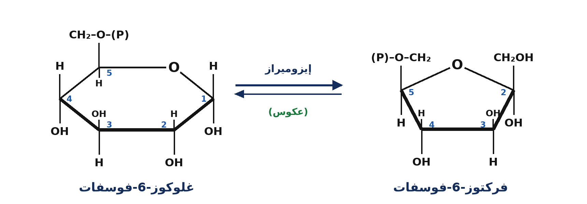

> [!explain] الخطوة 2: غلوكوز-6-فوسفات ← فركتوز-6-فوسفات
> كيف نكتبها: الحلقة **السداسية** تصير **خماسية**. الفوسفات تبقى على الكربون 6، أي تبقى **(P)–O–CH~2~** المعلّقة على اليسار. فوق السهم: **غلوكوز-6-فوسفات إيزوميراز**.
> لماذا: نريد أن يصبح السكر **متشابهاً من طرفيه** حتى ينقسم بعد قليل **من النص** إلى نصفين متساويين. وفي الفركتوز يصبح **الكربون 1 حراً** ليأخذ فوسفات ثانية.
> من أين: **لم يدخل ولم يخرج أي شيء**: نفس الذرات، ترتيب مختلف (مماكب). لذلك الأنزيم **إيزوميراز**.
> كيف تحدث: الأنزيم يفتح الحلقة، ينقل الـ C=O من الكربون 1 (ألدهيد) إلى الكربون 2 (كيتون)، ثم تنغلق حلقة خماسية.

## الخطوة 3: فوسفات ثانية على الطرف الآخر

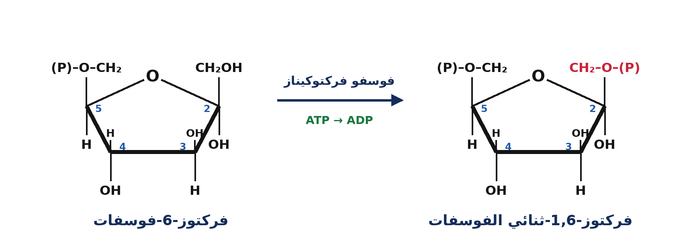

> [!explain] الخطوة 3: فركتوز-6-فوسفات ← فركتوز-1,6-ثنائي الفوسفات
> كيف نكتبها: انسخ حلقة الفركتوز، وغيّر **CH~2~OH** على اليمين (الكربون 1) إلى **CH~2~–O–(P)**. الآن في **فوسفات على الطرفين**. فوق السهم: **فركتوكيناز** (فوسفو فركتوكيناز)، و **+ ATP**.
> لماذا: صار الجزيء "متوازناً": **فوسفات على كل طرف**، فإذا قصصناه من النص يأخذ كل نصف فوسفات.
> من أين: الفوسفات الثانية من **ATP ثانٍ**.
> كيف تحدث: مثل الخطوة 1 تماماً: كيناز ينقل فوسفات من ATP إلى OH الكربون 1.

**عدّاد الطاقة:** صرفنا **2 ATP** (الخطوة 1 + الخطوة 3).

## الخطوة 4: قصّ السكر نصفين

> [!explain] الخطوة 4: الانشطار بالألدولاز
> كيف نكتبها: افتح الفركتوز واكتبه **سلسلة عمودية** من 6 صفوف كما في دفترك: CH~2~–O–(P)، ثم C=O، ثم HO–C–H، ثم H–C–OH، ثم H–C–OH، ثم CH~2~–O–(P). ارسم **خطاً يقطع بين الصف 3 والصف 4**. فوق السهم: **ألدولاز**. والناتج قطعتان:
> كيف نكتبها: **القطعة الفوقانية** = **ثنائي هيدروكسي أسيتون فوسفات**: CH~2~–O–(P)، ثم C=O، ثم CH~2~OH. **القطعة التحتانية** = **غليسر ألدهيد-3-فوسفات**: CHO، ثم H–C–OH، ثم CH~2~–O–(P).
> لماذا: الخلية تكسر السكر الكبير (6 كربون) إلى قطع أصغر (3 كربون) لتستخرج منها الطاقة.
> من أين: الكربونات 1 و 2 و 3 تعطي القطعة الفوقانية، والكربونات 4 و 5 و 6 تعطي التحتانية. وكل قطعة أخذت **فوسفات واحدة** من الطرفين.

## الخطوة 5: تحويل القطعة الفوقانية لتشبه التحتانية

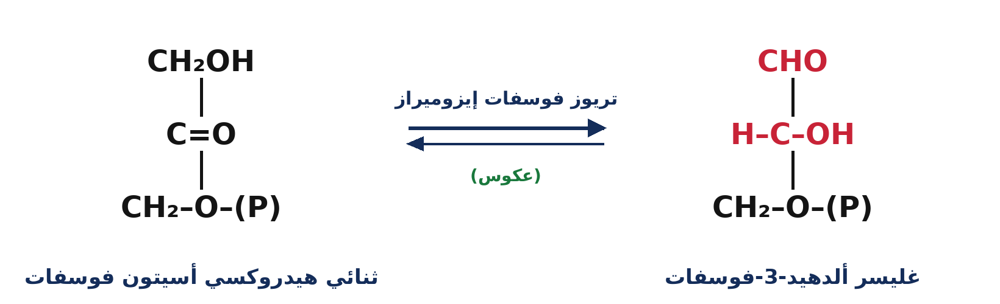

> [!explain] الخطوة 5: ثنائي هيدروكسي أسيتون فوسفات ← غليسر ألدهيد-3-فوسفات
> كيف نكتبها: كما في أول صفحتك الثانية: CH~2~–O–(P) ثم C=O ثم CH~2~OH، يصير: CHO ثم H–C–OH ثم CH~2~–O–(P). **الكيتون (C=O بالوسط) صار ألدهيد (CHO فوق)**. الأنزيم: **إيزوميراز**.
> لماذا: **وحده غليسر ألدهيد-3-فوسفات يكمل** في المرحلة الثانية. فنحوّل القطعة الأخرى إليه حتى **لا نضيّع نصف الغلوكوز**.
> من أين: لم يدخل ولم يخرج شيء: ترتيب مختلف فقط (مماكب)، مثل الخطوة 2.

> [!summary] **خلاصة المرحلة الأولى (مكتوبة في دفترك):**
> غلوكوز + 2ATP ← **2** غليسر ألدهيد-3-فوسفات
> صرفنا 2 ATP، وصار عندنا **جزيئتان** متشابهتان من 3 كربونات.

# المرحلة الثانية (II): من غليسر ألدهيد-3-فوسفات إلى البيروفات

**انتبه:** من هنا **كل خطوة تحدث مرتين** (لأن عندنا جزيئتين). نكتبها مرة واحدة، ونضرب الطاقة × 2.

## الخطوة 6: نزع الهيدروجين وإضافة فوسفات

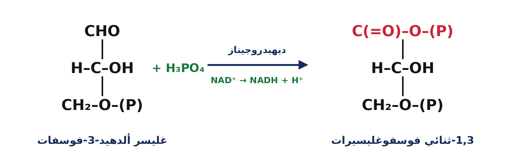

> [!explain] الخطوة 6: غليسر ألدهيد-3-فوسفات ← 1,3-ثنائي فوسفوغليسيرات
> كيف نكتبها: **الصف الأول فقط يتغير**: **CHO** يصير **C(=O)–O–(P)**، والصفان الآخران كما هما. نكتب بجانب المادة الأولى: **NAD⁺** و **H~3~PO~4~**، ونكتب بعد الناتج: **NADH** و **H⁺** (التي سطّرها الدكتور في دفترك، لأننا سنحتاجها في الخطوة 11). الأنزيم: **غليسر ألدهيد ديهيدروجيناز**.
> لماذا: هذه **أكسدة**: نأخذ هيدروجين الألدهيد. والطاقة التي تخرج من الأكسدة **لا تضيع**، بل تُخزّن في **رابطة الفوسفات الجديدة** على الكربون 1، وسنصنع منها ATP في الخطوة 7.
> من أين: الهيدروجين ذهب إلى **NAD⁺** فصار NADH + H⁺. والفوسفات الجديدة جاءت من **H~3~PO~4~** الحر، **وليس من ATP** (لذلك لم نصرف شيئاً هنا).
> كيف تحدث: الأنزيم (ديهيدروجيناز = نازع الهيدروجين) ينزع H من CHO ويعطيه لـ NAD⁺، ثم يركّب الفوسفات مكانه.

## الخطوة 7: أول ربح، ATP

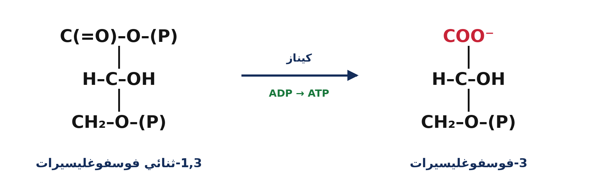

> [!explain] الخطوة 7: 1,3-ثنائي فوسفوغليسيرات ← 3-فوسفوغليسيرات
> كيف نكتبها: الفوسفات على **الكربون 1** تخرج، فيبقى **COO⁻** (حمض). الباقي كما هو: H–C–OH و CH~2~–O–(P). بجانب المادة **+ ADP**، وبجانب الناتج **+ ATP**. في دفترك سهم صغير يوضّح أن الـ (P) **ذهبت إلى ADP**.
> لماذا: هنا نستعيد الطاقة التي خزّناها في الخطوة 6.
> من أين: الفوسفات مع ADP تصنع **ATP**. والأنزيم **كيناز** (فوسفوغليسيرات كيناز)، لأنه ينقل فوسفات **إلى** ADP.
> كيف تحدث: لأن الخطوة تحدث **مرتين**: ربحنا **2 ATP**، أي **استرجعنا** الـ 2 ATP التي صرفناها في المرحلة الأولى.

**عدّاد الطاقة:** صرفنا 2 وربحنا 2، فالمجموع **صفر**. (ما زلنا لم نربح فعلياً.)

## الخطوة 8: الفوسفات تنتقل من الكربون 3 إلى 2

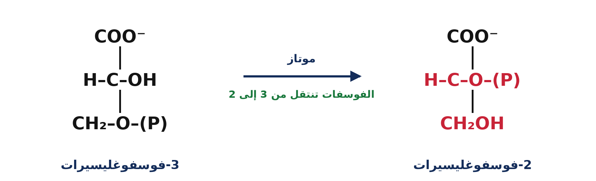

> [!explain] الخطوة 8: 3-فوسفوغليسيرات ← 2-فوسفوغليسيرات
> كيف نكتبها: COO⁻ تبقى فوق. **الصف الثاني** H–C–OH يصير **H–C–O–(P)**، و**الصف الثالث** CH~2~–O–(P) يصير **CH~2~OH**. أي: الـ (P) **صعدت درجة**: من الكربون 3 إلى الكربون 2.
> لماذا: تجهيزاً للخطوة 9، حيث نحتاج الفوسفات على الكربون 2.
> من أين: لم يدخل ولم يخرج شيء: الفوسفات **انتقلت داخل الجزيء نفسه**. الأنزيم: **موتاز** (فوسفوغليسيرات موتاز).

## الخطوة 9: خروج الماء

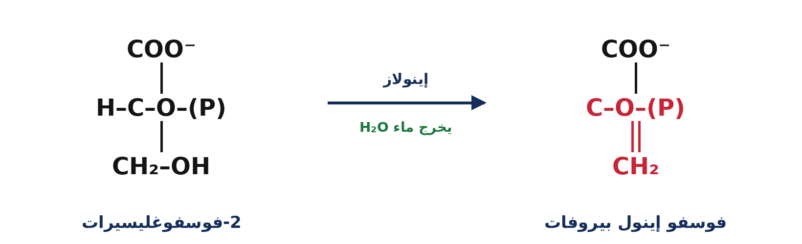

> [!explain] الخطوة 9: 2-فوسفوغليسيرات ← فوسفو إينول بيروفات
> كيف نكتبها: كما في دفترك: الدكتور **حوّط H على الكربون 2 و OH على الكربون 3**: هذان يخرجان معاً **ماءً (H~2~O)**. فيبقى الكربون 2 بلا H، والكربون 3 بلا OH، فيمسكان بعضهما **بيدين**: **C=CH~2~** (رابطة مضاعفة). الناتج: COO⁻، ثم C–O–(P)، ثم =CH~2~.
> لماذا: هذا يجعل رابطة الفوسفات على الكربون 2 **غنية جداً بالطاقة**، فنصنع منها ATP في الخطوة التالية.
> من أين: H مع OH يشكّلان ماء H~2~O. الأنزيم: **إينولاز** (من **إينول**: رابطة مضاعفة **"ين"** بجانب أكسجين **"ول"**).
> كيف تحدث (تحقّق): عدّ أيادي الكربون 3 في الناتج: يدان مع الهيدروجينين، ويدان مع الكربون 2 (رابطة مضاعفة)، المجموع **4** ✓.

## الخطوة 10: ثاني ربح، ATP

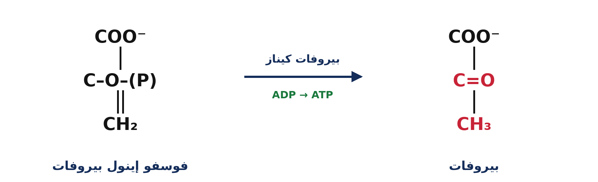

> [!explain] الخطوة 10: فوسفو إينول بيروفات ← بيروفات
> كيف نكتبها: الـ (P) على الكربون 2 **تذهب إلى ADP** فيصير ATP. الكربون 2 يصبح **C=O**، و =CH~2~ يصبح **CH~3~**. الناتج **بيروفات**: COO⁻، ثم C=O، ثم CH~3~. بجانب المادة **+ ADP**، وبجانب الناتج **+ ATP**.
> لماذا: هذا هو **الربح الحقيقي**: مرتين = **2 ATP** صافية.
> من أين: الفوسفات مع ADP تصنع ATP. الأنزيم: **بيروفات كيناز**.
> كيف تحدث: عندما تخرج الفوسفات، تنفك الرابطة المضاعفة C=C، ويصبح الأكسجين على الكربون 2 **C=O**، ويأخذ الكربون 3 هيدروجيناً ثالثاً فيصبح **CH~3~**.

**عدّاد الطاقة:** صرفنا 2 وربحنا 4، فالصافي **2 ATP**.

# المرحلة الثالثة (III): إعادة أكسدة NADH + H⁺

هذه **صفحتك الثالثة**. السؤال: في الخطوة 6 صرفنا **NAD⁺** وصار عندنا NADH. من أين نأتي بـ NAD⁺ جديد؟

## الخطوة 11: البيروفات يصير حمض اللبن

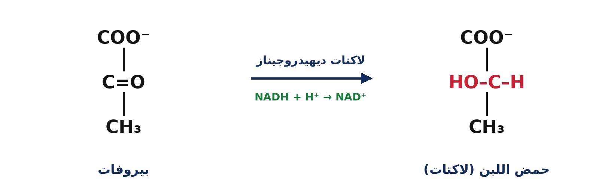

> [!explain] الخطوة 11: بيروفات ← L-حمض اللبن
> كيف نكتبها: **الصف الثاني فقط يتغير**: **C=O** يصير **HO–C–H**. COO⁻ و CH~3~ كما هما. نكتب بجانب البيروفات: **NADH** و **H⁺**، والناتج: **L-حمض اللبن** ومعه **NAD⁺**. في دفترك سهم من NADH إلى البيروفات: يعني الهيدروجين **رجع**.
> لماذا: **بدون أكسجين لا يوجد طريق آخر** لإرجاع NAD⁺. وبدون NAD⁺ **تتوقف الخطوة 6** ويتوقف كل شيء، فلا ATP. لذلك "تضحّي" الخلية بالبيروفات وتحوّله إلى حمض اللبن، فقط لتستعيد NAD⁺.
> من أين: الهيدروجين الذي أخذناه في الخطوة 6 (المحمول على NADH) أعطيناه هنا للبيروفات (هذا **إرجاع**). الأنزيم: **لاكتات ديهيدروجيناز**.
> كيف تحدث: مثال من الحياة: عند **الركض السريع** لا يكفي الأكسجين العضلات، فيتراكم **حمض اللبن** فيها.

## دولاب NAD⁺ (الرسمة الأخيرة في صفحتك)

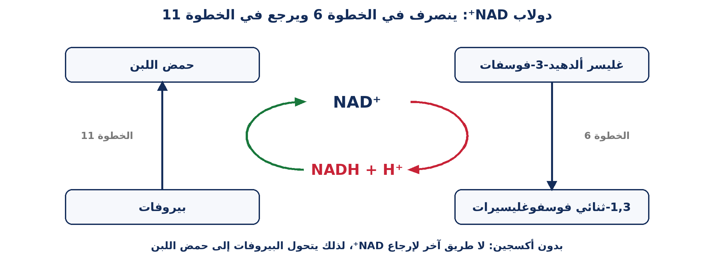

رسم الدكتور في آخر صفحتك سهمين متصالبين: هذه هي الفكرة:
- **يساراً في دفترك:** غليسر ألدهيد-3-فوسفات ← 1,3-ثنائي فوسفوغليسيرات: **يأخذ NAD⁺ ويعطي NADH + H⁺**.
- **يميناً في دفترك:** بيروفات ← حمض اللبن: **يأخذ NADH + H⁺ ويرجّع NAD⁺**.

> [!remember] NAD⁺ لا يُستهلك نهائياً: **يدور**. ولهذا لا نحسب NADH طاقةً في اللاهوائي: لقد صُرف على صنع حمض اللبن.

# حساب الطاقة

> [!problem] كم ATP نربح من جزيء غلوكوز واحد في التحلل اللاهوائي؟
> المعطيات: المرحلة I تصرف ATP في الخطوة 1 والخطوة 3. المرحلة II تعطي ATP في الخطوة 7 والخطوة 10، وكل خطوة فيها تحدث مرتين.
> القانون: الصافي = المربوح − المصروف
> الحل: 1. المصروف: واحد في الخطوة 1 وواحد في الخطوة 3، أي 2 ATP. 2. المربوح: الخطوة 7 مرتين والخطوة 10 مرتين، أي 4 ATP. 3. الصافي: 4 ناقص 2، أي 2 ATP.
> النتيجة: **2 ATP**، والناتج النهائي **جزيئتا حمض اللبن**.

> [!exam] اختبار: ما هي كمية الطاقة الناتجة عن تحول الغلوكوز لاهوائياً؟
> الجواب: **2 حمض لبن + 2 ATP**. (هذا سؤال الدكتور في الدفتر الآخر للمحاضرة نفسها.)

# كيف تذاكرها وتكتبها في الامتحان

**خطة المذاكرة (بالترتيب):**
1. احفظ **المجموعات الأربع**: CHO، C=O، COO⁻، (P).
2. احفظ **ترتيب الأسماء** فقط (11 اسماً) من الجدول تحت.
3. لكل خطوة احفظ **جملة واحدة: ماذا تغيّر؟** (العمود الثالث).
4. تدرّب: اكتب الغلوكوز، ثم **انسخ** كل مركب من الذي قبله **وغيّر فقط ما تغيّر**. هكذا لا تحتاج حفظ 11 رسمة.

| الخطوة | التحوّل | ماذا تغيّر؟ | الطاقة |
| 1 | غلوكوز ← غلوكوز-6-فوسفات | (P) على الكربون 6 | −1 ATP |
| 2 | ← فركتوز-6-فوسفات | سداسي ← خماسي | – |
| 3 | ← فركتوز-1,6-ثنائي الفوسفات | (P) على الكربون 1 | −1 ATP |
| 4 | ← قطعتان من 3 كربونات | قصّ من النص | – |
| 5 | ثنائي هيدروكسي أسيتون فوسفات ← غليسر ألدهيد-3-فوسفات | كيتون ← ألدهيد | – |
| 6 | ← 1,3-ثنائي فوسفوغليسيرات | CHO يصير C(=O)–O–(P) | NAD⁺ يصير NADH |
| 7 | ← 3-فوسفوغليسيرات | (P) تذهب لـ ADP | +1 ATP (× 2) |
| 8 | ← 2-فوسفوغليسيرات | (P) من 3 إلى 2 | – |
| 9 | ← فوسفو إينول بيروفات | يخرج ماء | – |
| 10 | ← بيروفات | (P) تذهب لـ ADP | +1 ATP (× 2) |
| 11 | ← حمض اللبن | C=O يصير HO–C–H | NADH يصير NAD⁺ |

> [!tip] **جملة للحفظ:** المرحلة I: **صرف، ترتيب، صرف، قصّ، ترتيب**. المرحلة II: **أكسدة، ربح، نقل، ماء، ربح**. المرحلة III: **إرجاع**.

> [!tip] **اختبر نفسك** (الأجوبة في السطر التالي لكل سؤال):
> 1. في أي خطوتين نصرف ATP؟ ← 1 و 3.
> 2. في أي خطوتين نربح ATP؟ ← 7 و 10 (كل واحدة مرتين).
> 3. ما الأنزيم الذي يقصّ السكر؟ ← الألدولاز.
> 4. من أين تأتي الفوسفات في الخطوة 6؟ ← من H~3~PO~4~ وليس من ATP.
> 5. لماذا يتحول البيروفات إلى حمض اللبن؟ ← لإرجاع NAD⁺ بغياب الأكسجين.

# صفحات دفترك

> [!note] أخطاء كتابة صغيرة في الدفتر: **NAP** و **NAPH** المقصود **NAD⁺** و **NADH**. و **APP** في الصفحة الثالثة المقصود **ADP**. و **AIP** في الصفحة الأولى المقصود **ATP**.

